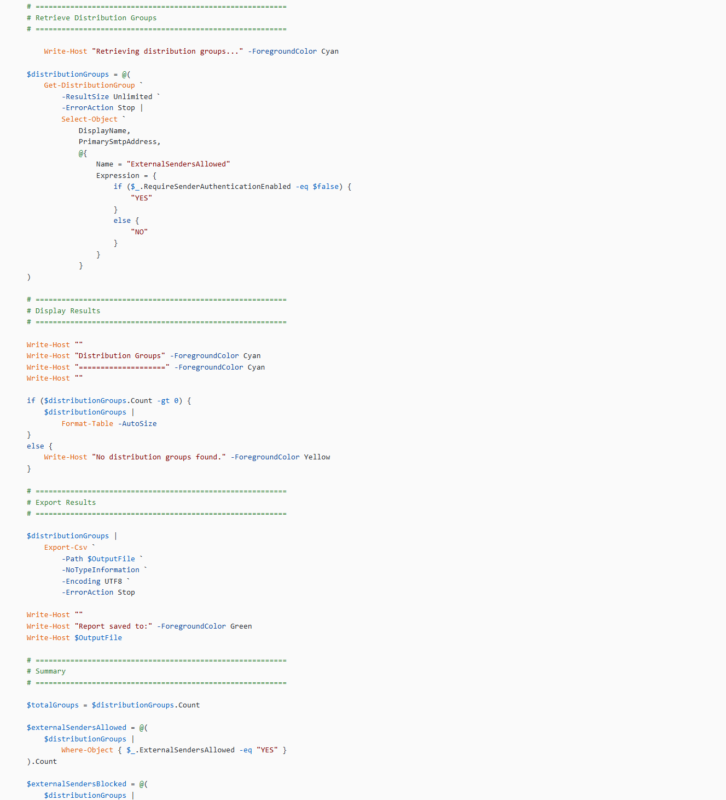

## Introduction

When reviewing Microsoft 365 security, it's easy to focus on the bigger picture and overlook individual configuration settings that can affect how an organisation receives email. Distribution groups are one example. Some need to accept messages from external senders, while others should only accept mail from authenticated users.

The challenge is knowing which groups allow external messages across the tenant. This PowerShell script provides a straightforward way to build that inventory and turn it into a report that administrators can use for security reviews and operational documentation.

## From Individual Checks to a Tenant-Wide Report

Manually checking distribution groups isn't practical in a tenant with hundreds or thousands of groups. Without a central report, identifying groups that permit unauthenticated senders can become a time-consuming administrative task.

The script automates that process by connecting to Exchange Online using certificate-based, app-only authentication and retrieving all distribution groups in the tenant.

Rather than changing configuration, it reads the current RequireSenderAuthenticationEnabled property and records whether each group permits external senders. This keeps the script focused on auditing, leaving any configuration changes to a separate, deliberate review process.

## What the Script Produces

The report includes three fields:

- DisplayName - the distribution group's display name.
- PrimarySmtpAddress - its primary email address.
- ExternalSendersAllowed - whether external or unauthenticated senders are permitted (YES or NO).

The results are displayed in the console and exported to:

> C:\Temp\Outlook\DistributionGroups-ExternalSendersAllowed.csv

The console also provides a summary of the total groups found, how many allow external senders, and how many require sender authentication.

For example, a report containing 1,250 distribution groups might identify 37 that allow external senders and 1,213 that block them. These figures are illustrative; actual results depend on the tenant's configuration.

## Authentication, Scale and Operational Considerations

The script uses certificate-based authentication through an Entra ID application configured for Exchange Online app-only access. This avoids interactive sign-in and makes the approach suitable for scheduled reporting, provided the certificate, application permissions, and Exchange Online RBAC configuration are in place.

Using -ResultSize Unlimited ensures the query isn't restricted to a default result limit, making it suitable for tenants with large distribution group inventories.

Error handling and guaranteed Exchange Online disconnection help make the script more appropriate for repeatable administrative use.

One important distinction: this is an inventory report, not a guarantee of mail delivery. A group marked YES permits unauthenticated senders, but mail flow rules, moderation, transport restrictions, and other controls can still affect whether a message reaches its destination.

The CSV is overwritten when the script runs again using the same output path, so retain previous reports separately if you need historical comparisons.

## What Comes Next?

The immediate value is visibility. Administrators can identify groups that allow external senders and review whether that configuration remains appropriate for their business purpose.

Possible future improvements include comparing reports over time, highlighting newly exposed groups, and integrating the results into a broader Microsoft 365 security reporting process. These are potential enhancements rather than existing script features.

## Resources

- The full script is available on GitHub here: **[https://pnp.github.io/script-samples/exchange-online-distribution-group-external-sender-audit/README.html?tabs=pnpps](https://pnp.github.io/script-samples/exchange-online-distribution-group-external-sender-audit/README.html?tabs=pnpps)**

## Join The Discussion

- How do you audit distribution group settings across your Exchange Online tenants? Do you rely on scheduled PowerShell reports, a central governance platform, or a combination of both?

- And when you identify groups that allow external senders, how do you determine whether that access is still required?
