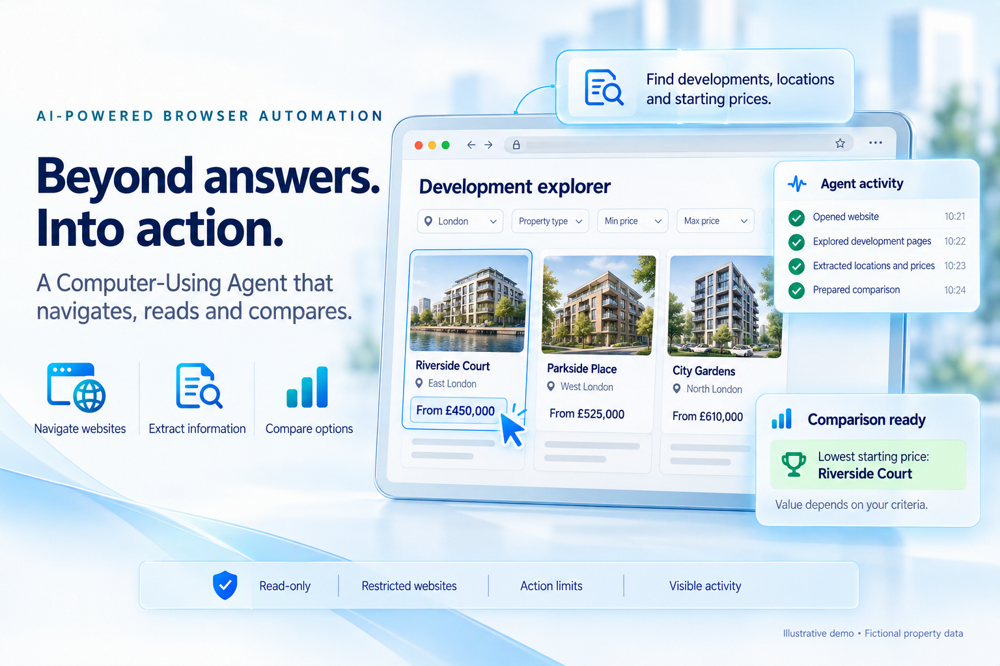
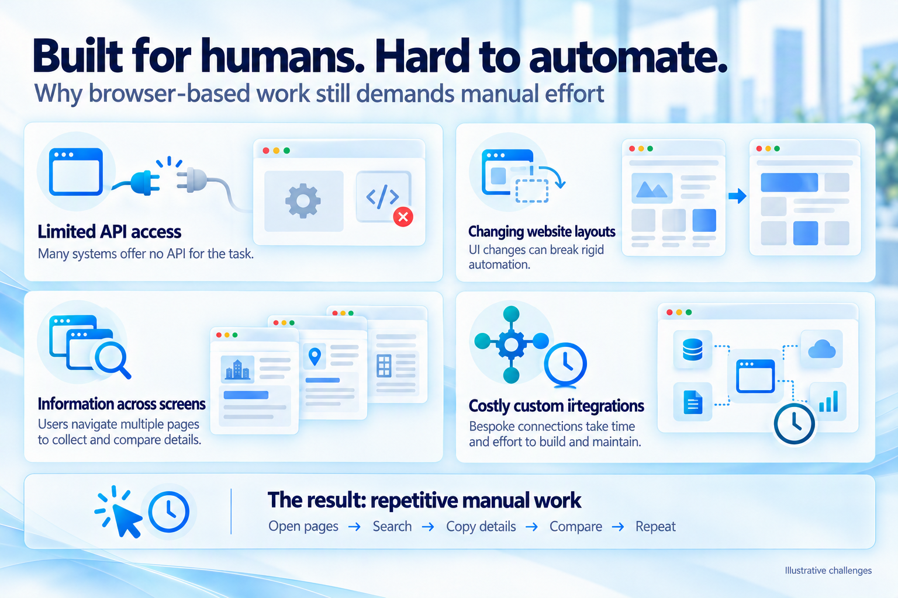
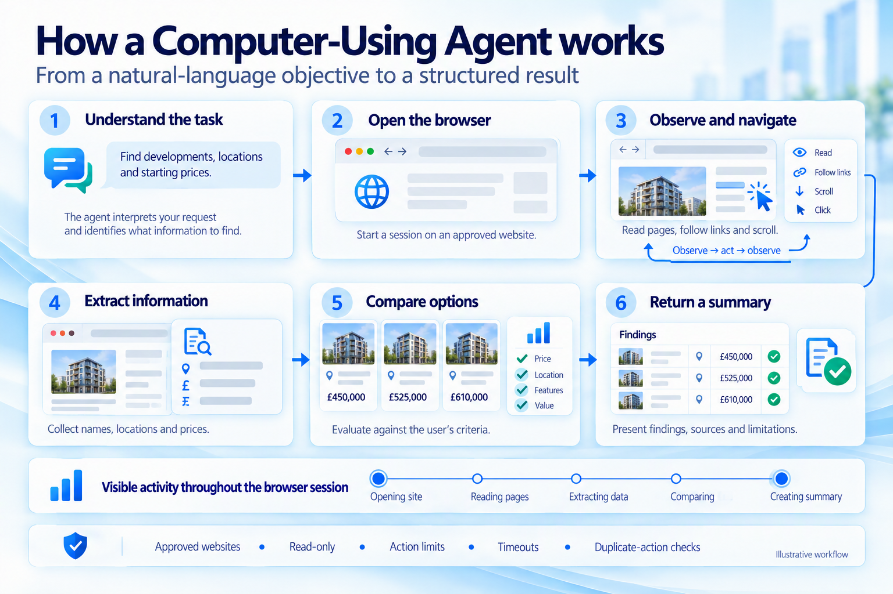
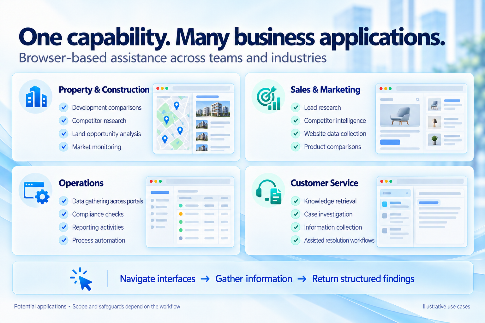

Artificial intelligence has become very good at answering questions.

But what happens when an AI needs to do more than simply respond?

What if it could actually open a browser, navigate a website, search through information, extract key details, and bring back a structured answer?

That's exactly what we explored in our latest proof of concept at Synapx.

## Introducing a Computer-Using Agent

A Computer-Using Agent (CUA) takes AI beyond conversation. Rather than providing instructions for a user to follow, the agent can interact with software and websites on the user's behalf.

In our demonstration, we created an AI-powered browser agent capable of:

- Opening a live website
- Navigating through pages
- Reading content
- Scrolling and exploring available information
- Extracting relevant business data
- Returning structured recommendations

Instead of telling a user where to find information, the agent finds it itself.

## The challenge

Most websites and business systems were designed for humans, not AI.

When information is spread across multiple pages, portals, and applications, users often spend significant time navigating interfaces, collecting data, and manually comparing options.

Traditional automation struggles because:

- Many systems don't expose APIs
- Website layouts change frequently
- Information is spread across multiple screens
- Building custom integrations is expensive

As a result, employees still spend hours every week performing browser-based tasks that require little decision-making but significant manual effort.

This raises an interesting question: **what if an AI could use software the same way a person does?**

Instead of integrating with systems, could it simply open a browser, understand what it sees, and complete the task itself?

## The demo

For our proof of concept, we used a publicly accessible property development website as the target environment.

A user provides a natural language instruction:

> Find all available developments, collect the location and starting price, and tell me which represents the best value.

The agent then:

- Opens a browser session.
- Navigates through the website.
- Reads page content.
- Extracts development information.
- Compares available options.
- Produces a structured summary for the user.

All activity is visible in real time, allowing users to watch exactly how the AI works through the task. This transparency is critical for building trust in autonomous systems.

## Why this matters

Most AI demonstrations focus on conversation. However, many business processes require action rather than discussion.

Employees spend significant amounts of time:

- Searching portals
- Looking up information
- Comparing options
- Gathering data from websites
- Repeating routine navigation tasks

Computer-Using Agents can help automate these repetitive workflows. Rather than replacing existing systems, they operate on top of them using familiar interfaces such as browsers and webpages.

This opens the door to automation even when APIs are unavailable or integration costs are high.

## Business applications

While property search provides an easy-to-understand example, the same approach can be applied across multiple industries.

**Property & construction**

- Development comparisons
- Competitor research
- Land opportunity analysis
- Market monitoring

**Sales & marketing**

- Lead research
- Competitor intelligence
- Website data collection
- Product comparisons

**Operations**

- Data gathering across portals
- Compliance checks
- Reporting activities
- Process automation

**Customer service**

- Knowledge retrieval
- Case investigation
- Information collection
- Assisted resolution workflows

## Built with responsible AI principles

Autonomous systems require appropriate controls. Our proof of concept includes safeguards such as:

- Restricted website access
- Read-only operation
- Action limits
- Timeout protection
- Duplicate-action detection

These measures ensure the agent remains focused, transparent, and safe while demonstrating the potential of browser-based automation.

## Looking ahead

Computer-Using Agents represent an exciting step forward in the evolution of AI.

The future is not simply about asking questions and receiving answers. It is about AI systems that can understand objectives, interact with digital environments, and complete meaningful tasks on behalf of users.

At Synapx, we're continuing to explore how these technologies can help organisations unlock new levels of productivity and efficiency.

The question is no longer:

> Can AI answer this?

It's becoming:

> Can AI do this?

And increasingly, the answer is yes.