---
# This is the title
title: "Azure Cost Insights in Copilot Cowork: Work IQ Meets a Custom MCP Connector"
# This is the publishing date of your article, usually this should match "now"
date: 2026-11-25T12:00:00+05:30
# This is your name
author: "Abhinav Yadav"
# This is your GitHub name
githubname: Yadui
# Don't change
categories: ["Community post"]
# Link to the thumbnail image for the post
images:
- images/14b-cowork-owners-table.png
# Don't change
tags: []
# Don't change
type: "regular"
draft: false
---

I wired Azure Cost Management into Copilot Cowork through a small MCP connector and let Work IQ work out who owns the spend. Here is the build, end to end, along with the seven things that broke along the way.

The question I hear most around month-end is simple: *"Azure went up, so whose is it?"* Cost Management tells me *how much*. *Whose* is usually hiding in a budget alert, a Teams chat, or one person's head. I wanted a single prompt to answer both halves.

This isn't a product overview. It's something I actually built and ran in our Foetron tenant, using a small MCP server, a Cowork plugin and Work IQ. I've kept the broken bits in, because there were seven of them before the first clean run.

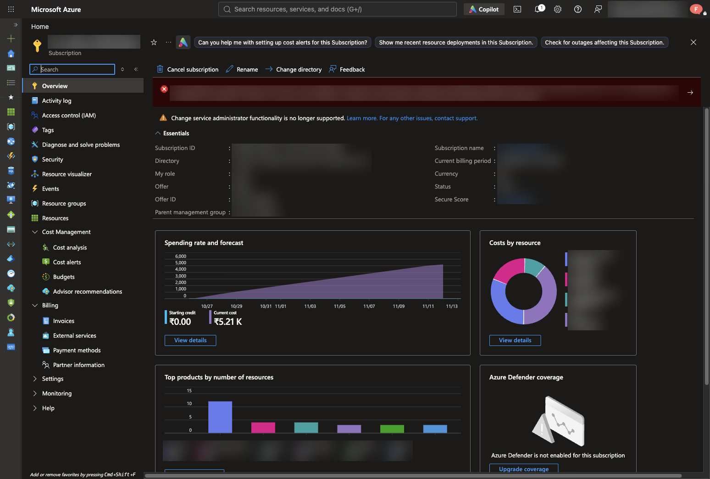
*Figure 1: The starting point. The numbers live in Cost Analysis. Who owns them doesn't.*

## 1. Why Cowork for this

Copilot Cowork is the agentic mode of Microsoft 365 Copilot. You describe an outcome, and it plans steps, calls tools, works in the background and asks before it changes anything. Two things made it the right host:

- **Work IQ is already there.** Cowork grounds itself in your mail, chats, meetings and files. I didn't have to build the "context" half.
- **Plugins accept remote MCP servers.** A Cowork plugin bundles *skills* (Markdown instructions) and *connectors* (remote MCP servers over Streamable HTTP). Cost data was the missing connector.

## 2. The goal

One prompt, *"Run my weekly Azure cost review… find who owns the top spenders… draft an email to the owners"*, should return:

1. Month-to-date spend and the projected month-end total for each subscription.
2. The top resource groups by cost.
3. The owner of each top spender, found by Work IQ in mail and Teams, plus any budget alerts.
4. A draft email to those owners that **I** decide whether to send.

Constraints: read-only, an allow-list of subscriptions, and no secrets inside the plugin.

## 3. How it fits together

> Cowork prompt → **Skill** (`azure-cost-review/SKILL.md`) → **Azure Cost MCP connector** (Container Apps, Streamable HTTP, Entra token) → **Cost Management Query & Forecast APIs**
> and in parallel → **Work IQ** (mail, Teams, People) → summary table + Outlook draft (approval before send)

Two identities do two different jobs:

- **Inbound (user to server):** Cowork gets an Entra token for my API app, `azure-cost-mcp`, with a `Costs.Read` scope, through the plugin vault. The server validates that token.
- **Outbound (server to Azure):** the Container App's system-assigned managed identity calls Cost Management. It has **Cost Management Reader** on two subscriptions and nothing else.

## 4. Building it step by step

### 4.1 The MCP server (Python, about 200 lines)

Four tools, all read-only: `get_costs`, `get_forecast`, `top_spenders` and `list_scopes`. They share one helper for Cost Management calls:

```python
API_VERSION = os.getenv("COST_API_VERSION", "2026-06-01")

async def _post(scope: str, op: str, body: dict) -> dict:
    token = (await credential.get_token(f"{ARM}/.default")).token
    url = f"{ARM}{scope}/providers/Microsoft.CostManagement/{op}?api-version={API_VERSION}"
    async with httpx.AsyncClient(timeout=60) as client:
        r = await client.post(url, json=body, headers={"Authorization": f"Bearer {token}"})
        if r.status_code == 429:
            retry = r.headers.get("x-ms-ratelimit-microsoft.costmanagement-qpu-retry-after", "60")
            raise RuntimeError(f"Cost Management throttled this call. Retry after {retry}s.")
        ...
```

Two details mattered more than I expected:

```python
# Cowork treats tools without annotations as destructive and asks for confirmation.
READ_ONLY = ToolAnnotations(readOnlyHint=True, destructiveHint=False, openWorldHint=False)

@mcp.tool(annotations=READ_ONLY)
async def get_forecast(scope: str | None = None) -> dict:
    """Month-to-date actual cost plus forecast to the end of the current month."""
    ...
    actual   = sum(r["cost"] for r in rows if r.get("CostStatus") == "Actual")
    forecast = sum(r["cost"] for r in rows if r.get("CostStatus") == "Forecast")
    return {"monthToDate": round(actual, 2), "forecastRemaining": round(forecast, 2),
            "projectedMonthTotal": round(actual + forecast, 2), "currency": currency,
            "note": None if forecast else "No forecast rows returned ... projected total equals actual."}
```

The tool does the arithmetic itself, so the model never adds up raw rows. The `note` field turned out to be useful, as you'll see in the results. `_scope()` rejects any subscription that isn't in `ALLOWED_SCOPES`.

### 4.2 Inbound auth

Cowork connectors don't support API keys yet, so the server validates an Entra v2 token in a Starlette middleware:

```python
key = jwks.get_signing_key_from_jwt(token).key
jwt.decode(token, key, algorithms=["RS256"],
           audience=AUDIENCE,  # v2 tokens carry the API app's client ID, not api://...
           issuer=f"https://login.microsoftonline.com/{TENANT_ID}/v2.0")
```

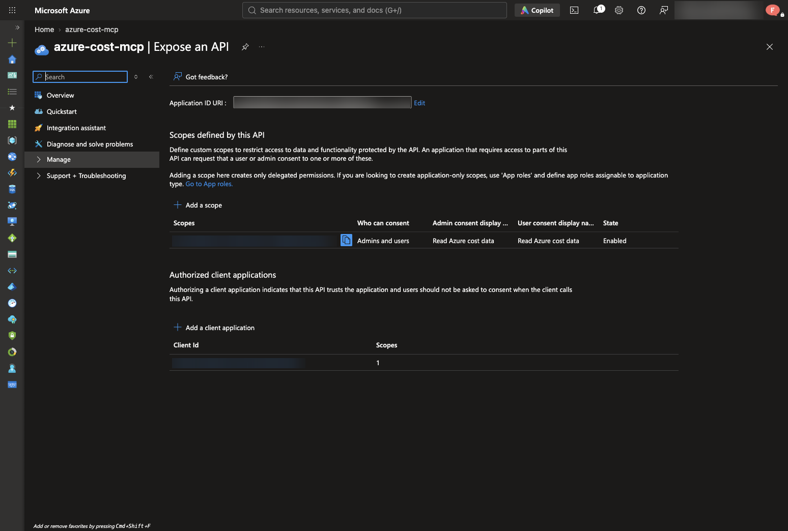
*Figure 2: The API app exposes one delegated scope, Costs.Read.*

### 4.3 Deploy

```bash
az containerapp up -n azure-cost-mcp -g rg-cowork-demo -l centralindia --source . \
  --ingress external --target-port 8000 --env-vars TENANT_ID=... API_AUDIENCE=... \
  ALLOWED_SCOPES=/subscriptions/<a>,/subscriptions/<b> ALLOWED_HOSTS=<app>.azurecontainerapps.io
az containerapp identity assign -n azure-cost-mcp -g rg-cowork-demo --system-assigned
az role assignment create --assignee-object-id <principalId> --assignee-principal-type ServicePrincipal \
  --role "Cost Management Reader" --scope /subscriptions/<a>
```

### 4.4 OAuth registration for the plugin vault

In the Teams Developer Portal (**Tools → OAuth client registration**), I registered the Entra endpoints, client ID and secret, and the scope `api://<app-id>/Costs.Read offline_access`. I also added `https://teams.microsoft.com/api/platform/v1.0/oAuthRedirect` as a redirect URI on the Entra app. The registration ID it generates becomes `referenceId` in the manifest.

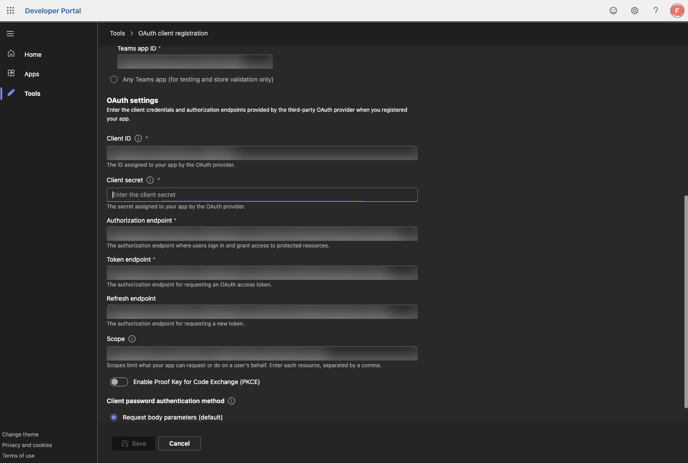
*Figure 3: OAuth client registration in the Teams Developer Portal. Read Flaw 6 before you copy these settings.*

### 4.5 The plugin package

```text
azure-cost-plugin.zip
├── manifest.json
├── color.png / outline.png
├── skills/azure-cost-review/SKILL.md
└── tools/azure-cost-tools.json      # output of tools/list
```

```json
"agentSkills": [{ "folder": "./skills/azure-cost-review" }],
"agentConnectors": [{
  "id": "azureCost",
  "displayName": "Azure Cost",
  "toolSource": {
    "remoteMcpServer": {
      "mcpServerUrl": "https://<app>.azurecontainerapps.io/mcp",
      "mcpToolDescription": { "file": "tools/azure-cost-tools.json" },
      "authorization": { "type": "OAuthPluginVault", "referenceId": "<registration-id>" }
    }
  }
}]
```

The skill is plain Markdown. This is the part that tells Cowork when to switch from cost data to Work IQ:

```markdown
4. Use Work IQ to find context: search the user's mail and Teams chats from the last 14 days
   for the top resource group names and any "budget" or "cost alert" emails.
   Quote who owns each top spender if you find it.
...
- Never guess numbers. Every figure must come from a tool result.
- Cost data refreshes about every 4 hours and the API is throttled. Don't call the same tool
  twice for the same inputs in one run.
```

Upload is **Plugins → Cowork → Add → Upload**, shared with **Only you**:

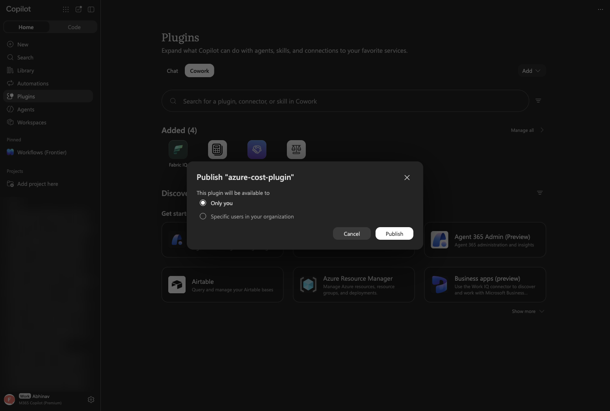
*Figure 4: A personal upload needs no admin approval.*

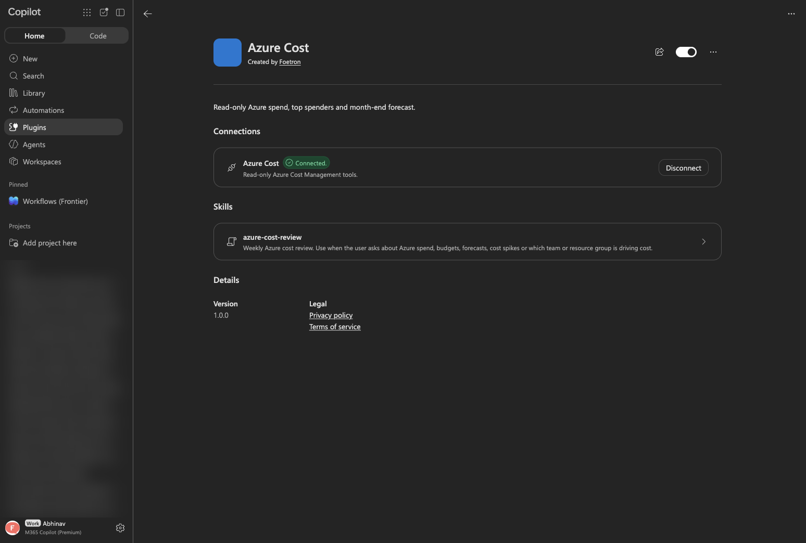
*Figure 5: Connector connected and skill detected.*

### 4.6 Running it

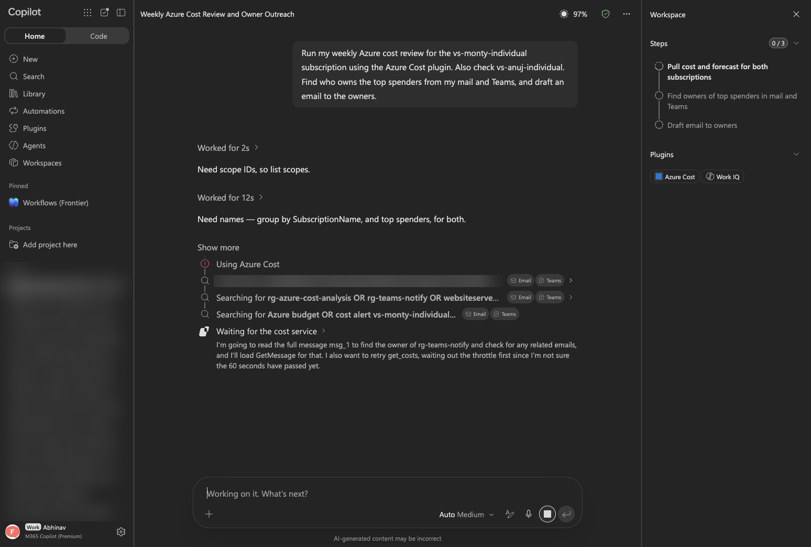
*Figure 6: Cowork plans three steps. It calls `list_scopes`, hits the Cost Management throttle, and runs Work IQ searches of my mail and Teams while it waits.*

After about a minute and a half:

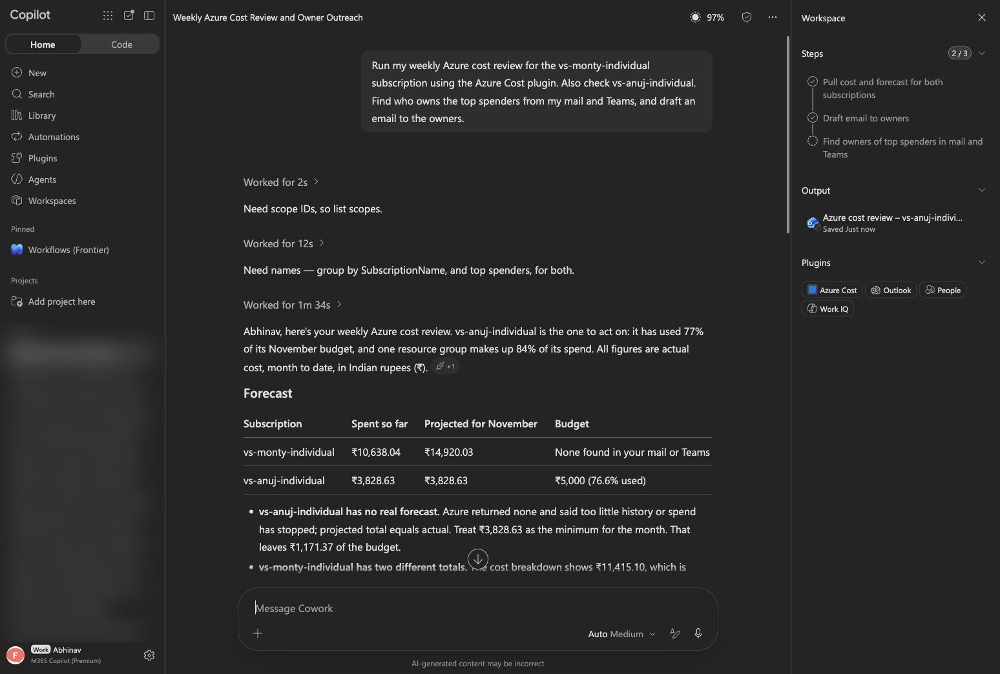
*Figure 7: Month-to-date and projected spend in ₹ for both subscriptions.*

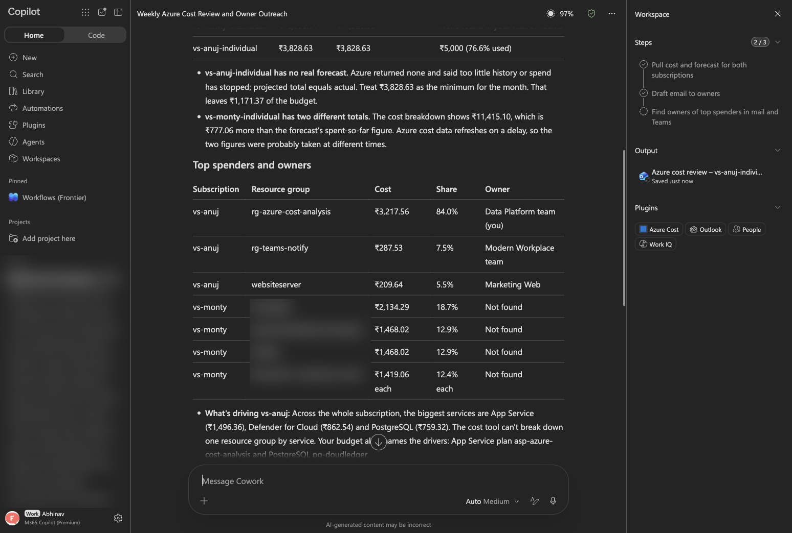
*Figure 8: Top spenders joined to owners. The costs come from the MCP tools, and the owners come from Work IQ (a budget-alert email and a Teams note).*

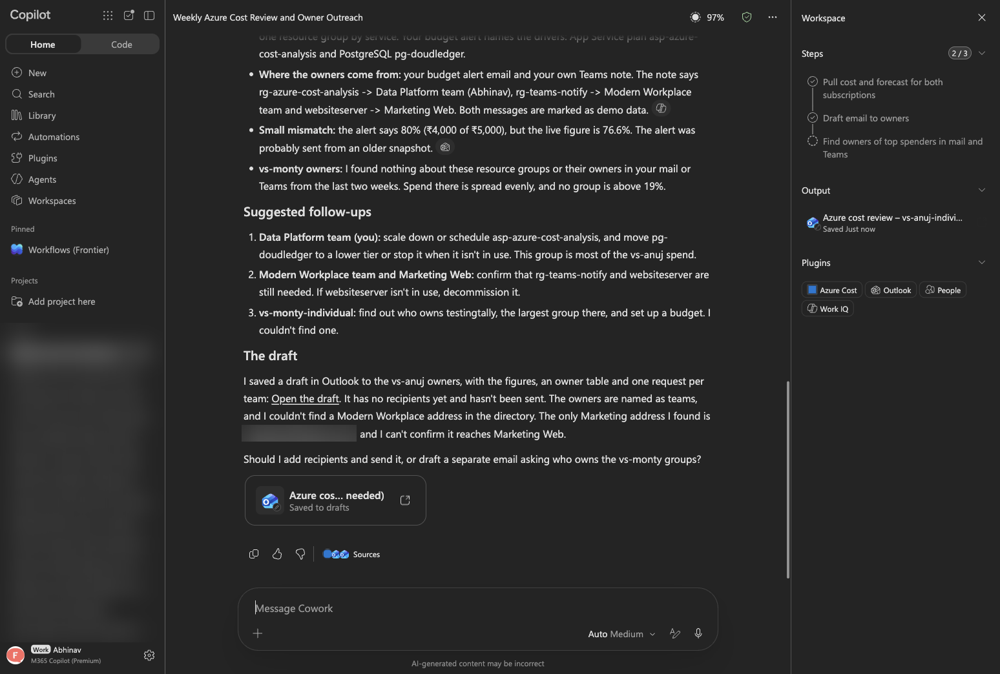
*Figure 9: Suggested follow-ups and an Outlook draft. Nothing was sent; Cowork asked first.*

What stood out in that output:

- **It used my `note` field.** For the cancelled subscription, it said there was "no real forecast" and treated the actual spend as the minimum for the month. It didn't invent a projection.
- **It caught a mismatch.** The budget email said 80%, but the live figure was 76.6%, and it worked out that the alert was older.
- **It noticed a gap in my tool.** It said it couldn't break down one resource group by service, because `get_costs` has no filter parameter. That's going into v2.
- **It was honest about missing owners.** For the second subscription it reported "Not found" instead of guessing.

## 5. Seven things that broke (and how I fixed them)

### Flaw 1: The MCP Python SDK moved under me
My first container crashed on `from mcp.server.fastmcp import FastMCP`. `mcp` 2.x renamed it to `MCPServer`. I pinned `mcp>=1.9,<2` for now. If you copy older samples, check the major version first.

### Flaw 2: "Invalid Host header" in the cloud
The server worked locally and failed behind Container Apps. The SDK's DNS-rebinding protection only allows `localhost` by default. The fix was `TransportSecuritySettings(allowed_hosts=[...])`, with the public FQDN passed in an env var. Along the way I also found that `az containerapp up --env-vars` **replaces** every environment variable instead of adding to them, and the next revision crashed with `KeyError: 'TENANT_ID'`.

### Flaw 3: Cost Management throttles faster than you think
I got a `429` after **three** manual calls, and Cowork hit the same throttle in the real run (Figure 6). Query cost is metered in QPUs per tenant. My tool reports `Retry-After` instead of failing silently, and the skill tells Cowork not to repeat calls. Next I'll add caching.

### Flaw 4: The API ignores your aggregation alias
I asked for `"totalCost": {"name": "Cost", "function": "Sum"}` and got a column called `Cost`. My first version read `totalCost` and got nothing. The fix was to normalise the column names.

### Flaw 5: The tool-description file was "not found" when it was right there
The first upload failed with `InvalidAgentConnector: ... MCP tool description file ./tools/azure-cost-tools.json not found in the app package`. The file was in the zip. It went through after I changed the path to `tools/azure-cost-tools.json` (no leading `./`) and rebuilt the zip without directory entries.

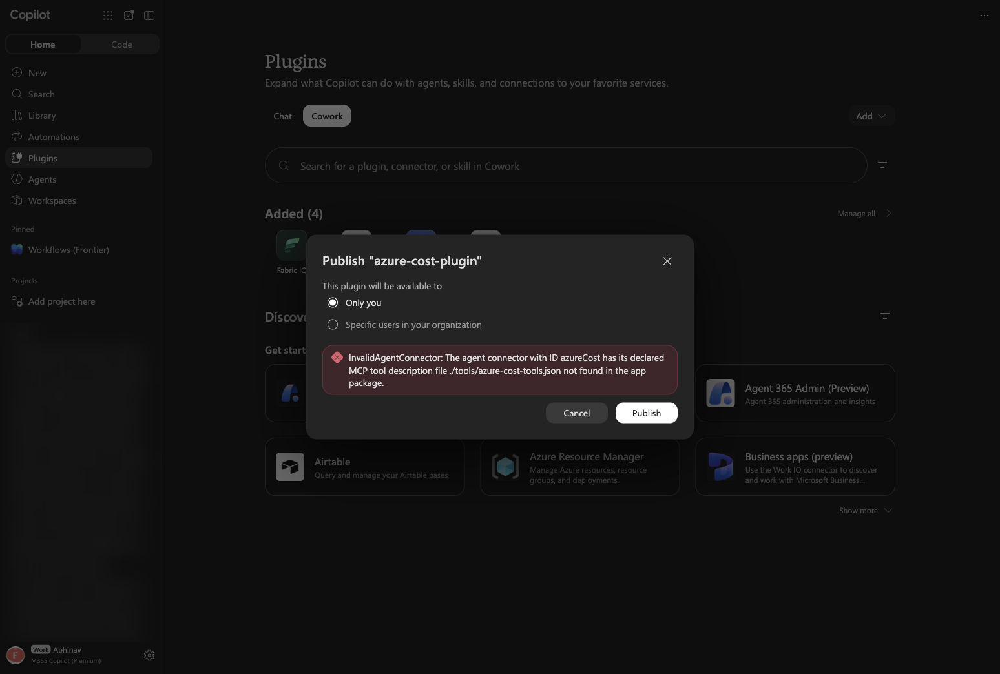
*Figure 10: The upload error, even though the file was in the package.*

### Flaw 6: "Authentication is still processing" forever
After the upload, the connector showed **"Could not verify connection"**. Clicking Connect did nothing except leave "Authentication is still processing". No popup opened and no sign-in reached Entra. The cause was the OAuth registration's **"Restrict usage by app → Existing Teams app ID"** setting, which I'd pointed at my manifest ID. Switching it to **"Any Teams app"** made the real Microsoft sign-in appear straight away. Keep the restriction at the organization level and test before you tighten it.

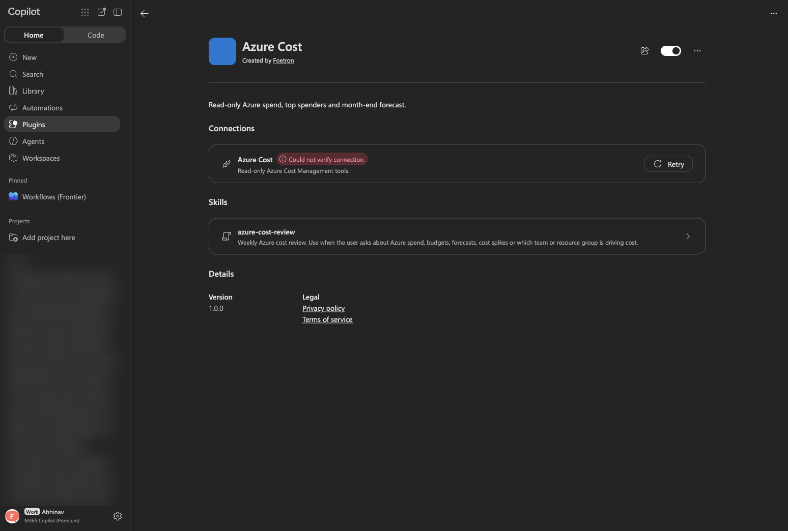
*Figure 11: What the app-ID restriction looks like from the user's side.*

### Flaw 7: Your test subscription can disappear
Halfway through, I found that one of the two demo subscriptions had been **cancelled**. Its cost history could still be queried, but nothing could be deployed into it. Cowork handled it well, because the forecast tool explained why there was no forecast. Even so, check your subscription's state before you plan a demo around it.

## Wrapping up

It works. One read-only MCP server, one skill file and Work IQ replaced my month-end spreadsheet chase with a single Cowork prompt. That prompt pulls live Azure spend, matches it to owners found in mail and Teams, and stops at a draft email that I choose whether to send.

The friction was all at the edges: SDK churn, hosting defaults, a throttled cost API, and plugin packaging and OAuth settings that the docs don't yet explain well. None of these is a blocker, but each cost me time. Plan for them, and the build itself is small. My next iteration adds a resource-group filter, response caching, and on-behalf-of auth, so each user sees only the subscriptions *they* can see.

Sample code (MCP server, Dockerfile, plugin package): [https://github.com/Yadui/cowork-azure-cost-mcp](https://github.com/Yadui/cowork-azure-cost-mcp)

**References**
- [Build plugins for Copilot Cowork](https://learn.microsoft.com/en-us/microsoft-365/copilot/cowork/cowork-plugin-development)
- [Manage Cowork plugins](https://learn.microsoft.com/en-us/microsoft-365/copilot/cowork/cowork-manage-plugins)
- [Work IQ MCP overview](https://learn.microsoft.com/en-us/microsoft-365-copilot/extensibility/work-iq/mcp/overview)
- [Cost Management Query API](https://learn.microsoft.com/en-us/rest/api/cost-management/query/usage) and [Forecast API](https://learn.microsoft.com/en-us/rest/api/cost-management/forecast/usage)
- [Cost Management automation and throttling](https://learn.microsoft.com/en-us/azure/cost-management-billing/costs/manage-automation)
