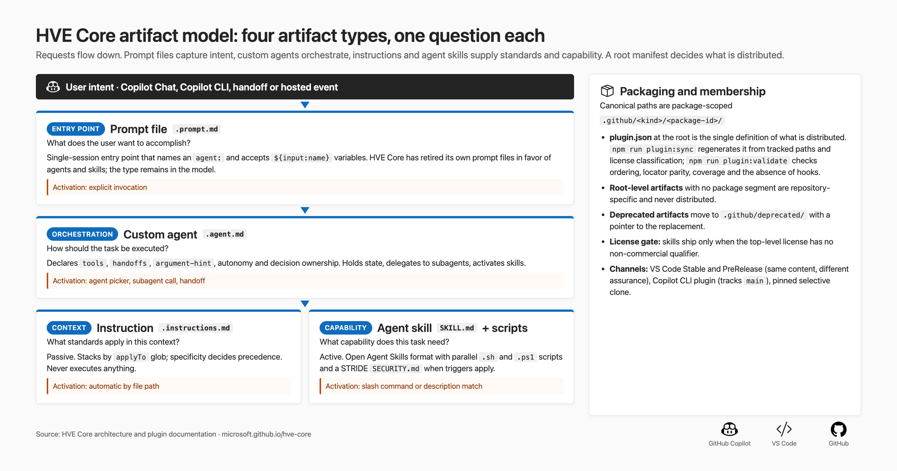
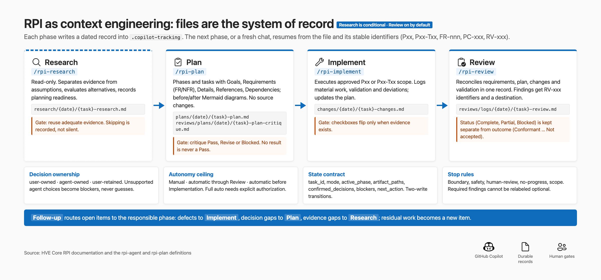
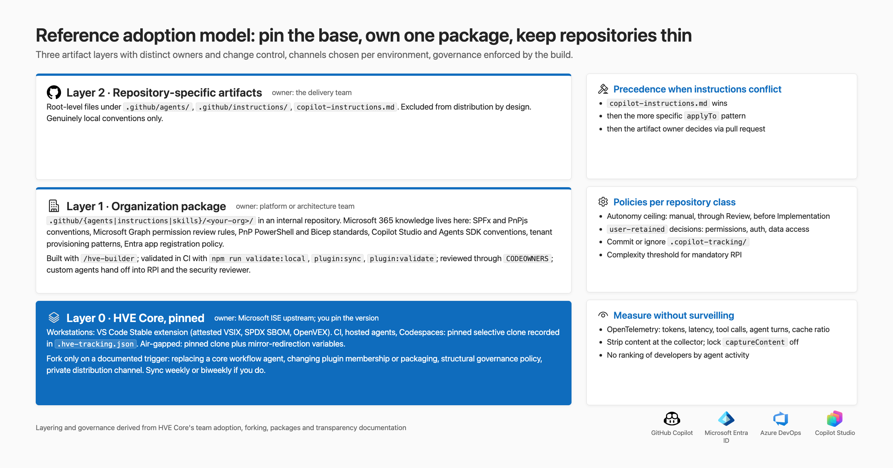

Most conversations I have about GitHub Copilot in large organizations are still about code generation. Generation is no longer the problem. The hard problems are architectural: managing context across a long task, deciding who owns which decision, defining what counts as evidence that work is done, and governing all of that across many repositories and more than one delivery partner.

**Hypervelocity Engineering (HVE)** is how Microsoft's Industry Solutions Engineering (ISE) team approaches those problems: a practice for delivering software with AI agents under explicit governance. **HVE Core** is its open-source reference implementation, published at [microsoft/hve-core](https://github.com/microsoft/hve-core) under the MIT license. It is a governed, agentic development lifecycle for GitHub Copilot, built from Markdown artifacts, scripts and a build system. Its stated principle: **AI carries the rules, humans keep the judgment.**

I read the repository rather than the marketing pages: the agent definitions, the validators and the release pipeline. This article covers what I found and how I would use it in a Microsoft 365 or agent platform estate.

## My verdict, in five lines

- HVE Core is a governed lifecycle for GitHub Copilot, not a catalog of prompts. Its adoption cost is organizational, and so is the return.
- Five of its design decisions stand on their own, framework or not.
- Its security posture is the most thorough I have seen in an open-source Copilot project.
- Bring it in pinned and layered, and use the full workflow only above a complexity threshold you define.
- There is no quantitative evidence yet that the workflow improves outcomes. Measure your own baseline before you mandate it.

## Where it sits

| Option | What you get | Lifecycle | Governance |
| --- | --- | --- | --- |
| A repository instructions file (copilot-instructions.md or AGENTS.md) | Guidance, one file per repository | None | Your PR process |
| [awesome-copilot](https://github.com/github/awesome-copilot) | A community catalog of agents, instructions, skills and plugins | None | Inspect before installing |
| [Spec Kit](https://github.com/github/spec-kit) | A spec-driven process for one feature | Strong, feature-centric | Templates and consistency checks |
| **HVE Core** | A package-scoped set of agents, instructions and skills with a manifest | Full lifecycle, built around RPI (Research, Plan, Implement, Review) | Plan critique, acceptance review, validated artifacts, per-skill threat models, attested releases |

HVE Core is Copilot-specific by design. If some of your teams use other coding agents, AGENTS.md stays the portable layer and HVE Core sits on top. The README is candid: highly opinionated, rapidly evolving, a source of patterns rather than a stable platform, and forkable if you need your own implementation.

## Five design decisions worth adopting on their own

### 1. Give every artifact type one job

HVE Core recognizes four artifact types and gives each a single question to answer. Prompt files answer what the user wants. Custom agents answer how the task should run. Instructions answer what standards apply in this context. Skills answer what capability the task needs. Instructions never execute anything; skills do. Agents orchestrate and hold state; prompts do not.



It sounds obvious until you find a 400-line instructions file that is a coding standard, a workflow and a tool wrapper at once. Pulling those apart is the cheapest improvement most teams can make.

### 2. Let one manifest decide what ships

Artifacts live under a package identifier, and a root manifest is the single definition of what gets distributed. Anything outside a package stays in the repository. The manifest is generated from the tree and validated in CI, so your standard Copilot configuration has a build-time definition instead of a wiki page.

One consequence: GitHub's Copilot cloud agent sees only committed content, so a shared standard reaches it through a pinned clone in the repository, organization-level custom agents published from your `.github` repository, or a fetch in `copilot-setup-steps.yml`.

### 3. Make files, not chat, the system of record

The flagship workflow is **RPI**: Research, Plan, Implement, Review, with Follow-up as the routing step. It looks like a waterfall imposed on an AI assistant. It is better read as a context engineering strategy whose process shape is a side effect.



Context windows are finite, and quality degrades before the limit. As a session accumulates tool output, the original instructions shrink to a small fraction of the context. RPI responds by treating chat history as disposable and dated files as the record. Each phase writes its research, plan, changes and review to `.copilot-tracking`, which HVE Core gitignores by default. Plans carry stable identifiers such as "P02-T03", so a fresh session can pick up a named task without replaying the conversation, and the orchestrating agent persists its own state for crash recovery. Research runs only for a demonstrated evidence gap, and skipping it is recorded.

I now recommend this pattern for any long-running agent; in Copilot Studio or Microsoft Foundry the equivalent is a plan and evidence record in Dataverse or storage, not the conversation thread.

### 4. Treat decision rights and autonomy as parameters

HVE Core does not ask whether the agent is autonomous. It asks which decisions the agent owns. Each phase's decision participation is `user-owned`, `agent-owned` or `user-retained`; the last keeps that phase's material decisions with a person even in an otherwise automatic run. Autonomy is a separate setting: manual per phase, automatic through Review, or automatic up to Implement and then manual. The agent definition says "automatic authorization is not consent" for destructive, hard-to-reverse, shared-system or externally visible actions, and repeated findings without progress become a blocker instead of another loop.

Status and outcome are kept apart. A review can complete and still find the work not acceptable, and a critique that returned no result is never treated as a pass.

### 5. Verify before you report

The security reviewer is an orchestrator that performs no assessment itself. It profiles the codebase, runs one assessor per applicable security skill, sends the FAIL and PARTIAL findings to a verifier that returns confirmed, disproved or downgraded, and lets a single report generator write the result. Plan mode skips verification; there is no code to check. When the profiler's signals for a skill are ambiguous, the reviewer includes the skill anyway, with a stated preference for false-positive inclusion over missed coverage. That is the right bias for security review and the wrong one for almost everything else, and the design makes it visible.

## Security and Responsible AI: where I looked hardest

For an architect in a regulated environment, this section settles the question, and HVE Core is strong here.

A shared instruction file, applied through `applyTo` to the planning and review agents, sets the **untrusted-content boundary**: anything fetched from the web, supplied for review, returned by a tool or carried in a work item is data to analyze, never instructions to follow. Coverage is uneven; the security reviewer's own definitions do not cite it. It is the control you add above Copilot Studio's built-in prompt-injection protection when an agent reads SharePoint documents or email. The Transparency Note says that instructions alone do not prevent prompt injection, so treat the boundary as necessary but not sufficient, and pair it with the client's tool approvals, workspace trust, sandboxing and least-privilege credentials for what the agent can call.

Every skill that ships scripts and touches the outside world, by making network requests, handling credentials, parsing external content or starting subprocesses, must carry a STRIDE threat model beside it. Validation fails any such skill with neither a model nor a classification entry, an exemption with a reason or a pending status against a tracked issue. I would now ask for that standard, plus a pinned version, scoped consent and reviewed tool descriptions, from any custom connector or Model Context Protocol (MCP) server my teams publish for a Copilot Studio or Microsoft 365 Copilot agent. Certified connectors are governed through data policies instead.

The security skills go beyond the OWASP Top 10 into the OWASP Top 10 for LLM Applications, the OWASP Top 10 for Agentic Applications and the OWASP MCP Top 10. The repository also practices what it checks: a software bill of materials and provenance attestation on releases, OpenVEX statements on Stable releases, and GitHub Actions pinned to full commit SHAs. It does not yet claim SLSA Build Level 3, and says so.

The Responsible AI Transparency Note is a document I would hand to a risk committee unchanged. It rules out ranking developers by agent activity, presenting generated assessments as certification, and using AI output as the sole basis for consequential decisions. The planning agents for security, Responsible AI, accessibility and supply chain all carry the same disclaimer: an assistive tool whose output must be independently reviewed before use, never security approval, certification or sign-off.

## How I would bring it into a Microsoft 365 estate



Three layers:

- **HVE Core itself, pinned.** The Stable channel of the Visual Studio Code extension on workstations, a pinned clone in CI and hosted agents, and the version recorded in an architecture decision record. The Copilot CLI plugin tracks `main`, so it is not a pinned channel. Do not fork until one of the forking guide's own triggers applies; a fork costs a review and merge on every upstream release.
- **An organization package** that holds your Microsoft 365 knowledge: SPFx conventions, Microsoft Graph permission review rules, PnP PowerShell and Bicep standards, Copilot Studio instruction and topic conventions, Microsoft 365 Agents Toolkit manifests, Power Platform solution and pipeline standards, and your Microsoft Entra app registration policy.
- **Repository-local artifacts** for anything specific to one codebase, excluded from distribution.

A Layer 1 instruction for Microsoft 365 Copilot declarative agents built with the Agents Toolkit:

```markdown
---
description: "Declarative agent conventions for the Microsoft 365 Copilot platform team"
applyTo: "**/appPackage/declarativeAgent*.json,**/appPackage/instruction*.txt"
---

- `OneDriveAndSharePoint` must list `items_by_url` or `items_by_sharepoint_ids`. Omitting both opens every OneDrive and SharePoint source in the organization, which is a review blocker.
- `WebSearch` and every `actions` entry need an approval line in `docs/capabilities.md`, and API plugins never use `None` auth against tenant data.
```

And a custom agent that wraps RPI with your own entry conditions:

```markdown
---
name: M365 Change Agent
description: Governed change workflow for Microsoft 365 solutions. Permission and tenant changes get a plan critique and a security review.
argument-hint: Describe the change and name the solution it affects
handoffs:
  - label: Plan with critique
    agent: RPI Agent
    prompt: /rpi-plan critique=standard
    send: false
  - label: Security review
    agent: Security Reviewer
    prompt: mode=diff
    send: false
---
```

Then govern it like production code. Decide up front on a named agent identity, least-privilege Graph and MCP scopes, audit logging and content exclusions. Give the organization package a named owner and enforce it with a CODEOWNERS file. Decide per repository class, not per developer, whether the `.copilot-tracking` records are committed as a review record; if so, scrub tenant identifiers and Graph payloads and add secret scanning. Set the autonomy ceiling per repository class too. Automatic through Review is fine for a sample repository. Anything that deploys to a production tenant stops before Implement, keeps new Graph scopes and app registrations user-retained, holds no tenant credentials in the agent's environment, and relies on Copilot's tool approvals, not the mode, to gate access. Last, define the complexity threshold for the full workflow; mine is any change touching authentication, permissions or data access. Below that, direct edits are faster and good enough.

## What I would push back on

- **No quantitative evidence.** The project's "why RPI" page claims measurably different outcomes but offers only an illustrative scenario. Measure defect escape rate and review cycle time yourself before you mandate anything.
- **Surface area and cost.** Sixty agents and eighty-five skills take time to understand. The agent definitions are long and occupy context on every prompt, and each prompt costs one premium request multiplied by the model's rate. Curate through a selective clone.
- **Documentation drift.** As of October 2026 the Marketplace listing still advertises prompt files the repository has retired, and the agents catalog marks several planners experimental. Read the repository, not the summaries.
- **Advisory by design.** Every reviewer says it is not certification. HVE Core lowers the cost of a good first draft for your security and Responsible AI functions, not the need for them.

## Closing

The agents in HVE Core will keep changing. What lasts is the thinking behind them: one job per artifact, one manifest that decides what ships, files rather than chat as the record, decision rights as settings, and verification before anything is reported. You can borrow those ideas for any agent platform without installing a thing. If you do adopt the framework, pin it, put your own package on top, and govern it like the rest of your production code.

## Resources

- [HVE Core on GitHub](https://github.com/microsoft/hve-core) and [documentation](https://microsoft.github.io/hve-core/)
- [The RPI methodology](https://microsoft.github.io/hve-core/docs/rpi/) and [Why the RPI workflow works](https://microsoft.github.io/hve-core/docs/rpi/why-rpi/)
- [Team adoption and governance](https://microsoft.github.io/hve-core/docs/customization/team-adoption/) and [Forking and extending HVE Core](https://microsoft.github.io/hve-core/docs/customization/forking/)
- [Responsible AI Transparency Note](https://github.com/microsoft/hve-core/blob/main/TRANSPARENCY-NOTE.md)
- [Custom agents in Visual Studio Code](https://code.visualstudio.com/docs/copilot/customization/custom-agents), [Agent Skills specification](https://agentskills.io/specification) and [Declarative agent manifest reference](https://learn.microsoft.com/microsoft-365-copilot/extensibility/declarative-agent-manifest)
