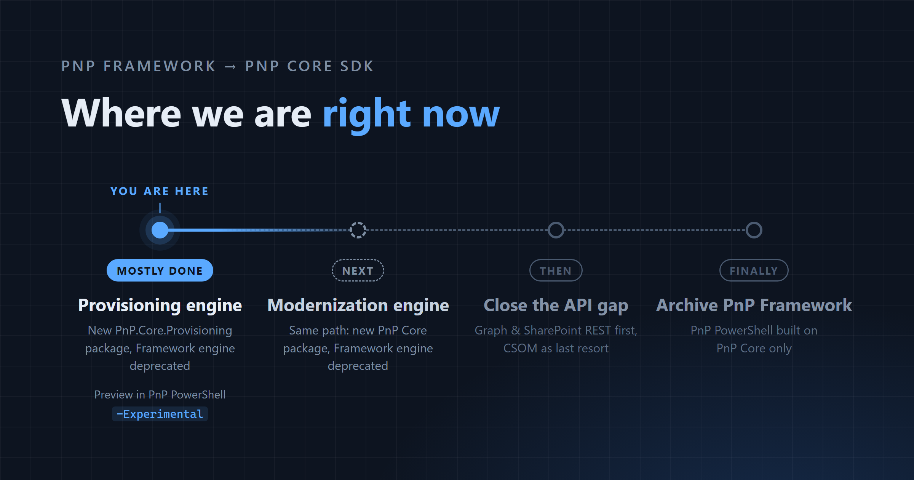
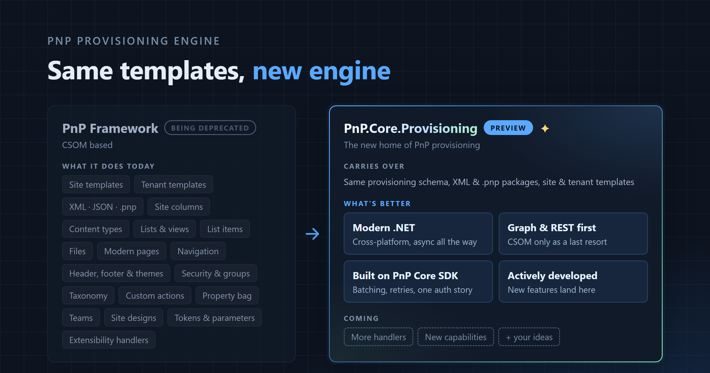
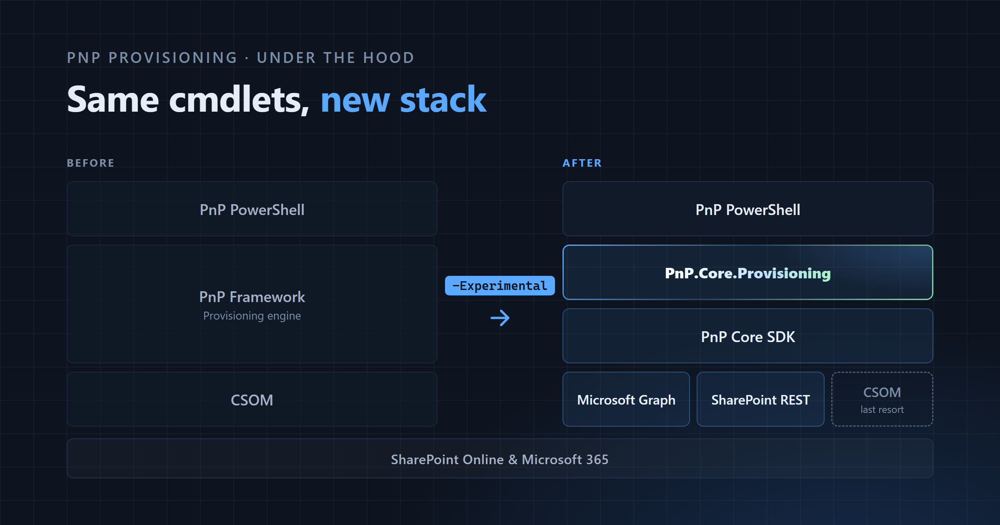

For years, the PnP provisioning engine has been doing the heavy lifting whenever you ran `Get-PnPSiteTemplate` to capture a site as a template, or `Invoke-PnPSiteTemplate` to apply that template to another site. That engine now has a new home. **PnP.Core.Provisioning**, the provisioning engine ported from PnP Framework to PnP Core SDK, is [available on NuGet](https://www.nuget.org/packages/PnP.Core.Provisioning) as a preview, and PnP PowerShell can already use it when you add `-Experimental` to the provisioning cmdlets.

In this post, we'll look at what changes and why, where we are in the bigger migration from PnP Framework to PnP Core SDK, how you can try the new engine today, and how you can help us get it ready.

## A bit of context: PnP Framework and PnP Core SDK

[PnP Framework](https://github.com/pnp/pnpframework) is the cross-platform successor to PnP-Sites-Core. It's built on CSOM, and it's the home of two engines many of you rely on: the **provisioning engine**, which extracts and applies site templates, and the **modernization engine**, which transforms classic SharePoint pages and sites into modern ones.

[PnP Core SDK](https://github.com/pnp/pnpcore) is the modern, async .NET SDK for Microsoft 365. It's built on Microsoft Graph and the SharePoint REST API, and it's the long-term future of PnP .NET tooling.

The two libraries overlap a lot, and maintaining both side by side isn't sustainable. That's why PnP Framework is being phased out, in the two phases we shared in the [PnP Framework roadmap update](https://pnp.github.io/blog/post/pnp-framework-roadmap-update-1/) back in June:

- [Phase 1](https://github.com/pnp/pnpframework/issues/1237): migrate the provisioning and modernization engines to PnP Core SDK, and deprecate them in PnP Framework.
- [Phase 2](https://github.com/pnp/pnpframework/issues/1238): fully deprecate PnP Framework and archive its repository.

## The roadmap and where we are now

Put on a map, the road from PnP Framework to PnP Core SDK has four stops:



1. **Provisioning engine.** Port the engine to a new PnP Core package, PnP.Core.Provisioning, and deprecate the engine in PnP Framework.
2. **Modernization engine.** Same path: a new PnP Core package, and the PnP Framework engine deprecated.
3. **Close the API gap.** Make sure PnP Core SDK covers everything PnP PowerShell still relies on PnP Framework for.
4. **Archive PnP Framework.** From then on, PnP PowerShell runs on PnP Core only.

We're at stop 1, and it's mostly done: the package is on NuGet, the docs and a sample app are published, and PnP PowerShell can run the new engine as a preview.

Stop 3 deserves a closer look, because the idea behind it guides everything that follows: **Graph and SharePoint REST first, CSOM as a last resort**. Microsoft Graph and the SharePoint REST API are where Microsoft 365 is heading, and they're what PnP Core SDK is built on. So whenever we move something across, we reach for Graph or REST first, and we only fall back to CSOM when there's no other way. The new provisioning engine already works like that: it keeps CSOM for the places REST can't reach, like classic publishing, workflows and composed looks.

## What the provisioning engine does, and what's new

A quick refresher: the provisioning engine describes a SharePoint site as a template, so you can extract it from one site and apply it to another. It works with site and tenant templates, stored as XML files or `.pnp` packages, and covers information architecture (site columns, content types, lists, libraries and views), pages and content, branding and navigation, security, taxonomy and, in tenant templates, Microsoft Teams.



PnP.Core.Provisioning uses the same provisioning schema and the same file formats, with all five schema versions from 2019-03 to 2022-09 ported, so an XML template can be read by both engines. There's one catch with `.pnp` packages for now, which we'll get to when we try the engine in PnP PowerShell.

What's better is everything underneath:

- **Modern .NET**: cross-platform, and async all the way.
- **Graph and REST first**: CSOM only as a last resort.
- **Built on PnP Core SDK**: batching, retries and one authentication story, shared with the rest of the SDK.
- **Actively developed**: this is where new features and fixes land from now on.

Let's keep expectations honest, though. This first version is a near 1:1 port: the goal was to bring the engine across with the behavior you know, not to redesign it, and not every handler has the same coverage as in PnP Framework yet. Improvements will follow, and your feedback will help us decide which come first.

## Under the hood: the new stack

Here's what changes when a provisioning cmdlet runs with `-Experimental`:

- **Before:** PnP PowerShell → PnP Framework → CSOM
- **After:** PnP PowerShell → PnP.Core.Provisioning → PnP Core SDK → Microsoft Graph and SharePoint REST, with CSOM as a last resort



Why should you care, if all you do is run the cmdlets?

- **It's future-proof.** The engine now sits on the SDK the community is investing in, instead of a library that's heading for the archive.
- **It moves away from CSOM.** Microsoft Graph and SharePoint REST come first, and CSOM is kept for the places they can't reach.
- **It benefits from PnP Core SDK's plumbing.** Batching and retries come with the SDK, so the engine doesn't have to reinvent them.

## Trying it in PnP PowerShell

### Opt in with `-Experimental`

The new engine is strictly opt-in. PnP PowerShell keeps using PnP Framework by default, and nothing changes in your scripts unless you add the `-Experimental` switch. Add it to a cmdlet, and that call runs on PnP.Core.Provisioning instead.

`-Experimental` is available on 15 provisioning cmdlets:

- **Site templates:** `Get-PnPSiteTemplate`, `Invoke-PnPSiteTemplate`, `Read-PnPSiteTemplate`, `Save-PnPSiteTemplate`, `Convert-PnPSiteTemplate` and `Set-PnPSiteTemplateMetadata`
- **Tenant templates:** `Get-PnPTenantTemplate`, `Invoke-PnPTenantTemplate`, `Read-PnPTenantTemplate` and `Save-PnPTenantTemplate`
- **Lists, data and files:** `Export-PnPListToSiteTemplate`, `Add-PnPDataRowsToSiteTemplate`, `Add-PnPListFoldersToSiteTemplate`, `Add-PnPFileToSiteTemplate` and `Remove-PnPFileFromSiteTemplate`

For all the details, have a look at the pull request that added it: [pnp/powershell#5474](https://github.com/pnp/powershell/pull/5474).

### Extract and apply a template

`-Experimental` ships in the nightly builds of PnP PowerShell. Once you're on a nightly, and connected with an app registration that has the right permissions (more on those in a moment), a round trip looks like this:

```powershell
Connect-PnPOnline -Url https://contoso.sharepoint.com/sites/marketing -ClientId "<client-id>" -Interactive

# Extract a template from the connected site with the new engine
Get-PnPSiteTemplate -Out marketing.xml -Experimental

# Apply it to another site, again with the new engine
Invoke-PnPSiteTemplate -Path marketing.xml -Url https://contoso.sharepoint.com/sites/marketing-copy -Experimental
```

Keep an eye on the warnings. The engine reports a problem and carries on instead of stopping at the first one, so a run can finish having skipped part of a template. PnP PowerShell shows those messages as warnings while the engine runs, and writes the errors once more when it's done, so your scripts can notice them with `-ErrorAction Stop` or `$?`.

### Permissions: more than AllSites.FullControl

This part will save you the most frustration. PnP Framework works through CSOM, where `AllSites.FullControl` on SharePoint is enough. PnP.Core.Provisioning also calls Microsoft Graph and the SharePoint REST API, so to use every part of the engine, the Entra ID app you connect with needs these delegated permissions:

| API | Delegated permissions |
| --- | --- |
| Microsoft Graph | `Group.ReadWrite.All`, `openid`, `profile`, `Sites.Manage.All`, `User.Read.All` |
| SharePoint | `AllSites.FullControl`, `AllSites.Manage`, `TermStore.ReadWrite.All`, `User.Read.All` |

Add them to your app registration and grant admin consent. [Register an Entra ID Application to use with PnP PowerShell](https://pnp.github.io/powershell/articles/registerapplication.html) shows how. Running unattended with app-only authentication? The [Demo.Console.Provisioning README](https://pnp.github.io/pnpcore/demos/Demo.Console.Provisioning/README.html) lists the application permissions the engine needs.

### Known differences in preview

PnP.Core.Provisioning is a preview, and a few things behave differently from PnP Framework for now:

- **`.pnp` packages don't work across the two engines yet.** A package saved without `-Experimental` can't be opened with `-Experimental`, and the other way around. When you hand a cmdlet a package from the other engine, it tells you which one to use. XML templates work with both.
- **`-ExcludeHandlers` behaves differently.** The new engine processes pages and their contents with a single `Pages` handler, so excluding either `Pages` or `PageContents` excludes both, and a warning tells you so. At least one handler also has to remain: values that leave nothing to run, such as `-ExcludeHandlers All`, are rejected instead of running everything.
- **A few smaller differences**, like template provider extensions not being run and `Get-PnPSiteTemplate` not writing markdown reports, are listed in [The experimental PnP.Core.Provisioning engine](https://pnp.github.io/powershell/articles/experimental-provisioning.html) article in the PnP PowerShell docs.

## For .NET developers

Everything PnP PowerShell does with `-Experimental`, you can do from your own code too. The engine ships as its own NuGet package

```shell
dotnet add package PnP.Core.Provisioning
```

PnP.Core.Provisioning builds on `PnP.Core` and `PnP.Core.Admin` and is released in lockstep with them, so keep all three on matching versions. From there, everything starts from your `PnPContext`:

```csharp
using (var context = await pnpContextFactory.CreateAsync("SiteToWorkWith"))
{
    var manager = context.GetProvisioningManager();

    var template = await manager.GetTemplateAsync(new ExtractConfiguration
    {
        ProgressDelegate = (step, current, total) => Console.WriteLine($"{current}/{total} {step}"),
        MessagesDelegate = (message, type) => Console.WriteLine($"[{type}] {message}")
    });
}
```

Applying a template works the same way through `ApplyTemplateAsync`, and tenant templates through `GetTenantTemplateAsync` and `ApplyTenantTemplateAsync`. The [provisioning page in the PnP Core SDK docs](https://pnp.github.io/pnpcore/using-the-sdk/provisioning-intro.html) covers the rest: opting into content, saving templates as XML or `.pnp`, tenant templates, and reading what the engine reports. 

If you'd rather see the engine working end to end first, the [Demo.Console.Provisioning](https://pnp.github.io/pnpcore/demos/Demo.Console.Provisioning/README.html) sample lets you extract, inspect and apply templates from a simple console menu, with both interactive and app-only authentication.

## What happens to PnP Framework provisioning

The provisioning engine in PnP Framework is being deprecated. In practice, that means, new features and fixes go to PnP.Core.Provisioning, so provisioning issues and ideas belong in [pnp/pnpcore](https://github.com/pnp/pnpcore/issues).

Deprecated doesn't mean gone: your existing code keeps working, and the PnP Framework packages stay on NuGet.

Before making the switch, we went through the open PnP Framework provisioning fixes and merged the important ones that were still pending, as announced in [pnp/pnpframework#1286](https://github.com/pnp/pnpframework/issues/1286). If you know of an important fix or feature that's still waiting, let us know in that issue, or open an issue in pnp/pnpcore so it can land in the new engine.

## What's next

With the provisioning engine mostly in place, the roadmap continues:

1. **The modernization engine** takes the same path: a new PnP Core package, with the PnP Framework engine deprecated.
2. **Closing the API gap** in PnP Core SDK follows, so the SDK covers everything PnP PowerShell still needs PnP Framework for, with Graph and REST first and CSOM as a last resort.
3. **Archiving PnP Framework** comes last. From then on, PnP PowerShell runs on PnP Core only.

In the meantime, PnP.Core.Provisioning keeps improving with frequent updates and fixes, and we'll keep sharing progress in the [phase 1](https://github.com/pnp/pnpframework/issues/1237) and [phase 2](https://github.com/pnp/pnpframework/issues/1238) roadmap issues.

## Help us test it

This is where you come in. Real templates applied to real tenants are the most useful feedback we can get, and getting started takes three steps:

1. **Get the nightly.** Install the latest nightly build of PnP PowerShell, or update to it if you already have the module. 
2. **Add `-Experimental`.** Take the provisioning scripts and templates you already use, add the switch, and compare the result with what PnP Framework gives you.
3. **Report what you find** in [pnp/pnpcore](https://github.com/pnp/pnpcore/issues). Please include the template, or a trimmed-down version that still shows the problem, together with the messages the engine reported. Those two things make all the difference when we try to reproduce an issue. Just remove anything sensitive from the template before you share it.

Not ready to test yet? There are other ways to get involved: join the [Microsoft 365 & Power Platform community calls](https://aka.ms/community/calls), start a conversation in [GitHub Discussions](https://github.com/pnp/pnpcore/discussions), or send a pull request. PRs are always welcome!

## Wrap-up

PnP.Core.Provisioning is a big milestone: the first of the PnP Framework engines now lives in PnP Core SDK, and you can run it from PnP PowerShell today. It's still a preview, and that's exactly why your feedback matters right now. What you test and report shapes what ships.

Let's keep moving forward, together.

- [Phase 1 roadmap issue on GitHub](https://github.com/pnp/pnpframework/issues/1237)
- [Phase 2 roadmap issue on GitHub](https://github.com/pnp/pnpframework/issues/1238)
- [PnP Core SDK repository](https://github.com/pnp/pnpcore)
- [PnP Framework repository](https://github.com/pnp/pnpframework)
- [PnP.Core.Provisioning on NuGet](https://www.nuget.org/packages/PnP.Core.Provisioning)
- [Provisioning sites with templates (PnP Core SDK docs)](https://pnp.github.io/pnpcore/using-the-sdk/provisioning-intro.html)
- [The experimental PnP.Core.Provisioning engine (PnP PowerShell docs)](https://pnp.github.io/powershell/articles/experimental-provisioning.html)

