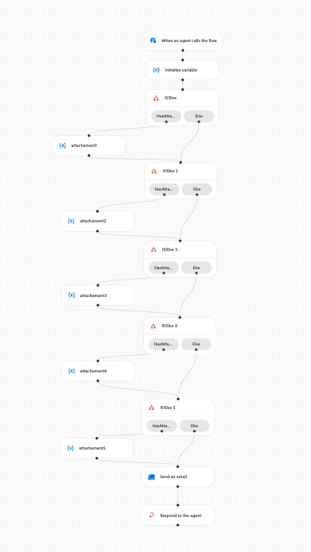
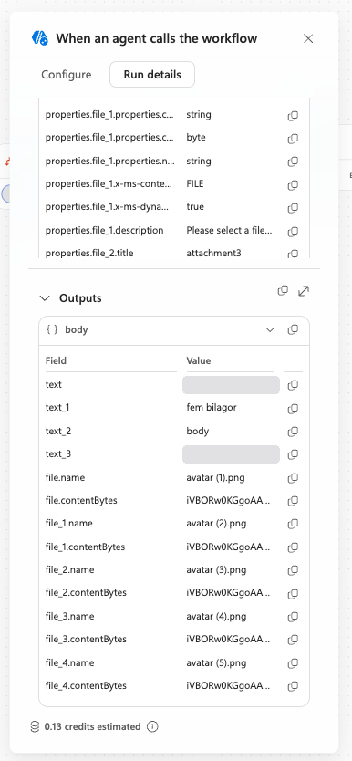
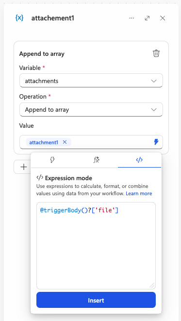
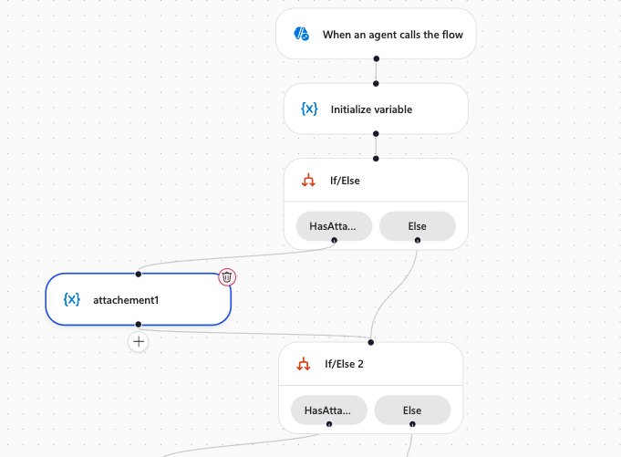
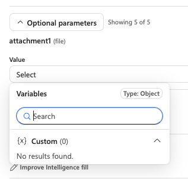
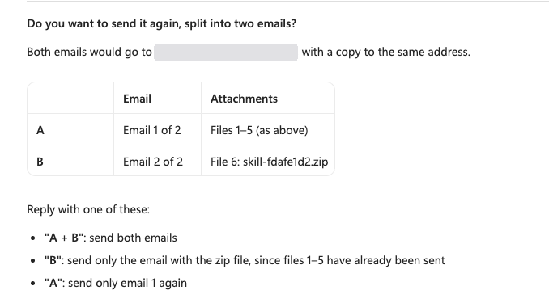

*Lessons from rebuilding a SendMail tool in the new workflows experience (GitHub Copilot harness), November 2026. The GitHub Copilot harness is the runtime inside Copilot Studio, not the GitHub coding assistant. The workflows experience is in preview and changes quickly, so details may differ by the time you read this.*

Background reading on Microsoft Learn: [Workflows overview](https://learn.microsoft.com/en-us/microsoft-copilot-studio/workflows-experience/flows-overview) and [Add a workflow as a tool to an agent](https://learn.microsoft.com/en-us/microsoft-copilot-studio/workflows-experience/flow-agent).

## The short version

If you only need the pattern, here it is:

1. Trigger **When an agent calls the flow** with your text inputs plus five optional **File** inputs.
2. One **Array** variable, `attachments`, initialized to `[]`.
3. One **If/Else** per file: condition *Name* **is not empty**.
4. In the true branch, **Append to array** with the raw file reference written in **Expression mode**, for example `triggerBody()?['file']`. Do not build the object as text.
5. Join both branches of every If/Else to the next step.
6. Pass the whole array to **Attachments** in **Send an email (V2)**. An empty array is fine.
7. On the agent side, leave the file inputs on **Fill with Intelligence**. In the new experience that works, even though the documentation for the standard harness says it does not.

The rest of this post explains why each step is there, because almost none of it was obvious from the designer.

## Background

I had a working Copilot Studio agent whose escalation step called an agent flow named SendMail. The agent summarized the conversation and the flow emailed the summary to a support mailbox, with a copy to the user. When I moved the agent to a new environment and rebuilt the tool in the new workflows experience, logic that had been routine in the classic designer took most of a day. None of the problems were hard once understood. Almost none were visible in the designer itself.

## The requirement

The agent calls a workflow with four text values (to, subject, body and the user's own address for a copy) and up to five optional files the user uploaded in the chat. The workflow sends one email with every supplied file attached and responds to the agent. Zero files must also work.

## The final design

```text
Start → Initialize variable → If/Else 1 → If/Else 2 → If/Else 3 → If/Else 4 → If/Else 5 → Send an email (V2) → Respond to the agent
```



- **Start** uses *When an agent calls the flow*, with four required text inputs and five optional File inputs, `attachment1` to `attachment5`.
- **Initialize variable** creates an Array variable `attachments` with the value `[]`.
- **Each If/Else** checks one file with the condition *Name* **is not empty**. The true branch holds *Update variable*, operation *Append to array*, with the whole file object as the value. The else branch is empty. Both paths connect to the next If/Else, and both paths of the fifth block connect to *Send an email (V2)*.
- **Send an email (V2):** the *Attachments* field is switched to accept an entire array (the `{x}` toggle next to the field label) and receives `attachments`. *CC* and *Reply To* both receive the user's address, so the user gets a copy and support can answer the user directly.
- **Respond to the agent** comes after the email, so it runs on every path.

The append values, entered in Expression mode:

| Input in the designer | Internal name | Append to array value |
|---|---|---|
| attachment1 | `file` | `triggerBody()?['file']` |
| attachment2 | `file_1` | `triggerBody()?['file_1']` |
| attachment3 | `file_2` | `triggerBody()?['file_2']` |
| attachment4 | `file_3` | `triggerBody()?['file_3']` |
| attachment5 | `file_4` | `triggerBody()?['file_4']` |

Tested with zero, one, two and five files, first from the workflow's own test runs and then from the agent in the chat. Every run delivered the right attachments with correct names and sizes. Run details estimated a five-file run at 0.13 Copilot Credits.

## What I learned

### The trigger cannot receive a list of files

The obvious design is one input holding an array of files, looped straight into the email. *When an agent calls the flow* has no list or array input type, and a File input holds exactly one file. Five optional File inputs, each checked separately, was the only route I found. It works, but it caps the number of attachments and multiplies the nodes on the canvas.

### The trigger has two names

On the canvas the trigger node is labelled *When an agent calls the flow*, which matches the documentation. Open the same node and the panel title says *When an agent calls the workflow*. It is the same trigger. Search the docs for the first name.

### Display names are not the names you reference

Inputs are shown by the title you give them, but expressions need the internal names the designer generates. My text inputs became `text`, `text_1`, `text_2` and `text_3`. The file inputs became `file` to `file_4`. The reliable way to find them is to run the workflow once and open the trigger's **Run details**, where the input schema and the outputs show the real keys.



The same view shows what a file looks like when it arrives: an object with a `name` string and a `contentBytes` string holding the file as base64 (a PNG starts with `iVBORw0KGgo`). The schema declares `contentBytes` as a string with format `byte`.

### A text template silently breaks the attachment

My first attempt built each attachment in the *Append to array* value field as text: typed braces and keys, with the *Name* and *Content Bytes* tokens inserted from the slash menu. The designer accepted it, and the run failed on *Send an email (V2)* with a bare `InternalServerError`.

The inputs of the failed action showed three faults with one cause:

- the array item was a JSON string with escaped quotes, not an object
- the content was raw binary starting with the PNG signature, not base64, because interpolating a byte-format value into text decodes it
- the file name had gained a space on each side

The connector's error said none of this. Only the raw inputs showed it.

### Expression mode has a narrower function set than Power Automate

In Power Automate I would have built the object with `addProperty`. The new designer saved it, then flagged the node with *Unknown function: addProperty*. I did not find documentation listing which expression functions the new designer supports. The [workflow expression functions reference for Logic Apps](https://learn.microsoft.com/en-us/azure/logic-apps/workflow-definition-language-functions-reference) lists `addProperty`, so the gap is in the new designer, not in the language.

### The three tabs in the value picker do different things

Typing a slash in a value field opens a picker with three tabs:

- **Lightning** inserts dynamic content.
- **fx** is the *Expression assistant*, an AI prompt. A pasted expression is treated as a description, not as code.
- **`</>`** is *Expression mode*, where expressions are typed. It accepts a function call or a reference only; a JSON object literal is rejected with *Expected function name or reference*.



### The simplest expression was the right one

The incoming file object already has the shape the Outlook connector needs, so there is nothing to build. Appending `triggerBody()?['file']` as a pure expression keeps the object intact and keeps `contentBytes` as base64. Expression mode shows it as `@triggerBody()?['file']`, and once inserted the value field shows a chip with the input's display name, `attachment1`, which hides which internal key it points to. The connector accepted the lowercase keys `name` and `contentBytes`, although the connector documentation writes them as `Name` and `ContentBytes` ([Office 365 Outlook connector reference](https://learn.microsoft.com/en-us/connectors/office365/)).

### An empty attachments array is fine

I expected to need a separate email action for the no-attachment case. An empty array sent the email without attachments and without errors, so one email action covers every case.

### Branches have to be joined by hand

An action added after an If/Else is attached to that branch only. My first layout had *Respond to the agent* hanging off the true branch, which would leave the agent without a response whenever there was no file. Dragging a connection from the Else output to the next node joins the paths. It is easy to miss on a canvas with five branches.



### Duplicating blocks needs care

Duplicating a finished If/Else saves time, but the copy keeps the references to the original file. Change both the token in the condition and the expression in the append value in every copy, or the same file is attached twice while another is silently skipped.

## Calling it from the agent: Fill with Intelligence just works

I expected the agent side to be the hard part. The Learn article on [passing files to tools](https://learn.microsoft.com/en-us/microsoft-copilot-studio/guidance/pass-files-to-connectors) is written for the standard harness and says file inputs only work as a Power Fx formula with the *Custom value* option, not with dynamic fill by AI. I had prepared formulas based on `System.Activity.Attachments` for all five files.

That path does not exist in the new experience, at least not in November 2026. In the tool's input settings, choosing a value for a file input opens a picker of the agent's own variables, filtered to *Type: Object*. Mine listed *Custom (0)* and *No results found*. There are no system variables, no way to type a formula, and for file inputs not even a button to create a new variable.



So I tried the option the documentation says does not work. With every input left on *Fill with Intelligence*, files included, I attached an image in the chat and asked the agent to send it. The email arrived with the 2.9 MB image attached and intact. With six images, the agent noticed by itself that the tool accepts five, stopped, and asked whether to send the first five or split them into two emails. No formulas, no topics, no mapping. After a day of wrestling with expressions, that was the best moment of the build, and the strongest argument I found for the new experience.



*A follow-up in the same test, after the first five files had been sent. The agent normally answers in Swedish, so I asked it to reply in English.*

The user's address worked the same way. `System.User.Email` could not be selected, but describing the `userEmail` input as always being the signed-in user's address was enough for the agent to fill it correctly.


## Suggestions for the product team

1. Let *When an agent calls the flow* accept an array of files, so a variable number of attachments needs no fixed set of inputs and no If/Else per file.
2. Show each input's internal name next to its display name in the Start node.
3. Catch malformed attachments before the run fails: warn when a byte value or an object is inserted into a text template, and explain the InternalServerError when one still reaches the connector.
4. Publish the list of supported expression functions, and flag unsupported ones such as `addProperty` before save.
5. Make the difference between the Expression assistant and Expression mode clearer, for example by offering to move pasted code to Expression mode.
6. Offer a visible join for If/Else branches, or default new actions after an If/Else to run after both paths.
7. Clarify which file-passing guidance applies to the new experience. The current article is written for the standard harness and says AI fill does not work for file inputs. In the new experience the formula option was not available, and AI fill worked.

## Summary

The working pattern is short once known: optional File inputs on the trigger, an array variable, one If/Else per file on *Name is not empty*, *Append to array* with the raw file reference from Expression mode, and the array passed whole to *Send an email (V2)*. On the agent side, file inputs worked with *Fill with Intelligence* and no formulas. Most of the time went into discovering behaviour the designer did not explain, which is why the suggestions matter as much as the solution.
