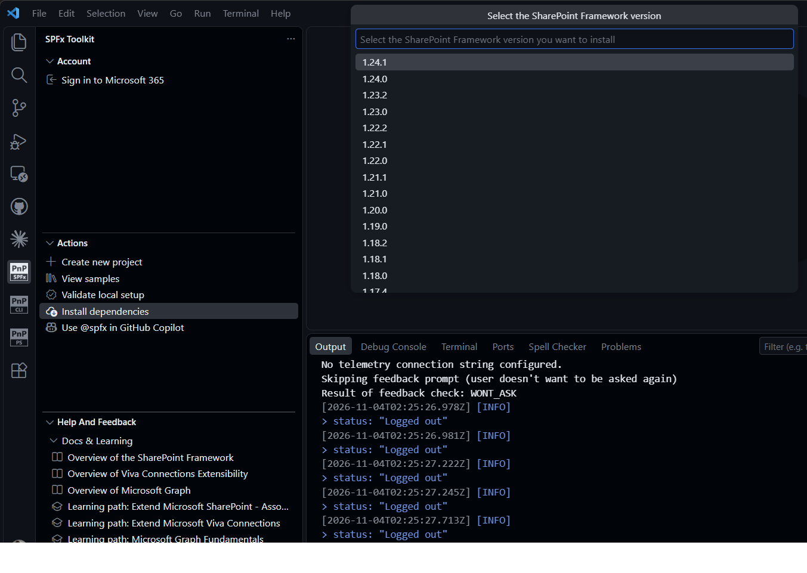
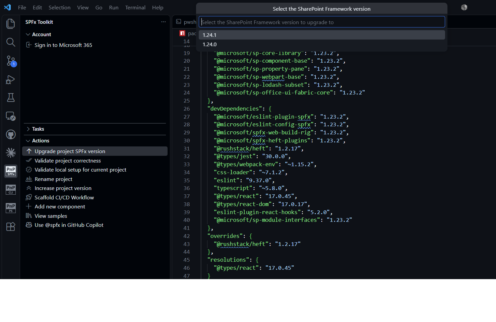
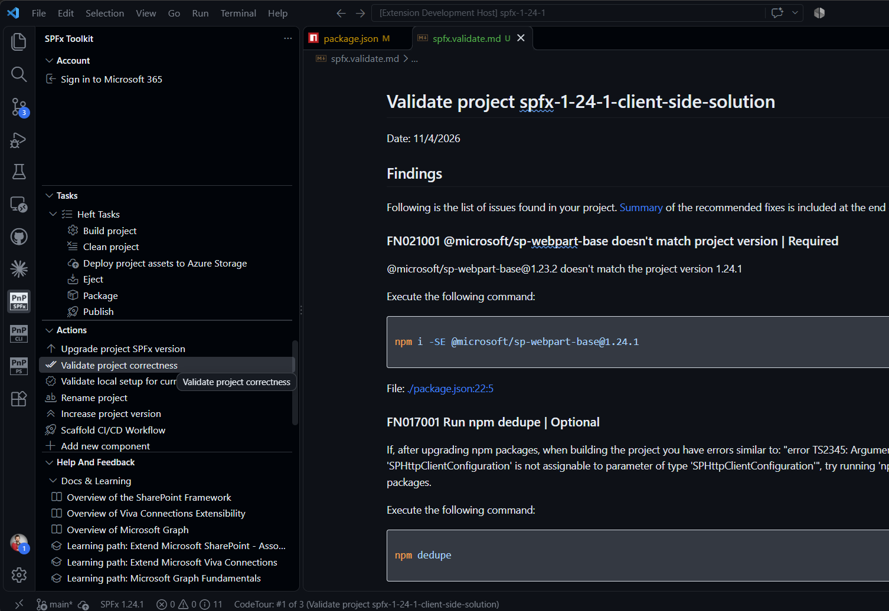
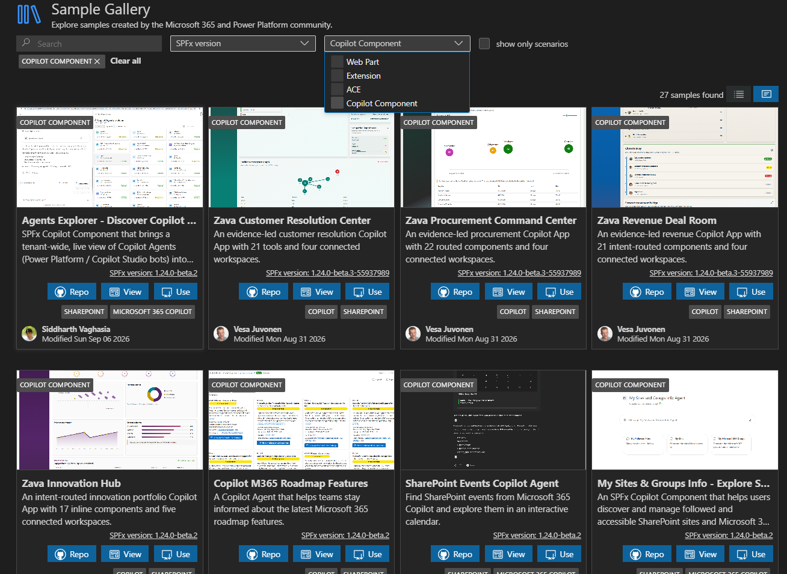
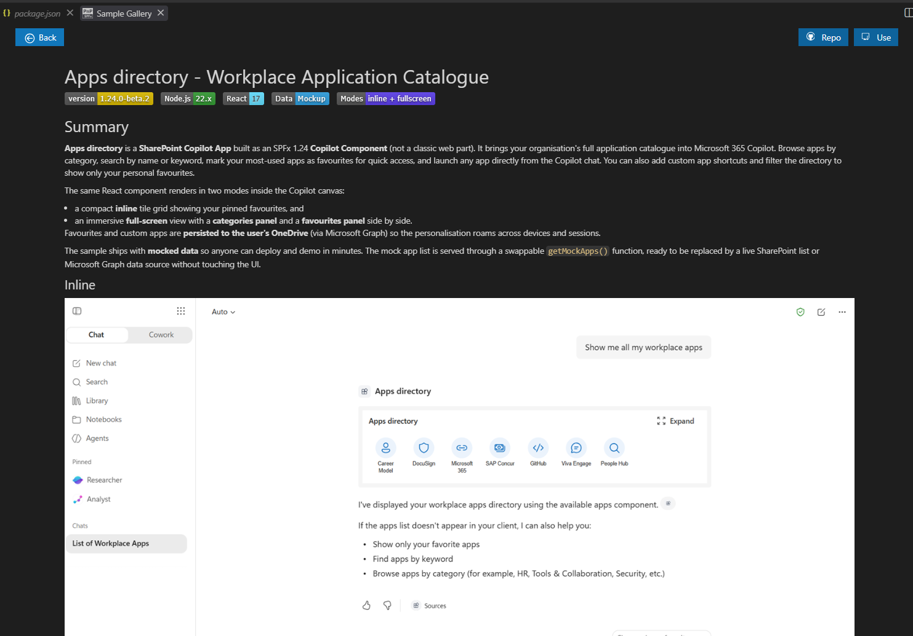
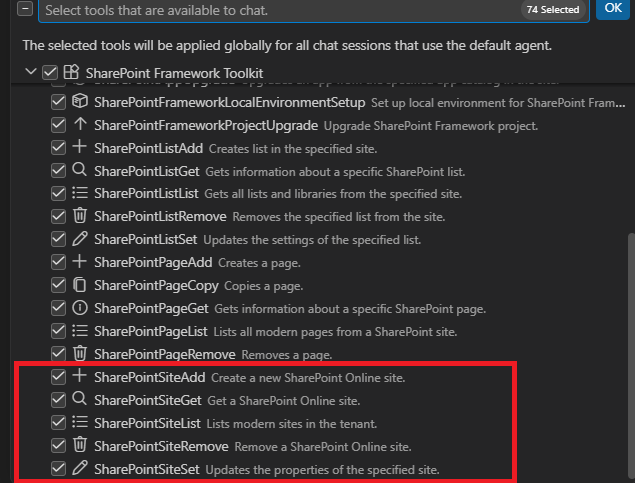

## 🗒️ Quick intro

[SharePoint Framework Toolkit](https://marketplace.visualstudio.com/items?itemName=m365pnp.viva-connections-toolkit) is a Visual Studio Code extension that aims to boost your productivity in developing and managing [SharePoint Framework solutions](https://learn.microsoft.com/sharepoint/dev/spfx/sharepoint-framework-overview?WT.mc_id=m365-15744-cxa) helping at every stage of your development flow, from setting up your development workspace to deploying a solution straight to your tenant without the need to leave VS Code, it even allows you to create a CI/CD pipeline to introduce automated deployment of your app and also comes along with AI capabilities which will allow you to manage your SharePoint Online tenant straight from GitHub Copilot chat extension.

Sounds cool 😎? Let's see some new enhancements we added in this minor release

## SPFx 1.24 support

SPFx Toolkit now supports SharePoint Framework v1.24.0 and v1.24.1, so you can work with the latest version of SPFx from the very first step to the very last one.

When setting up your development environment with the **Install dependencies** action, you may now pick SPFx 1.24.1 or 1.24.0 and SPFx Toolkit will install all the matching dependencies for you.

Already have an existing project? The **Upgrade project SPFx version** action now lets you upgrade it to SPFx 1.24.1 or 1.24.0. You will get a detailed report with all the steps required to upgrade your project.

And once you are on SPFx 1.24, the **Validate project correctness** action will check your project against the new version and point out anything that doesn't match.

Under the hood, we updated the CLI for Microsoft 365 dependency to the latest version, which brings support for the new SPFx version to the upgrade, validation and local setup checks.

## Copilot Apps samples in the Sample Gallery

SPFx 1.24 introduces Copilot Components, allowing you to build apps that render directly inside the Microsoft 365 Copilot experience. To help you get started, we added support for the new [SPFx Copilot Apps samples repository](https://github.com/pnp/spfx-copilot-apps) to the SPFx Toolkit Sample Gallery.

You will find the new samples under the **Copilot Component** filter, next to the already well-known Web Part, Extension and ACE samples.

Just like with any other sample, you may open the details, check out the repo, or use it as a starting point for your own project with a single click.

## New AI capabilities to manage SharePoint sites

We continue to extend the Language Model Tools that allow you to manage your SharePoint Online tenant straight from GitHub Copilot chat. In this release, we focused on SharePoint sites and added two new tools:

- `list_spo_site` - lists the modern SharePoint Online sites in your tenant
- `set_spo_site` - updates the properties and settings of an existing SharePoint Online site

We also refactored the existing tools to give you more control:

- `add_spo_site` - now supports applying a site design, creating the site with a site collection app catalog, and removing a previously deleted site with the same URL
- `remove_spo_site` - now allows you to skip the recycle bin or remove a site that is already in the recycle bin

Together with the already existing `get_spo_site` tool, this means you may now create, list, get, update and remove sites simply by chatting with GitHub Copilot 🤖.

## 👏 You ROCK 🤩

This release would not have been possible without the help of some really awesome folks who stepped in and joined our journey in creating the best-in-class SharePoint Framework tooling in the world. We would like to express our huge gratitude and shout out to:

- [Saurabh Tripathi](https://github.com/Saurabh7019)
- [Adam Wójcik](https://github.com/Adam-it)
- [Nico De Cleyre](https://github.com/nicodecleyre)

## 🗺️ Future roadmap

We don't plan to stop, we are already thinking of more awesome features we plan to deliver in upcoming releases. Top of our mind currently is:

- More AI capabilities to help you manage your SharePoint Online tenant even better
- Bulk operations for apps in an app catalog

If you want to check what we are planning, check out our [issues](https://github.com/pnp/vscode-viva/issues). Feedback is appreciated 👍.

## 👍 Power of the community

This extension would not have been possible if it hadn’t been for the awesome work done by the [Microsoft 365 & Power Platform Community](https://pnp.github.io/). Each sample gallery: SPFx web parts & extensions, ACE samples & scenarios, and now also Copilot Apps, is populated with the contributions made by the community. Many of the functionalities of the extension, like upgrading, validating, and deploying your SPFx project, would not have been possible if it weren’t for the [CLI for Microsoft 365](https://pnp.github.io/cli-microsoft365/) tool. I would like to thank all of our awesome contributors sincerely! Creating this extension would not have been possible if it weren’t for the enormous work done by the community. You all rock 🤩.

If you would like to participate, the community welcomes everybody who wants to build and share feedback around Microsoft 365 & Power Platform. Join one of our [community calls](https://pnp.github.io/#community) to get started, and be sure to visit 👉 https://aka.ms/community/home.

## 🙋 Wanna help out?

Of course, we are open to contributions. If you would like to participate, do not hesitate to visit our [GitHub repo](https://github.com/pnp/vscode-viva) and start a discussion or engage in one of the many issues we have. We have many issues that are just ready to be taken. Please follow our [contribution guidelines](https://github.com/pnp/vscode-viva/blob/main/contributing.md) before you start.
Feedback (positive or negative) is also more than welcome.

## 🔗 Resources

- [SPFx Toolkit Docs](https://aka.ms/spfx/toolkit)
- [Download SharePoint Framework Toolkit at VS Code Marketplace](https://marketplace.visualstudio.com/items?itemName=m365pnp.viva-connections-toolkit)
- [Download SharePoint Framework Toolkit at Open VSX Registry](https://open-vsx.org/extension/m365pnp/viva-connections-toolkit)
- [SPFx Toolkit GitHub repo](https://github.com/pnp/vscode-viva)
- [Microsoft 365 & Power Platform Community](https://pnp.github.io/#home)
- [Join the Microsoft 365 & Power Platform Community Discord Server](https://discord.gg/YtYrav2VGW)
- [Join the Microsoft 365 Developer Program](https://developer.microsoft.com/en-us/microsoft-365/dev-program)
