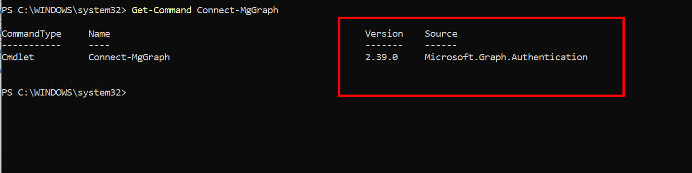
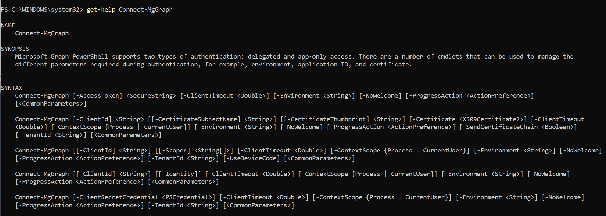
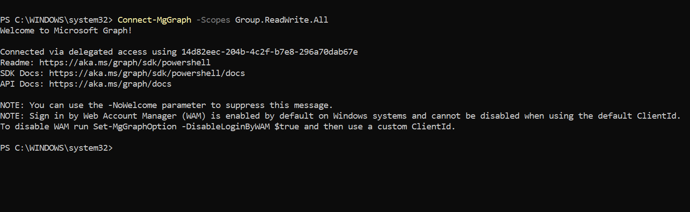
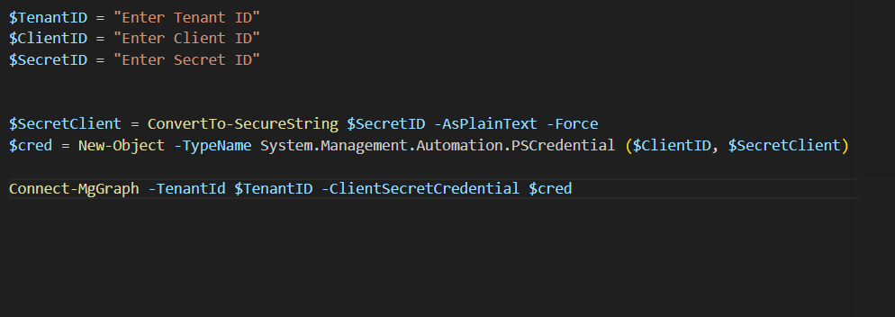

### Introduction

If you’re working with Microsoft 365, automation is quickly becoming an essential skill. Connect-MgGraph provides a simple way to connect PowerShell to Microsoft Graph, allowing you to automate administrative tasks across Microsoft 365 services from a single place.

In this article, we’ll explore how to use Connect-MgGraph and Microsoft Graph PowerShell to get started with Microsoft 365 automation. Whether you’re managing users, devices, groups, or other resources, understanding this connection is the first step toward building powerful automation.

**Know more about Microsoft Graph PowerShell SDK**
Microsoft Graph acts as the gateway to Microsoft’s cloud ecosystem, offering a unified endpoint, https://graph.microsoft.com– to connect with data, insights, and intelligence across Microsoft 365, Windows, and Enterprise Mobility + Security. Instead of juggling multiple APIs, developers can rely on this single entry point to streamline integration and build solutions that tap into the full breadth of Microsoft services.

To automate tasks, Microsoft provides the Graph PowerShell SDK through the PowerShell Gallery. This SDK includes two modules: Microsoft.Graph (aligned with the v1.0 REST API) and Microsoft.Graph.Beta (aligned with the beta REST API). Together, they empower administrators and developers to script, automate, and manage Microsoft 365 environments efficiently, making it easier to deliver scalable solutions and reduce manual effort.

**Install Microsoft Graph PowerShell Modules**

Installing the Microsoft Graph PowerShell module is essential for automation. I’ve already documented the recommended approach for setting up both the Microsoft.Graph and Microsoft.Graph.Beta modules. If you’re new to this topic, I encourage you to refer to that guide for a step‑by‑step walkthrough and best practices.

To install the Microsoft Graph PowerShell SDK, your PowerShell version should be at least 5.1 or later. However, Microsoft recommends having PowerShell 7 or later. As per Microsoft, no additional prerequisites are required to use the SDK with PowerShell 7 or later.

**Understand the Connect-MgGraph cmdlet**

You must have already installed the Microsoft Graph modules. It’s time to learn about the Connect-MgGraph. The Connect-MgGraph is part of Microsoft.Graph.Authentication module. You must invoke Connect-MgGraph before any commands that access Microsoft Graph. This cmdlet gets the access token using the Microsoft Authentication Library.

Microsoft Graph PowerShell supports two types of authentication: delegated and app-only access. Several cmdlets are available to manage the various parameters required during authentication, such as the environment, application ID, and certificate.
 
Delegated Access runs under the context of a signed‑in user. Permissions are granted based on that user’s role and consent. Requires interactive sign‑in. And, app‑Only access runs without a signed‑in user. Permissions are granted directly to the application via Azure AD. Uses certificates or client secrets for authentication.

## Learning Connect-MgGraph Through Get-Help

Let’s begin exploring Connect-MgGraph from the ground up. If you’re new to Microsoft Graph, a great starting point is to use the PowerShell Get-Help command with Connect-MgGraph.

This will provide detailed guidance on how the cmdlet works and the parameters it supports. The Get-Help cmdlet is a powerful way to learn about any PowerShell command, giving you the documentation you need directly within your console.

## Delegated Access – Interactive Authentication

The Connect-MgGraph cmdlet includes the -Scopes parameter, which you can use during interactive authentication. By specifying the required permissions, you obtain delegated access for your session. In this example, I am authenticating with the Group.ReadWrite.All scope.

## App-only Access: Using Client Credentials with Client Secret

In the PowerShell snippet above, we are connecting to Microsoft Graph using app-only authentication with a client secret. Instead of prompting a user to sign in interactively, the script leverages the application’s own identity by supplying the Tenant ID, Client ID, and Client Secret.

The secret is converted into a secure string, wrapped in a PSCredential object, and then passed to Connect-MgGraph via the -ClientSecretCredential parameter. This method grants the application permissions that have been consented to in Azure AD, allowing it to act independently of any user session. In practice, this means the app itself is authorised to perform operations in Microsoft Graph without requiring delegated access from a signed-in user.

### Conclusion

Connect-MgGraph is more than just a cmdlet to establish a connection. It is the starting point for using Microsoft Graph PowerShell to automate Microsoft 365 administration. Once you understand authentication, permissions, and how to work with Graph commands, you can begin replacing repetitive administrative tasks with reliable PowerShell automation.

Happy
Learning!
