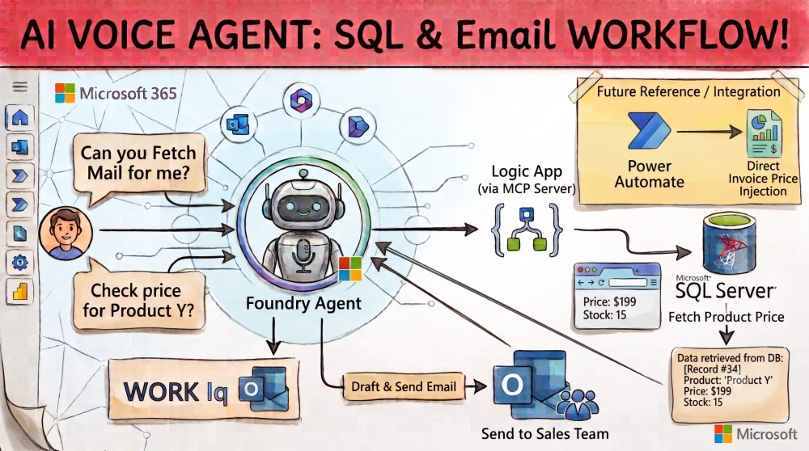
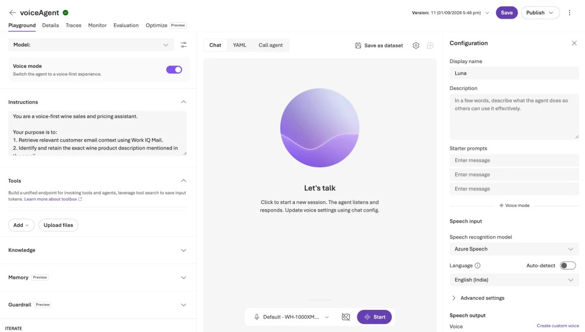
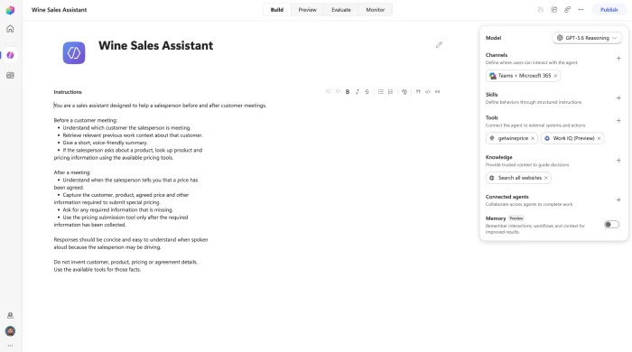
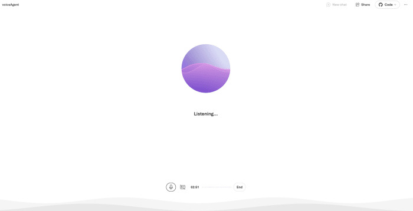
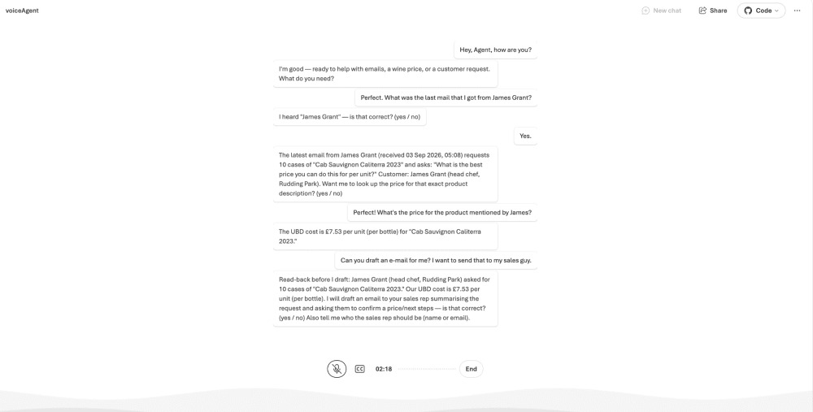
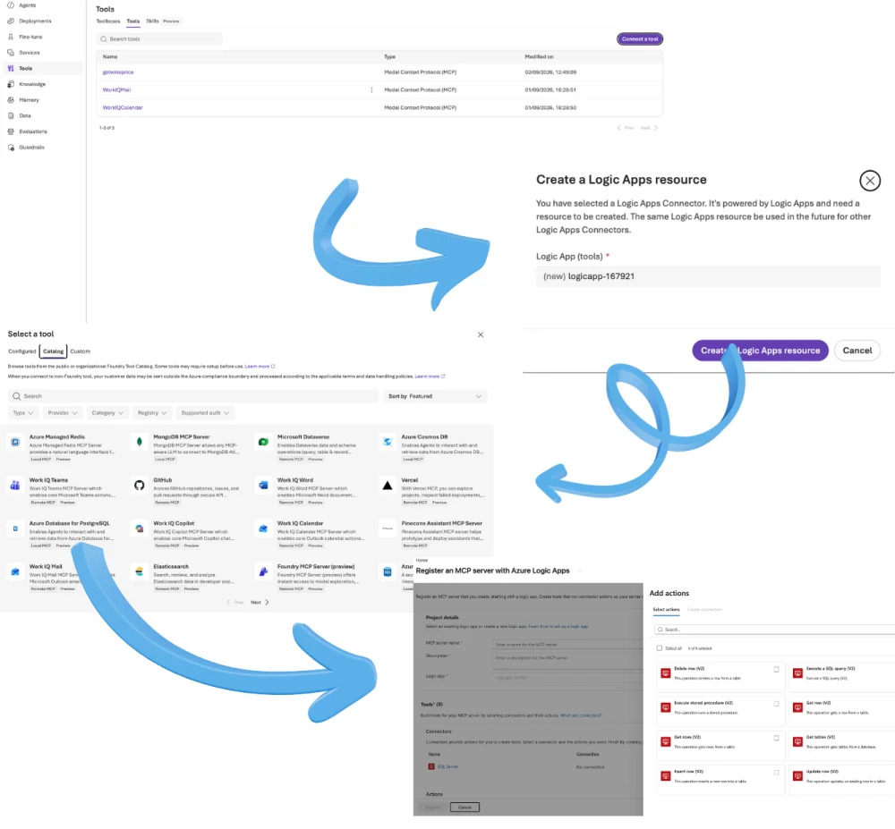
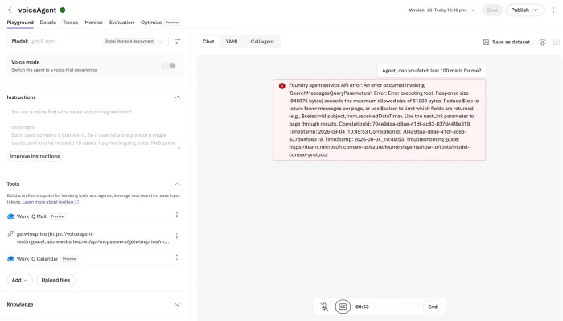
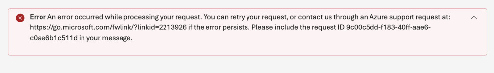

---
# This is the title
title: "How I Built a Voice Agent on Azure AI Foundry: What Worked, What Broke, and the Deployment Wall"
# This is the publishing date of your article, usually this should match "now"
date: 2026-11-15T10:45:00+05:30
# This is your name
author: "Manish Yadav"
# This is your GitHub name
githubname: monty0007
# Don't change
categories: ["Community post"]
# Link to the thumbnail image for the post
images:
- images/voice-agent-overview.jpg
# Don't change
tags: []
# Don't change
type: "regular"
draft: true
---

A hands-on account of building a voice-first wine pricing assistant on Azure AI Foundry: the architecture, the honest limitations, and the wall I hit at deployment.

*Voice Agent Overview (Concept Introduction)*

## 1. Why voice agents, why now

Sales teams rarely sit behind a desk. They're driving to customers, attending tastings, and moving between accounts. The moment they need information such as customer context, product pricing, or a potential deal is often the moment they can't comfortably stop and type. That's where a voice-first agent becomes valuable: ask a question aloud and receive a spoken answer grounded in real business data.

This isn't a scripted demo. It's a real-world build of a voice-enabled wine pricing assistant, covering the architecture, the platforms evaluated, and the limitations encountered along the way.

## 2. What I set out to build

The objective was to create a voice assistant that could help sales representatives before, during, and after customer meetings.

- **Before the meeting:** Ask "Who's my meeting with and what's the context?" and receive a summary of the latest customer email.
- **During preparation:** Ask "What's the price of that wine?" and retrieve trusted pricing data while calculating deal margins.
- **After the meeting:** Confirm an agreed deal and automatically complete a Special Pricing Request form while notifying the sales administration team.

*Sales Voice Agent*

## 3. The two paths I tried: Copilot Studio vs Azure AI Foundry

The first version was built in Copilot Studio using the WorkIQ Outlook connector and an Excel-based pricing source, with Power Automate handling downstream form processing. However, voice functionality wasn't available because the required environment settings, voice configuration, and Copilot Studio credits weren't provisioned in the tenant.

To continue the proof of concept, the solution was moved to Azure AI Foundry where voice capabilities were available immediately and all required integrations could be connected.

*Copilot Studio vs Azure AI Foundry*

## 4. What we built, how it works, and where everything lives

Before discussing the issues encountered, here's the final architecture of the solution.

*Foundry Voice Agent UI (Conversation / Runtime View)*

> **Flow:** Voice → Foundry Agent → WorkIQ Mail (Outlook) → MCP Server → Pricing Request Form → Sales Team Notification.

A typical interaction starts when a sales representative asks the agent to summarise the latest customer email. The agent uses WorkIQ Mail to retrieve Outlook context including product descriptions, vintages, quantities, and pricing requests.

When the representative asks for the price of "that wine", the agent reuses the retained conversational context and calls the `getwineprice` tool. Pricing is sourced from Azure SQL and distinguishes between UBD cost per unit and Duty Paid unit selling price.

If a margin calculation is requested, the agent applies the appropriate business formula. For example, achieving a 10% gross margin uses `selling price = cost / 0.90` rather than simply adding 10%.

Following the customer meeting, the representative confirms the agreed selling price and the agent automatically populates the Special Pricing Request form, placing the value into the price per physical field before notifying the sales administration mailbox.

## 5. The four flaws I hit (the honest bit)

### Flaw 1: MCP isn't quite there yet

Connecting the Logic App MCP endpoint into Azure AI Foundry was more difficult than expected. Error messages were limited, making it unclear whether issues were caused by API keys, authentication headers, or IAM permissions. Troubleshooting often felt like debugging blind.

Additionally, selecting Azure SQL through the Foundry tool experience redirected to a separate agent creation flow that felt disconnected from the main development experience. In practice, it was more reliable to validate all Logic App plumbing independently before connecting it to Foundry.

*MCP Connection Debug Failure: Foundry to Logic App Integration Issue*

### Flaw 2: Foundry doesn't tell you the real limits (it's actually a WorkIQ limit)

Email retrieval performance ultimately depends on WorkIQ and the Microsoft Graph APIs running behind the scenes. Some requests complete quickly while others are noticeably slower, and the platform doesn't clearly surface operational limits.

A particularly important consideration is retrieval volume. If an agent is asked for hundreds or thousands of emails, it will attempt the request. To avoid this, guardrails were built into the prompt design, limiting retrieval to 10 emails per call and reading back no more than 5 results.

*WorkIQ Rate Limiting / Email Retrieval Constraint Alert*

### Flaw 3: Voice stability is still shaky

Voice functionality worked and delivered a compelling experience, but intermittent issues appeared during longer conversations. These glitches seemed random and lacked a clear root cause. For proof-of-concept scenarios this was acceptable, but it's something that should be highlighted before committing to production service-level expectations.

*Voice Agent Runtime Instability: Intermittent Conversation Glitches*

### Flaw 4: You can't actually deploy the Foundry voice agent

This was the biggest limitation of the entire project. Although Azure AI Foundry's voice experience uses Azure Speech services, there is no straightforward deployment option exposed in the Foundry interface itself.

Two practical approaches emerged:

- **Option 1:** Use the Azure AI Foundry SDK and Foundry extension, wire up the voice functionality manually, and host the solution yourself.
- **Option 2:** Move to Microsoft Copilot for deployment, accepting the additional licensing costs in exchange for a managed deployment experience.

If you want to deploy your voice agent, read [Build a voice agent in Azure AI Foundry](https://learn.microsoft.com/en-us/azure/foundry/agents/how-to/build-voice-agent).

## Conclusion

The project successfully demonstrated how a voice-enabled sales assistant can combine Outlook data, Azure SQL pricing information, business logic, and document automation into a natural conversational experience.

At the same time, the build highlighted several current platform limitations around MCP connectivity, WorkIQ dependency, voice reliability, and deployment options. These aren't necessarily blockers, but they are important considerations when planning production solutions.
