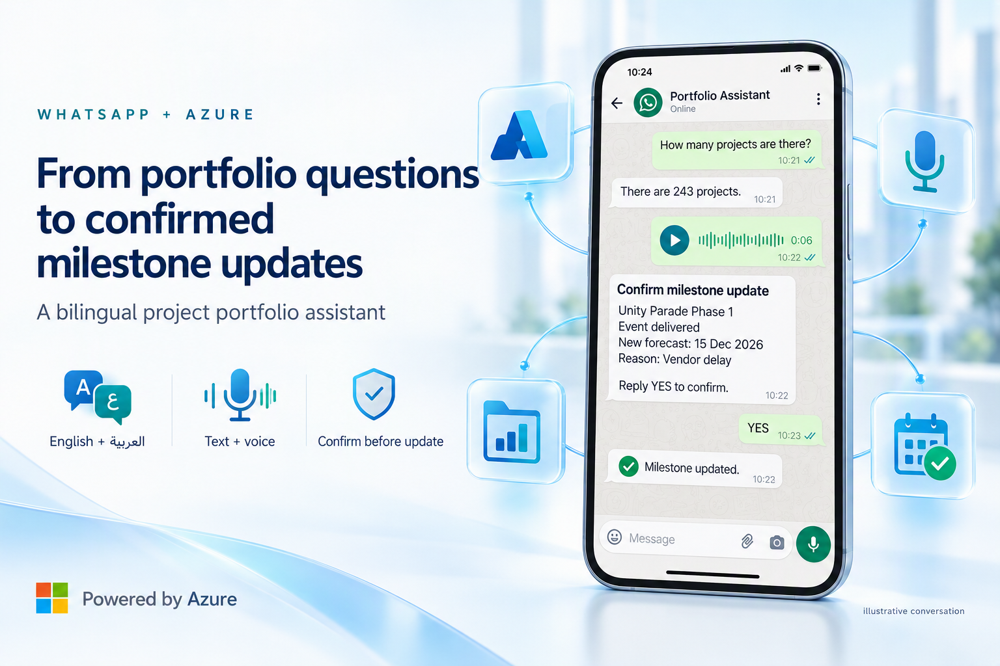
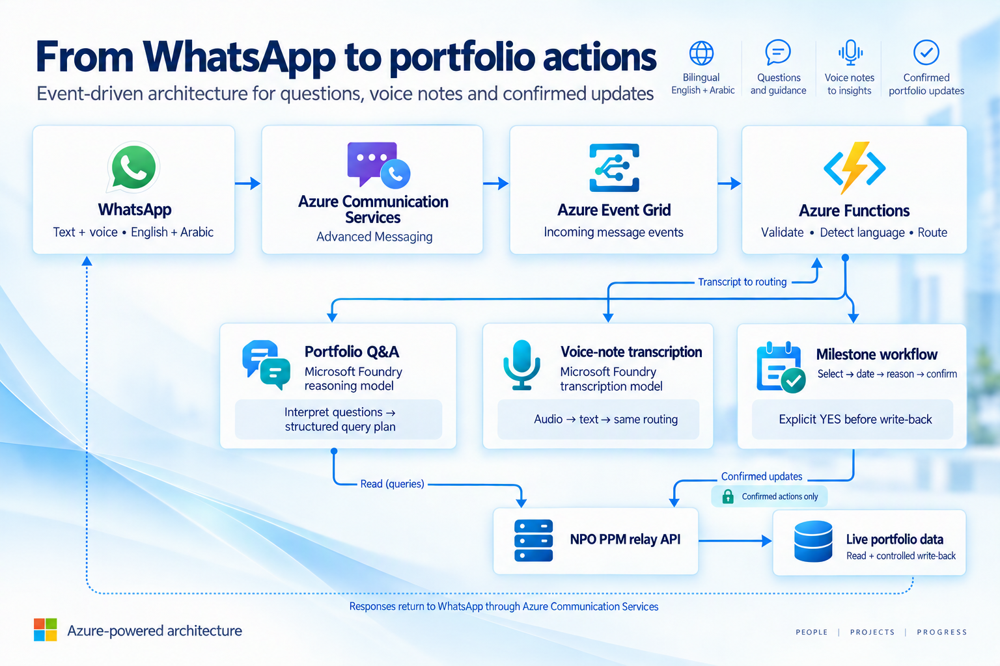
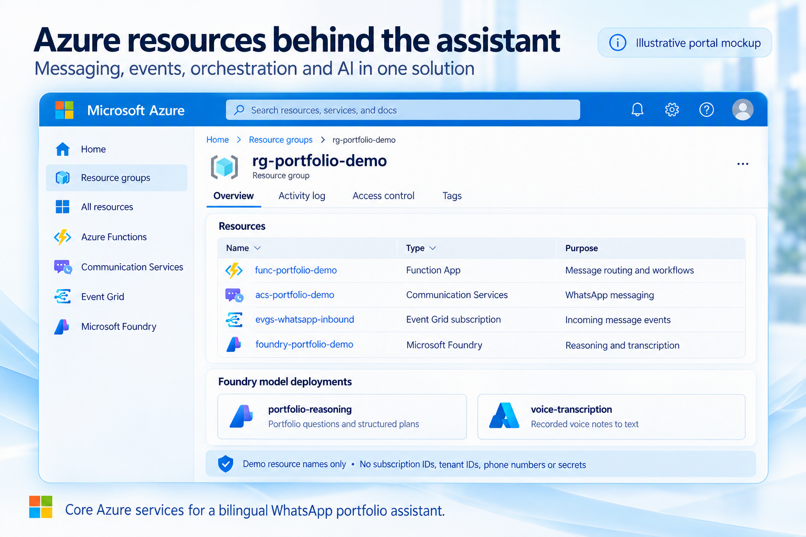
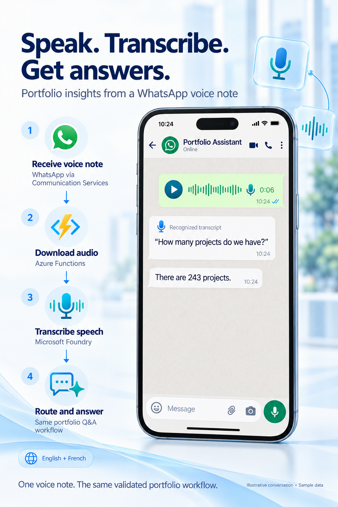
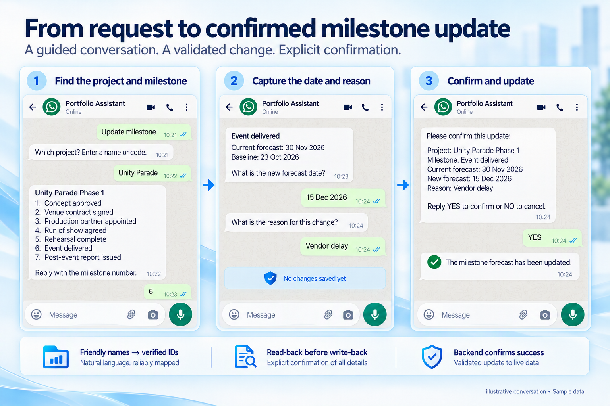
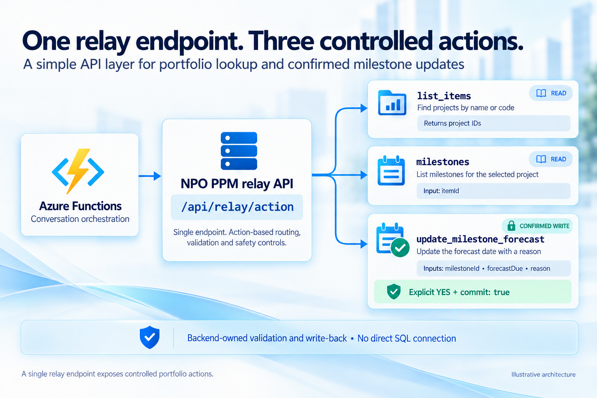
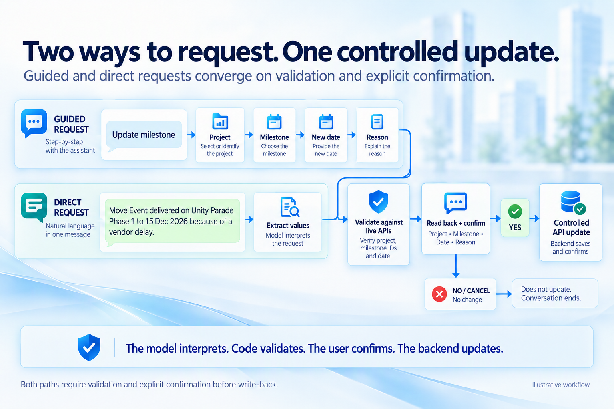
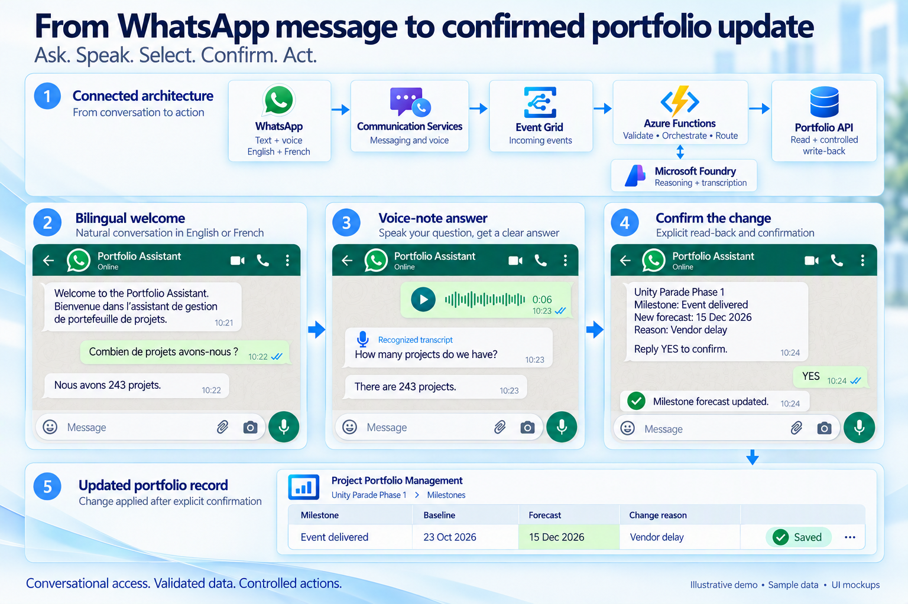

Project teams often need a quick answer or a small operational change without opening another dashboard, finding the correct record, or navigating several screens.

What if they could simply open WhatsApp and ask:

> How many projects are currently in the portfolio?

Or send a voice note:

> Show me the upcoming milestones.

And, when necessary, securely update a milestone through a guided conversation:

```
Update milestone
Unity Parade Phase 1
Event delivered
15 December 2026
Vendor delay
YES
```

That is the experience I explored by building a bilingual Project Portfolio Management assistant using Azure Communication Services, Event Grid, Azure Functions, Microsoft Foundry models, and live NPO PPM APIs.

The result is a working proof of concept that supports:

- English and French conversations
- Typed WhatsApp messages
- WhatsApp voice notes
- Portfolio questions from structured data
- Guided milestone selection
- Forecast-date updates through live APIs
- Explicit confirmation before any write-back



## The problem

Portfolio information often exists across dashboards, reports, structured tables, and operational systems. Accessing it can require several manual steps:

1. Open the portfolio application.
2. Find the correct project.
3. Navigate to its milestones.
4. Locate the milestone record.
5. Check the current forecast date.
6. Enter a new date and reason.
7. Save the change.

That workflow is appropriate when users need a complete view of the portfolio. However, it is inefficient when the user only needs a quick answer or wants to perform one controlled action.

The objective of this proof of concept was not to replace the portfolio application. It was to create a simpler conversational entry point for common interactions while keeping validation and write-back in the existing backend.

## The solution

The assistant uses WhatsApp as its conversational interface and Azure as the integration layer.

```
WhatsApp user
      ↓
Azure Communication Services
      ↓
Azure Event Grid
      ↓
Azure Function
      ├── Text-processing path
      ├── Voice-note transcription path
      ├── Portfolio Q&A path
      └── Milestone-update workflow
              ↓
        NPO PPM relay API
              ↓
          Live backend data
```

Azure Communication Services receives WhatsApp messages, and Event Grid publishes incoming Advanced Messaging events to the Azure Function. Microsoft documents `Microsoft.Communication.AdvancedMessageReceived` as the event emitted when an Advanced Messaging channel receives a message.

The Event Grid payload exposes information such as the message type, textual content, sender details, and media details when a message contains an attachment or audio recording.



## Core Azure services

### Azure Communication Services

Azure Communication Services provides the WhatsApp messaging channel used to receive user messages and send replies.

Incoming messages are delivered through Event Grid events, while outgoing responses are sent through the Advanced Messaging client.

The same messaging flow supports:

- Text questions
- French text
- Voice notes
- Confirmation messages
- Success and error responses

### Azure Event Grid

Event Grid provides the event-driven connection between Azure Communication Services and the Azure Function.

Instead of continuously polling for new WhatsApp messages, the Function is triggered whenever a supported messaging event arrives. This keeps the implementation lightweight and serverless.

### Azure Functions

The Function acts as the orchestration layer. It:

1. Validates the incoming event.
2. Determines whether the message is text or audio.
3. Downloads and transcribes voice notes.
4. Detects the message language.
5. Routes the message to either normal Q&A or the milestone-update workflow.
6. Calls the relevant backend API.
7. Sends the resulting response through WhatsApp.

### Microsoft Foundry models

The implementation uses separate models for separate responsibilities:

- A general reasoning model interprets portfolio questions and produces structured query plans.
- A transcription model converts completed voice-note audio files into text.

Microsoft's transcription guidance distinguishes completed file transcription from real-time streaming transcription. A recorded WhatsApp voice note fits the file-upload transcription pattern.

The transcription endpoint accepts an audio file and returns its text representation. Common supported formats include OGG, WAV, MP3, M4A and WebM.



## Bilingual English and French conversations

The assistant supports English and French without requiring the user to set a permanent language preference.

The first greeting is bilingual:

```
Welcome to the Synapx PPM Assistant.

Bienvenue dans l'assistant de gestion de portefeuille de projets.
```

For every subsequent message, the Function detects the language of the latest text or voice-note transcript. This means a user can switch naturally:

```
User: How many projects are there?
Assistant: There are 243 projects.
```

Then:

```
User: Combien y a-t-il de risques ?
Assistant: Il y a 43 risques.
```

And then switch back to English in the next message.

The language is evaluated for each interaction, so the solution does not need to store a permanent language preference.



## Supporting WhatsApp voice notes

A WhatsApp voice note arrives as a media message rather than a normal text message.

The incoming event contains information similar to:

```json
{
  "messageType": "audio",
  "media": {
    "mimeType": "audio/ogg; codecs=opus",
    "id": "media-id"
  }
}
```

The Function uses the media ID to download the audio from Azure Communication Services. The downloaded OGG/Opus recording is then sent to the transcription model:

```
WhatsApp voice note
        ↓
ACS media ID
        ↓
Azure Function downloads audio
        ↓
Transcription model
        ↓
Text transcript
        ↓
Normal assistant workflow
```

For example, the user can record:

> How many projects do we have?

The assistant returns:

```
🎤 "How many projects do we have?"

There are 243 projects.
```

The same flow works with French voice notes because the transcript is passed through the same language-detection logic as typed text.

## Separating questions from actions

A key design decision was to separate informational questions from operational changes.

### Normal Q&A

Questions such as these continue through the portfolio query path:

```
How many projects are there?
Show high-priority risks.
Give me a portfolio overview.
Which milestones are upcoming?
```

The model turns the question into a structured plan, and deterministic code runs the query against the available data.

### Milestone-update workflow

An update should not be handled like an ordinary question.

The Function checks every message for a milestone-update trigger before sending it into the normal Q&A path. For the proof of concept, the command is intentionally simple:

```
Update milestone
```

This starts a guided workflow.

```
Trigger detected?
    ├─ Yes → Start or continue milestone-update session
    └─ No  → Continue with normal portfolio Q&A
```

This approach avoids depending on a large language model to make an irreversible change directly.

## Guided milestone update

The update flow is deliberately conversational and controlled.

### Step 1: Start the workflow

The user sends:

```
Update milestone
```

The assistant replies:

```
Which project's milestone do you want to update?

Type the project name or code.
```

### Step 2: Identify the project

The user enters:

```
Unity Parade
```

The Function calls the live projects API and matches the user's input to the relevant project record. The backend response provides identifiers such as:

```json
{
  "itemId": 77,
  "code": "PJ103400",
  "nameEn": "Unity Parade Phase 1"
}
```

The user never needs to know or enter `itemId`.

### Step 3: List the milestones

Using the selected project's `itemId`, the Function requests that project's milestones. The assistant presents them as a numbered list:

```
Unity Parade Phase 1

1. Concept approved
2. Venue contract signed
3. Production partner appointed
4. Run of show agreed
5. Rehearsal complete
6. Event delivered
7. Post-event report issued

Reply with the milestone number.
```

The hidden API result still contains the actual milestone identifiers:

```json
{
  "milestoneId": 112,
  "itemId": 77,
  "nameEn": "Event delivered",
  "forecastDue": "2026-11-30",
  "baselineDue": "2026-10-23"
}
```

The assistant preserves that record in the user's temporary session.

### Step 4: Collect the new forecast date

The user selects:

```
6
```

The assistant replies:

```
Event delivered

Current forecast: 2026-11-30
Baseline: 2026-10-23

What is the new forecast date?
```

The user can enter `2026-12-15` or `15 Dec 2026`. The Function converts the submitted value into a consistent `YYYY-MM-DD` format.

### Step 5: Collect a reason

The assistant asks:

```
What is the reason for this change?
```

The user replies:

```
Vendor delay
```

### Step 6: Read the change back

Before calling the update action, the assistant provides a summary:

```
Please confirm this update:

Project: Unity Parade Phase 1
Milestone: Event delivered
Current forecast: 2026-11-30
New forecast: 2026-12-15
Reason: Vendor delay

Reply YES to confirm or NO to cancel.
```

Nothing has been changed at this point.

### Step 7: Call the live update API

Only after the user replies `YES` does the Function call the NPO PPM relay API:

```json
{
  "from": "<WhatsApp user>",
  "action": "update_milestone_forecast",
  "commit": true,
  "input": {
    "milestoneId": 112,
    "forecastDue": "2026-12-15",
    "reason": "Vendor delay"
  }
}
```

The backend performs the actual update and returns a read-back response.

### Step 8: Confirm success

A successful backend response contains the save status and the updated milestone identifier:

```json
{
  "kind": "change",
  "saved": true,
  "status": "done",
  "readBack": {
    "en": "The milestone forecast has been updated.",
    "fr": "La date prévisionnelle du jalon a été mise à jour."
  },
  "result": {
    "milestoneId": 112,
    "changed": true
  }
}
```

The assistant sends the backend's read-back result to the user.



## How the assistant connects friendly names to backend IDs

The user interacts using project and milestone names. The APIs operate using internal identifiers. The Function connects the two through a straightforward lookup process:

```
"Unity Parade"
      ↓
list_items action
      ↓
itemId = 77
      ↓
milestones action with itemId 77
      ↓
"Event delivered"
      ↓
milestoneId = 112
      ↓
update_milestone_forecast action
```

This is an important usability pattern. Users work with recognizable business terms:

- Project name
- Project code
- Milestone name
- Forecast date
- Reason

The integration handles:

- `itemId`
- `milestoneId`
- API action names
- Request structure
- Authentication

## One relay endpoint, three actions

The POC uses one NPO PPM relay endpoint with different action values.

**List projects**

```json
{
  "from": "<WhatsApp user>",
  "action": "list_items",
  "input": {}
}
```

**List milestones for a project**

```json
{
  "from": "<WhatsApp user>",
  "action": "milestones",
  "input": {
    "itemId": 77
  }
}
```

**Update a milestone forecast date**

```json
{
  "from": "<WhatsApp user>",
  "action": "update_milestone_forecast",
  "commit": true,
  "input": {
    "milestoneId": 112,
    "forecastDue": "2026-12-15",
    "reason": "Vendor delay"
  }
}
```

This keeps the Azure Function simple. It does not connect directly to SQL and does not duplicate the backend's business logic.

The recommended pattern is to keep the WhatsApp integration at the agent layer: relay the user's message to NPO PPM, return the backend's response, and let NPO PPM answer from live role-aware data and manage the action and confirmation rules.



## Session management

A milestone update takes place across several WhatsApp messages, so the Function needs to remember the current step. A small in-memory session stores information such as:

```json
{
  "step": "enterReason",
  "project": {
    "itemId": 77,
    "code": "PJ103400",
    "nameEn": "Unity Parade Phase 1"
  },
  "milestone": {
    "milestoneId": 112,
    "nameEn": "Event delivered",
    "forecastDue": "2026-11-30"
  },
  "newDate": "2026-12-15"
}
```

The state progresses through:

```
askProject
    ↓
pickProject
    ↓
pickMilestone
    ↓
enterDate
    ↓
enterReason
    ↓
confirm
    ↓
update
```

For the POC, the session is held in Function memory and expires after ten minutes of inactivity. This is sufficient for a controlled demonstration. For a production implementation, session state should be moved to a durable store such as Azure Cache for Redis, Cosmos DB, or another system already approved for the application.

## Direct requests and guided requests

The assistant can support two interaction styles.

**Guided command**

```
Update milestone
```

This always starts the step-by-step workflow.

**Direct request**

```
Move Event delivered on Unity Parade Phase 1 to 15 Dec 2026 because of a vendor delay.
```

For a direct request, the reasoning model can extract:

```json
{
  "isUpdate": true,
  "project": "Unity Parade Phase 1",
  "milestone": "Event delivered",
  "newDate": "2026-12-15",
  "reason": "Vendor delay"
}
```

The Function still validates those details against the live project and milestone APIs. If every value matches, the assistant moves directly to the confirmation message. If something is missing, it asks only for the missing value.

Crucially, the model does not write to the backend. The model only interprets the request. The verified IDs and explicit `YES` confirmation control the actual update.



## Safety and responsible action design

An assistant that only reads information has a different risk profile from an assistant that changes operational data. The POC therefore uses several safeguards.

**Explicit confirmation.** The update is not committed until the user replies `YES`.

**Read-back before write-back.** The assistant displays the project, milestone, current forecast date, new forecast date, and reason. This gives the user an opportunity to catch mistakes.

**Cancellation.** Users can reply `NO` or `CANCEL`, and nothing is changed.

**Backend-owned write-back.** The Function calls a controlled NPO PPM relay action. It does not connect directly to SQL.

**Secrets outside the code.** API keys and connection strings remain in Function App settings or an approved secret store.

**Safer production logging.** For production or external demonstrations:

- Set `DEBUG = false`.
- Do not log API keys.
- Do not log approval PINs.
- Avoid logging complete message bodies or phone numbers.
- Log event IDs, API status, and action outcomes instead.

Raw debug output should be disabled, phone numbers and message text should not be logged when confidential confirmation data can pass through, and backend replies should be sent without rewriting them.

## Challenges and lessons

**Use the deployment endpoint Azure provides.** The transcription deployment initially returned `DeploymentNotFound` because the Function called the generic v1 audio path instead of the deployment-specific endpoint. Using the exact endpoint displayed by the Foundry deployment resolved the issue.

**Separate IDs from the user experience.** Business users should not need to know `itemId` or `milestoneId`. The assistant should resolve friendly names and codes into internal IDs.

**Keep deterministic operations outside the language model.** The language model is useful for:

- Understanding questions
- Detecting language
- Extracting potential update details
- Formatting readable replies

Plain code and APIs should handle:

- Selecting a numbered option
- Looking up records
- Comparing dates
- Building the update request
- Committing the change

**Require confirmation before actions.** A conversational interface can make operational changes feel deceptively casual. The read-back and explicit confirmation make the change visible and intentional.

**Reuse one conversation pipeline.** Once a voice note has been transcribed, the same routing and business logic can be reused. There is no need to create separate voice and text agents.

## Final result

The completed proof of concept supports:

- ✅ WhatsApp messaging
- ✅ English and French
- ✅ Text and voice-note input
- ✅ Portfolio Q&A
- ✅ Live project lookup
- ✅ Live milestone lookup
- ✅ Guided milestone selection
- ✅ New-date and reason capture
- ✅ Read-back and confirmation
- ✅ Controlled API write-back
- ✅ Success response from the live backend

The most important shift is that the solution is no longer only a chatbot. It can understand a request, map business language to system identifiers, guide the user through a controlled process, and complete a verified action through the existing application APIs.

That is the difference between conversational access and a genuine operational assistant.



## Technology stack

- Azure Communication Services
- Azure Event Grid
- Azure Functions
- Microsoft Foundry
- Azure OpenAI transcription model
- JavaScript / Node.js
- NPO PPM relay APIs
- WhatsApp Business messaging
- Structured portfolio data
- English and French language support

## Closing thought

The value of conversational AI is not simply that users can ask a question in natural language. The greater value appears when the assistant can connect that conversation to validated enterprise data and controlled operational actions.

For this proof of concept, WhatsApp became a lightweight interface to the project portfolio. Users can ask, speak, select, confirm, and act, while the existing backend remains responsible for the data and business operation.

That is a small interaction layer with potentially significant operational value.
