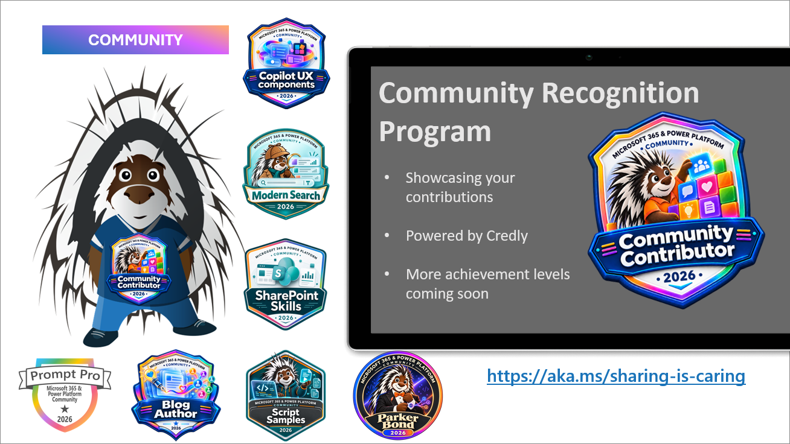

<!--
Weekly refresh model: upcoming calls, full-call recordings, videos, blog posts, events, recognition.
Use the reporting window's publication dates, not the dates of the calls featured in demo clips.
Check Videos and Live on all three linked channels; exclude Shorts and scheduled broadcasts.
List full community calls only under recordings. Use presenter profile links from descriptions when available.
Refresh both linked blog feeds and every event in the CommunityDays upcoming listing, including virtualized rows.
Use the event site's displayed dates, not raw UTC end dates; confirm call dates, time zones and lineups each week.
-->

Join the Microsoft 365, Copilot and Power Platform community for live demos, product updates and questions with presenters. Everyone is welcome, whether you build with no code, low code or code.

[Community calls](#community-calls-this-week) | [Recordings](#latest-community-call-recordings) | [New videos](#new-videos) | [Blog posts](#new-blog-posts) | [Events](#upcoming-events)

## Community calls this week

Download a [recurring community call invite](https://aka.ms/community/calls) and join the conversation. Want to share something you built or learned? [Volunteer for a demo spot](https://aka.ms/community/request/demo).

### Copilot, Microsoft 365 & Power Platform product updates call - 3 November

* **Tuesday, 3 November 2026, 8:00 AM PT / 4:00 PM UTC**
* [Join the call](https://aka.ms/m365-dev-call-join) | [Recurring invite](https://aka.ms/community/ms-speakers-call-invite) | [Recordings](https://www.youtube.com/playlist?list=PLR9nK3mnD-OUQOW86tT5dkCRQAVGY7DlH)

Latest news from Microsoft on Copilot, Microsoft 365 and Power Platform, followed by these demos:

* [Joe Komban](https://www.linkedin.com/in/kjoefrancis/) - Copilot in SharePoint: New Skills Management Experience and Productivity Features
* [Paolo Pialorsi](https://www.linkedin.com/in/paolopialorsi/) - Building Copilot Cowork Skills and Plugins
* [Vesa Juvonen](https://www.linkedin.com/in/vesajuvonen/) - Copilot UX Components: From AI Chat to Interactive Business Applications - Sales Pipeline in Action

### Copilot, Microsoft 365 & Power Platform community call - 5 November

* **Thursday, 5 November 2026, 7:00 AM PT / 3:00 PM UTC**
* [Join the call](https://aka.ms/spdev-sig-call-join) | [Recurring invite](https://aka.ms/community/m365-powerplat-call-invite) | [Recordings](https://www.youtube.com/playlist?list=PLR9nK3mnD-OURfm5Ypu-wK52cxBv_gXCA)

Community demos this week:

* [Vijay Kumar Gilakattula](https://www.linkedin.com/in/g-vijai-kumar/) - Content Rollup aggregate news across SharePoint sites with Microsoft Search
* [Marc André Schröder-Zhou](https://www.linkedin.com/in/dev-schroeder/) - Creating UX component solution to manage approvals directly in Copilot canvas
* [Adam Wójcik](https://www.linkedin.com/in/adam-w%C3%B3jcik-9b7777a6/) - Announcing new and updated PnP Provisioning engine for M365 provisioning automation

Pacific Time changes to standard time on 1 November. The UTC times above reflect that change.

---

## Latest community call recordings

Both full community-call recordings published on [Microsoft Community Learning](https://www.youtube.com/@MicrosoftCommunityLearning/videos) during 23-29 October are listed here. Dates below are publication dates. The 29 October call recording was not yet available when sources were checked.

* [MGCI Community Builders Network Call - October 2026](https://www.youtube.com/watch?v=RCeuhgHjw9E) - published 27 October.
    * MGCI program and subcommittee updates, plus building community through teamwork, with Heather Cook and Isidora Katanić.
* [Copilot, Microsoft 365 & Power Platform weekly call – 27th of October, 2026](https://www.youtube.com/watch?v=28lrWP7mwlI) - published 27 October.
    * Custom plugins for Copilot in SharePoint, the Copilot prompt sample gallery and Copilot Cowork extensibility, with [Joe Komban](https://www.linkedin.com/in/kjoefrancis/), [Rabia Williams](https://www.linkedin.com/in/rabiawilliams/) and [Paolo Pialorsi](https://www.linkedin.com/in/paolopialorsi/).

---

## New videos

Published 23-29 October across all three channels, newest first within each channel. Videos and Live tabs were checked; Shorts and scheduled livestreams are excluded. Full community calls appear only in the recordings section above. Presenter profiles are linked where available.

### Microsoft Community Learning

[Subscribe to Microsoft Community Learning](https://www.youtube.com/@MicrosoftCommunityLearning/videos)

* [Multi-agent patterns in Microsoft Copilot](https://www.youtube.com/watch?v=7YI29LcEWa8) by [Reshmee Auckloo](https://www.linkedin.com/in/reshmee-auckloo-98a23619/) and [Lee Ford](https://www.linkedin.com/in/lee-ford/) - 29 October
* [Live AMA: How AI-powered attacks happen - Real threat scenarios and security controls that stop them](https://www.youtube.com/watch?v=v-miSCeIypo) - 28 October
* [Hosted in your Microsoft 365 tenant, governed by you | Copilot UX components](https://www.youtube.com/watch?v=z1A_yeKBL5Y) - 28 October
* [Join Jeff Teper in Amsterdam for ESPC!](https://www.youtube.com/watch?v=Y2O4t1URA2g) with Jeff Teper - 27 October
* [Building Copilot Components with React – Employee HR Agent Scenario](https://www.youtube.com/watch?v=6Lhb1of3NkA) by [Vesa Juvonen](https://www.linkedin.com/in/vesajuvonen/) - 27 October
* [Explore what's new in Copilot | Mondays at Microsoft (Episode 94)](https://www.youtube.com/watch?v=B1mYO6-lSv8) with Heather Cook, Jonathan Jones and Rachel Solomon Nambi - 27 October
* [Join Karuana Gatimu in Amsterdam for ESPC 2026!](https://www.youtube.com/watch?v=tWK25CvZKFM) with Karuana Gatimu - 27 October
* [Extending Agent Builder with Copilot Connectors](https://www.youtube.com/watch?v=3TvVySc_wEI) by [David Warner](https://www.linkedin.com/in/davidwarnerii/) - 26 October
* [Building a Domain-Specific AI Advisor with Power Automate + SharePoint + External LLM APIs](https://www.youtube.com/watch?v=TG2gJkG686s) by [OluwaMayowa Ogbeide](https://www.linkedin.com/in/oluwamayowa-ogbeide/) - 25 October
* [Setup and use PnP PowerShell with Copilot to manage your tenant without knowing it](https://www.youtube.com/watch?v=98-xzNmaLLM) by [Adam Wójcik](https://www.linkedin.com/in/adam-w%C3%B3jcik-9b7777a6/) - 24 October
* [Latest updates on SharePoint Embedded - What's new](https://www.youtube.com/watch?v=mBqz4odpolU) by [Steve Pucelik](https://www.linkedin.com/in/stevepucelik/) - 23 October

### Power Platform

[Subscribe to Power Platform](https://www.youtube.com/@mspowerplatform/videos)

* [What are people talking about at PPCC26? | LIVE from the Microsoft Community Lounge](https://www.youtube.com/watch?v=8xZCGCwWylQ) with Tatiana and Vandana - 28 October
* [Welcome to PPCC26! | LIVE from the Microsoft Community Lounge](https://www.youtube.com/watch?v=JAIPIQpQ2pY) with Tatiana and Vandana - 27 October
* [From the Theater Stage to a Tech Career | Tiffany Duppong | My Maker Journey](https://www.youtube.com/watch?v=Tb-vvs_andI) with Tiffany Duppong - 27 October
* [From Infrastructure Engineer to Published Author | Manikandan Venkatachalam | My Maker Journey](https://www.youtube.com/watch?v=218Nk8ITSnM) with Manikandan Venkatachalam - 27 October
* [From Neuroscience Major to Tech Consultant | Linda Lee | My Maker Journey](https://www.youtube.com/watch?v=nP78odEqf2U) with Linda Lee - 27 October
* [The Animal Shelter Project That Changed Everything | Nsikan Ikpe | My Maker Journey](https://www.youtube.com/watch?v=Nh6ncrDAOHs) with Nsikan Ikpe - 27 October
* [A 10-Year Career Break, but She Never Stopped Learning | Maryam Umar | My Maker Journey](https://www.youtube.com/watch?v=5y-GNgkovz0) with Maryam Umar - 27 October
* [The Weekend Curiosity That Changed Her Career | Delia Zuniga | My Maker Journey](https://www.youtube.com/watch?v=ofQ-7tQMNiM) with Delia Zuniga - 27 October
* [Dataverse Security via coding agent for IT admins](https://www.youtube.com/watch?v=H4fYxmCWOOA) by Paul Liew - 26 October
* [Prompt Columns: Pre-computed AI insights, ready for every agent](https://www.youtube.com/watch?v=v4N5Zgfz8g4) by Vaishanavi Mirapurkar and Insha Arora - 26 October
* [Low-latency sync for Link to Fabric](https://www.youtube.com/watch?v=Nn9Q-O6vVV0) by Tommy Graham - 26 October
* [Meet the Admins: Stories from the Power Platform Community](https://www.youtube.com/watch?v=NhbwZdeqVvc) - 26 October
* [Meet the Microsoft admins at PPCC26!](https://www.youtube.com/watch?v=u2n4hNPysko) - 23 October
* [Feel The Power at PPCC26!](https://www.youtube.com/watch?v=xyxbyh1nGQs) - 23 October

### Microsoft 365 Developer

[Subscribe to Microsoft 365 Developer](https://www.youtube.com/@Microsoft365Developer/videos)

* [Beyond text: the Copilot UX components Experience - Copilot Dev Camp Summit Fall 2026](https://www.youtube.com/watch?v=OIcv38ZEC-8) by [Paolo Pialorsi](https://www.linkedin.com/in/paolopialorsi/) - 28 October

## New blog posts

Posts published 23-29 October on both blog platforms.

### Microsoft 365 Developer Blog

* [Streamline creation and management of AI-ready, custom apps with SharePoint Embedded](https://devblogs.microsoft.com/microsoft365dev/streamline-creation-and-management-of-ai-ready-custom-apps-with-sharepoint-embedded/) by [Steve Pucelik](https://www.linkedin.com/in/stevepucelik/) - 28 October. Create and manage apps through the new Apps experience in the SharePoint admin center, manage containers and configure billing.
* [Copilot UX components are generally available: bring interactive experiences into Copilot](https://devblogs.microsoft.com/microsoft365dev/copilot-ux-components-are-generally-available-bring-interactive-experiences-into-copilot/) by [Vesa Juvonen](https://www.linkedin.com/in/vesajuvonen/) - 28 October. Bring dashboards, forms and business actions into Copilot with SharePoint Framework 1.24.

### Microsoft 365 and Power Platform Community Blog

* [Weekly Agenda - 26th of October week](https://pnp.github.io/blog/weekly-agenda/26-10-26/) by [Vesa Juvonen](https://github.com/VesaJuvonen/) - 23 October. The previous week's calls and community resources.

---

## Upcoming events

The complete [CommunityDays upcoming event listing](https://www.communitydays.org/events?when=upcoming), checked on 29 October: **38 events**, grouped by month. This includes the Power Platform Community Conference, which is in progress through 30 October. Follow each event link for registration and the latest details.

### October 2026

* [Power Platform Community Conference](https://www.communitydays.org/event/2026-10-27/power-platform-community-conference) - Las Vegas, NV, United States - 27-30 October 2026

### November 2026

* [TechCon 365 Dallas](https://www.communitydays.org/event/2026-11-02/techcon-365-dallas) - Irving, TX, United States - 2-6 November 2026
* [Microsoft 365 Live](https://www.communitydays.org/event/2026-11-04/microsoft-365-live) - Virtual, Colombia - 4-7 November 2026
* [Azure and Github Community Day](https://www.communitydays.org/event/2026-11-10/azure-and-github-community-day) - Dublin, Ireland - 10 November 2026
* [Update Conference Prague 2026](https://www.communitydays.org/event/2026-11-12/update-conference-prague-2026) - Hybrid, Prague, Czechia - 12-13 November 2026
* [AI Community Conference - Toronto 2026](https://www.communitydays.org/event/2026-11-13/ai-community-conference-toronto-2026) - Toronto, Ontario, Canada - 13 November 2026
* [AI Community Conference - Boston 2026](https://www.communitydays.org/event/2026-11-13/ai-community-conference-boston-2026) - Cambridge, MA, United States - 13 November 2026
* [MN M365 17TH BI-ANNUAL FALL WORKSHOP day](https://www.communitydays.org/event/2026-11-13/mn-m365-17th-bi-annual-fall-workshop-day) - Edina, MN, United States - 13 November 2026
* [AI Virtual Days 2026](https://www.communitydays.org/event/2026-11-13/ai-virtual-days-2026) - Virtual, Spain - 13-14 November 2026
* [M365 Community Days Atlanta '26](https://www.communitydays.org/event/2026-11-14/m365-community-days-atlanta-26) - Morrow, GA, United States - 14 November 2026
* [Microsoft Ignite 2026 NYC Community Day](https://www.communitydays.org/event/2026-11-16/microsoft-ignite-2026-nyc-community-day) - New York, NY, United States - 16 November 2026
* [Community Days 2026 - Guadalajara](https://www.communitydays.org/event/2026-11-17/community-days-2026-guadalajara) - Guadalajara, Jalisco, Mexico - 17 November 2026
* [aMP Day Lyon 2026](https://www.communitydays.org/event/2026-11-17/amp-day-lyon-2026) - Lyon, Auvergne-Rhône-Alpe, France - 17 November 2026
* [Community Summit Roadshow Denver](https://www.communitydays.org/event/2026-11-17/community-summit-roadshow-denver) - Denver, CO, United States - 17 November 2026
* [M365 Community Days DC - Microsoft Ignite 2026 Watch Party + Unconference](https://www.communitydays.org/event/2026-11-17/m365-community-days-dc-microsoft-ignite-2026-watch-party-plus-unconference) - Arlington, Virginia, United States - 17 November 2026
* [Power BI & Fabric Barcelona - November 2026](https://www.communitydays.org/event/2026-11-19/power-bi-and-fabric-barcelona-november-2026) - Barcelona, Catalunya, Spain - 19 November 2026
* [AICD - Mumbai](https://www.communitydays.org/event/2026-11-21/aicd-mumbai) - Mumbai, Maharashtra, India - 21 November 2026
* [Boston Code Camp 41](https://www.communitydays.org/event/2026-11-21/boston-code-camp-41) - Burlington, MA, United States - 21 November 2026
* [CollabDays Oslo 2026](https://www.communitydays.org/event/2026-11-23/collabdays-oslo-2026) - Oslo, Norway - 23 November 2026
* [Techbayanihan 2026 Naga City](https://www.communitydays.org/event/2026-11-23/techbayanihan-2026-naga-city) - Naga City, Camarines Sur, Philippines - 23 November 2026
* [.NET Africa Conference 2026](https://www.communitydays.org/event/2026-11-24/dotnet-africa-conference-2026) - Sandton, Gauteng, South Africa - 24-26 November 2026
* [Techbayanihan 2026 Parañaque City](https://www.communitydays.org/event/2026-11-25/techbayanihan-2026-paranaque-city) - Parañaque, Metro Manila, Philippines - 25-26 November 2026
* [Workplace Ninjas India](https://www.communitydays.org/event/2026-11-27/workplace-ninjas-india) - New Delhi, Delhi, India - 27-28 November 2026
* [Dynamics 365 AIERP Summit - Lisbon](https://www.communitydays.org/event/2026-11-27/dynamics-365-aierp-summit-lisbon) - Lisboa, Portugal - 27 November 2026
* [Techbayanihan 2026 Baguio City](https://www.communitydays.org/event/2026-11-28/techbayanihan-2026-baguio-city) - Baguio City, Benguet, Philippines - 28 November 2026
* [ESPC26](https://www.communitydays.org/event/2026-11-30/espc26) - Amsterdam, North Holland, Netherlands - 30 November-3 December 2026

### December 2026

* [Community Summit Roadshow Ft. Lauderdale](https://www.communitydays.org/event/2026-12-01/community-summit-roadshow-ft-lauderdale) - Fort Lauderdale, FL, United States - 1 December 2026
* [Convergence 2026](https://www.communitydays.org/event/2026-12-08/convergence-2026) - Miami Beach, FL, United States - 8-11 December 2026

### January 2027

* [M365 Con 27](https://www.communitydays.org/event/2027-01-11/m365-con-27) - Virtual, Germany - 11-22 January 2027
* [Workplace Ninjas US 2027](https://www.communitydays.org/event/2027-01-11/workplace-ninjas-us-2027) - Scottsdale, AZ, United States - 11-13 January 2027
* [M365 Community Days Montréal #4-2026 – Sans gouvernance, pas d’IA](https://www.communitydays.org/event/2027-01-27/m365-community-days-montreal-hash4-2026-sans-gouvernance-pas-dia) - Montreal, QC, Canada - 27 January 2027

### February 2027

* [Cloud Tech Tallinn 2027](https://www.communitydays.org/event/2027-02-04/cloud-tech-tallinn-2027) - Tallinn, Harjumaa, Estonia - 4-5 February 2027
* [Knoxville Microsoft Community Days](https://www.communitydays.org/event/2027-02-25/knoxville-microsoft-community-days) - Friendsville, TN, United States - 25-26 February 2027

### March 2027

* [FABCON & SQLCON 2027](https://www.communitydays.org/event/2027-03-08/fabcon-and-sqlcon-2027) - Atlanta, GA, United States - 8-12 March 2027
* [AI Agent and Copilot Summit NA 2027](https://www.communitydays.org/event/2027-03-30/ai-agent-and-copilot-summit-na-2027) - Chula Vista, CA, United States - 30 March-1 April 2027

### April 2027

* [M365 Community Days DC 2027](https://www.communitydays.org/event/2027-04-08/m365-community-days-dc-2027) - Arlington, VA, United States - 8-9 April 2027
* [Exchange & Security Summit 2027](https://www.communitydays.org/event/2027-04-13/exchange-and-security-summit-2027) - Frankfurt am Main, Hessen, Germany - 13-14 April 2027

### May 2027

* [Microsoft 365 Community Conference](https://www.communitydays.org/event/2027-05-04/microsoft-365-community-conference) - Las Vegas, NV, United States - 4-6 May 2027

---

## Recognition

Contributed to the community? Opt in to the [community recognition program](https://pnp.github.io/recognitionprogram/) and earn badges for your contributions.

