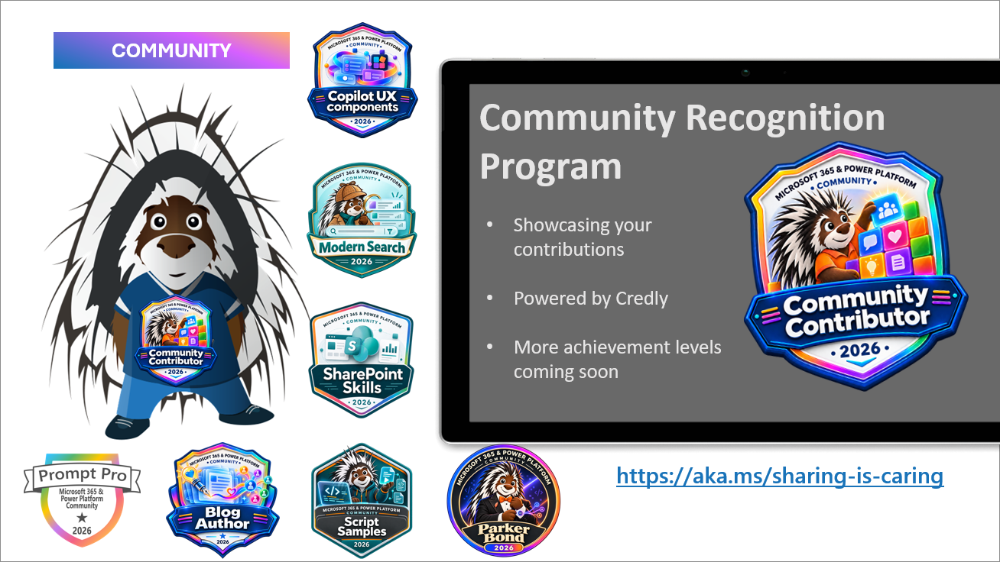

Join the Microsoft 365, Copilot and Power Platform community for live demos, product updates and questions with presenters. Everyone is welcome, whether you build with no code, low code or code.

[Community calls](#community-calls-this-week) | [Recordings](#latest-community-call-recordings) | [New videos](#new-videos) | [Blog posts](#new-blog-posts) | [Events](#upcoming-events)

## Community calls this week

Download a [recurring community call invite](https://aka.ms/community/calls) and join the conversation. Want to share something you built or learned? [Volunteer for a demo spot](https://aka.ms/community/request/demo).

### Copilot, Microsoft 365 & Power Platform product updates call - 10 November

* **Tuesday, 10 November 2026, 8:00 AM PT / 4:00 PM UTC**
* [Join the call](https://aka.ms/m365-dev-call-join) | [Recurring invite](https://aka.ms/community/ms-speakers-call-invite) | [Recordings](https://www.youtube.com/playlist?list=PLR9nK3mnD-OUQOW86tT5dkCRQAVGY7DlH)

Latest news from Microsoft on Copilot, Microsoft 365 and Power Platform, a community together mode group photo, followed by these demos:

* [Nicole Woon](https://www.linkedin.com/in/niwoon/) - Introducing HTML Pages in SharePoint
* [James Eccles](https://www.linkedin.com/in/ecclesjames/) - 10 Things Developers Often Get Wrong About SharePoint Embedded
* [Paolo Pialorsi](https://www.linkedin.com/in/paolopialorsi/) - Building Copilot Cowork Plugins with WIQD

### Copilot, Microsoft 365 & Power Platform community call - 12 November

* **Thursday, 12 November 2026, 7:00 AM PT / 3:00 PM UTC**
* [Join the call](https://aka.ms/spdev-sig-call-join) | [Recurring invite](https://aka.ms/community/m365-powerplat-call-invite) | [Recordings](https://www.youtube.com/playlist?list=PLR9nK3mnD-OURfm5Ypu-wK52cxBv_gXCA)

Latest on SharePoint Framework (SPFx), Copilot prompt of the week, PnPjs, CLI for Microsoft 365, Dev Proxy, Reusable Controls for SPFx, SPFx Toolkit VS Code extension, PnP Search Solution and updates on samples.

Community demos this week:

* [Ejaz Hussain](https://www.linkedin.com/in/hussaine/) - Bringing employee recognition into the Copilot canvas with SPFx Copilot components
* [Kurt Rolland](https://www.linkedin.com/in/krolland/) - Document Intake: filing documents from a Copilot conversation with a Copilot UX component
* Manish Yadav - Creating a Voice Agent using Foundry SDK

---
## Latest community call recordings

Full community-call recordings published during 29 October-5 November (UTC). Dates below are publication dates (UTC). Sources checked on 5 November.

* [Copilot, Microsoft 365 & Power Platform weekly call – 3rd of November, 2026](https://www.youtube.com/watch?v=MKWWqFXorcY) - published 3 November.
    * 📺 Copilot, Microsoft 365 & Power Platform community call on November 3rd 2026. Recap on news and updates from Microsoft, followed with demos typically by Microsoft presenters.
* [Microsoft 365 Champion community call - October 2026](https://www.youtube.com/watch?v=8x01Ht6T1Fo) - published 2 November.
    * Check out our October Microsoft 365 Champion community call to learn more about Copilot in PowerPoint: Brand kit and Skills.
* [Copilot, Microsoft 365 & Power Platform community call – 29th of October, 2026](https://www.youtube.com/watch?v=0faTmbe-pcY) - published 29 October.
    * 📺 Microsoft 365 & Power Platform Community call on October 29th, 2026.
* [Maturity Model for Microsoft 365- Oct 2026 - Modern Compliance in Microsoft 365: Model Perspective](https://www.youtube.com/watch?v=mLk3M359RZ0) - published 29 October.
    * Recording of the public Maturity Model for Microsoft 365 call on October 20th, 2026.

---

## New videos

Published during 29 October-5 November (UTC), newest first within each channel. Shorts and scheduled livestreams are excluded. Full community calls appear only in the recordings section above. Presenter profiles are linked where available.

### Microsoft Community Learning

[Subscribe to Microsoft Community Learning](https://www.youtube.com/@MicrosoftCommunityLearning/videos)

* [Surfacing your business apps in Copilot canvas – AI Project Portfolio Scenario](https://www.youtube.com/watch?v=CAG8ybSr4Ls) by [Vesa Juvonen](https://www.linkedin.com/in/vesajuvonen/) - 5 November
* [Introduction of Microsoft Copilot harness in Copilot Studio](https://www.youtube.com/watch?v=rl_f9WDAd0w) by [Remi Dyon](https://www.linkedin.com/in/remidyon/) - 4 November
* [Build once, deploy across Microsoft 365 tenants | Copilot UX components](https://www.youtube.com/watch?v=w-f85nGfz3E) - 4 November
* [Heather Cook Invites You to ESPC 2026 | Microsoft 365 & AI Community](https://www.youtube.com/watch?v=a1RQmB3m23o) - 3 November
* [Adam Harmetz Invites You to ESPC 2026 | Microsoft 365, Copilot & AI](https://www.youtube.com/watch?v=lL2mopearew) - 3 November
* [Women in Tech at ESPC 2026 | Karuana Gatimu & Heather Cook](https://www.youtube.com/watch?v=ZVKbk_HNqBQ) - 3 November
* [Using Skills in Copilot Studio New Experience](https://www.youtube.com/watch?v=u9Y5kjX-epk) by [Sriram Balaji -](https://www.linkedin.com/in/srirambalaji/) - 3 November
* [Microsoft Ignite 2026 | Join Karuana Gatimu for AI Adoption & Community](https://www.youtube.com/watch?v=IHJk2nGg434) - 2 November
* [Filling seats! How to market your event | MGCI Event Organizer Training - Oct 2026](https://www.youtube.com/watch?v=LKr4pOsYcck) - 2 November
* [Inside AI for the public sector | Mondays at Microsoft (Episode 95)](https://www.youtube.com/watch?v=zBBnjq6Q1h0) - 2 November
* [Build an Enterprise AI Document Summarizer with Azure Blob Storage + Copilot Studio](https://www.youtube.com/watch?v=pZHCSOYg4xc) by [Seena Khan -](https://www.linkedin.com/in/seena-khan-ab1b29123/) - 2 November
* [Bringing the physical world to Copilot Studio](https://www.youtube.com/watch?v=_19ZmbVi6WQ) by [Ed Williams -](https://www.linkedin.com/in/automatethemundane/) - 1 November
* [Building a Bookmark Hub solution with SPFx for easy information tracking](https://www.youtube.com/watch?v=Kepu27ga19A) by [Saurabh Tripathi -](https://www.linkedin.com/in/saurabh-k-tripathi/), [Nico De Cleyre -](https://www.linkedin.com/in/nicodecleyre/) and [Adam Wójcik -](https://www.linkedin.com/in/adam-w%C3%B3jcik-9b7777a6/) - 31 October
* [How to get Usage metrics from the Power Platform Admin Center](https://www.youtube.com/watch?v=LDxPmyeT_fw) by [Nathalie Leenders -](https://www.linkedin.com/in/nathalie-leenders-8853871b/) - 30 October

### Power Platform

[Subscribe to Power Platform](https://www.youtube.com/@mspowerplatform/videos)

* [Power Platform admin plugin for Copilot Cowork | EP05 | Agents Under Control](https://www.youtube.com/watch?v=YjXZ3MO843Y) - 4 November
* [What actually mattered at PPCC26? | LIVE from the Microsoft Community Lounge](https://www.youtube.com/watch?v=w1AUmUdI4-g) - 29 October

### Microsoft 365 Developer

[Subscribe to Microsoft 365 Developer](https://www.youtube.com/@Microsoft365Developer/videos)

* [Declarative Agents unleashed: What's New, What's Next - Copilot Dev Camp Summit Fall 2026](https://www.youtube.com/watch?v=wyUHnWVr_nY) - 3 November

## New blog posts

Posts published during 29 October-5 November (UTC) on both blog platforms.

### Microsoft 365 Developer Blog

* [Deprecation notice: Low-trust SharePoint add-ins in SharePoint Server Subscription Edition](https://devblogs.microsoft.com/microsoft365dev/deprecation-notice-low-trust-sharepoint-add-ins-in-sharepoint-server-subscription-edition/) by SharePoint team - 4 November. Support for low-trust SharePoint Add-ins in SharePoint Server Subscription Edition ends on January 12, 2027. The January 2027 public update will disable these add-ins by default. Organizations should identify affected solutions and plan their migration to supported alternatives, such as SharePoint Framework (SPFx). SharePoint REST, CSOM, and JSOM APIs are not affected.
* [Your voice shapes SPFx: take our developer survey](https://devblogs.microsoft.com/microsoft365dev/your-voice-shapes-spfx-take-our-developer-survey/) by Vesa Juvonen - 4 November. Help shape the future of SPFx. Share your developer experience in our survey, open until December 9, 2026, and help guide future investments. Explore highlights from a year of updates, including Copilot UX components, and discover what’s next on the roadmap and how to get involved in the community.
* [Your app needs documents. Do you really want to build a document platform?](https://devblogs.microsoft.com/microsoft365dev/your-app-needs-documents-do-you-really-want-to-build-a-document-platform/) by Steve Pucelik - 3 November. File storage is rarely just file storage. Imagine your team is building a contract management application. At first, the document requirement looks straightforward: upload a file, organize it, retrieve it, and let the right people open it. Then the real requirements from your customer, security, and operations teams arrive, and the scope quickly expands to

### Microsoft 365 and Power Platform Community Blog

* [CLI for Microsoft 365 v12.0](https://pnp.github.io/blog/cli-for-microsoft-365/cli-for-microsoft-365-v12-0/) by [Jasey Waegebaert](https://github.com/jwaegebaert/) - 2 November. We’re excited to announce CLI for Microsoft 365 v12.0, a new major release that brings support for SharePoint Framework v1.
* [Weekly Agenda - 2nd of November week](https://pnp.github.io/blog/weekly-agenda/26-11-02/) by [Vesa Juvonen](https://github.com/VesaJuvonen/) - 30 October. Join the Microsoft 365, Copilot and Power Platform community for live demos, product updates and questions with presenters.

---

## Upcoming events

[CommunityDays upcoming event listing](https://www.communitydays.org/events?when=upcoming), checked on 5 November: **38 events**, grouped by month. Follow each event link for registration and the latest details.

### November 2026

* [TechCon 365 Dallas](https://communitydays.org/event/2026-11-02/techcon-365-dallas) - Irving, TX, United States - 2-7 November 2026
* [Microsoft 365 Live](https://communitydays.org/event/2026-11-04/microsoft-365-live) - Virtual · Colombia - 4-8 November 2026
* [Azure and Github Community Day](https://communitydays.org/event/2026-11-10/azure-and-github-community-day) - Dublin, Ireland, Ireland - 10 November 2026
* [Update Conference Prague 2026](https://communitydays.org/event/2026-11-12/update-conference-prague-2026) - Hybrid · Prague, Czechia - 12-13 November 2026
* [AI Community Conference - Toronto 2026](https://communitydays.org/event/2026-11-13/ai-community-conference-toronto-2026) - Toronto, Ontario, Canada - 13 November 2026
* [MN M365 17TH BI-ANNUAL FALL WORKSHOP day](https://communitydays.org/event/2026-11-13/mn-m365-17th-bi-annual-fall-workshop-day) - Edina, MN, United States - 13 November 2026
* [AI Community Conference - Boston 2026](https://communitydays.org/event/2026-11-13/ai-community-conference-boston-2026) - Cambridge, MA, United States - 13 November 2026
* [AI Virtual Days 2026](https://communitydays.org/event/2026-11-13/ai-virtual-days-2026) - Virtual · Spain - 13-14 November 2026
* [M365 Community Days Atlanta '26](https://communitydays.org/event/2026-11-14/m365-community-days-atlanta-26) - Morrow, GA, United States - 14 November 2026
* [Microsoft Ignite 2026 NYC Community Day](https://communitydays.org/event/2026-11-16/microsoft-ignite-2026-nyc-community-day) - New York, NY, United States - 16 November 2026
* [Community Days 2026 - Guadalajara](https://communitydays.org/event/2026-11-17/community-days-2026-guadalajara) - Guadalajara, Jalisco, Mexico - 17 November 2026
* [aMP Day Lyon 2026](https://communitydays.org/event/2026-11-17/amp-day-lyon-2026) - Lyon, Auvergne-Rhône-Alpe, France - 17 November 2026
* [Community Summit Roadshow Denver](https://communitydays.org/event/2026-11-17/community-summit-roadshow-denver) - Denver, CO, United States - 17-18 November 2026
* [M365 Community Days DC - Microsoft Ignite 2026 Watch Party + Unconference](https://communitydays.org/event/2026-11-17/m365-community-days-dc-microsoft-ignite-2026-watch-party-plus-unconference) - Arlington, Virginia, United States - 17 November 2026
* [Power BI & Fabric Barcelona - November 2026](https://communitydays.org/event/2026-11-19/power-bi-and-fabric-barcelona-november-2026) - Barcelona, Catalunya, Spain - 19 November 2026
* [AICD - Mumbai](https://communitydays.org/event/2026-11-21/aicd-mumbai) - Mumbai, Maharashtra, India - 21 November 2026
* [Boston Code Camp 41](https://communitydays.org/event/2026-11-21/boston-code-camp-41) - Burlington, MA, United States - 21 November 2026
* [CollabDays Oslo 2026](https://communitydays.org/event/2026-11-23/collabdays-oslo-2026) - Oslo, Norway - 23 November 2026
* [Techbayanihan 2026 Naga City](https://communitydays.org/event/2026-11-23/techbayanihan-2026-naga-city) - Naga City, Camarines Sur, Philippines - 23 November 2026
* [.NET Africa Conference 2026](https://communitydays.org/event/2026-11-24/dotnet-africa-conference-2026) - Sandton, Gauteng, South Africa - 24-26 November 2026
* [Techbayanihan 2026 Parañaque City](https://communitydays.org/event/2026-11-25/techbayanihan-2026-paranaque-city) - Parañaque, Metro Manila, Philippines - 25-26 November 2026
* [Workplace Ninjas India](https://communitydays.org/event/2026-11-27/workplace-ninjas-india) - New Delhi, Delhi, India - 27-28 November 2026
* [Dynamics 365 AIERP Summit - Lisbon](https://communitydays.org/event/2026-11-27/dynamics-365-aierp-summit-lisbon) - Lisboa, Portugal - 27 November 2026
* [Techbayanihan 2026 Baguio City](https://communitydays.org/event/2026-11-28/techbayanihan-2026-baguio-city) - Baguio City, Benguet, Philippines - 28 November 2026
* [ESPC26](https://communitydays.org/event/2026-11-30/espc26) - Amsterdam, North Holland, Netherlands - 30 November-3 December 2026

### December 2026

* [Community Summit Roadshow Ft. Lauderdale](https://communitydays.org/event/2026-12-01/community-summit-roadshow-ft-lauderdale) - Fort Lauderdale, FL, United States - 1 December 2026
* [Convergence 2026](https://communitydays.org/event/2026-12-08/convergence-2026) - Miami Beach, FL, United States - 9-11 December 2026

### January 2027

* [M365 Con 27](https://communitydays.org/event/2027-01-11/m365-con-27) - Virtual · Stuttgart, Germany - 11-22 January 2027
* [Workplace Ninjas US 2027](https://communitydays.org/event/2027-01-11/workplace-ninjas-us-2027) - Scottsdale, AZ, United States - 11-14 January 2027
* [M365 Community Days Montréal #4-2026 – Sans gouvernance, pas d’IA](https://communitydays.org/event/2027-01-27/m365-community-days-montreal-hash4-2026-sans-gouvernance-pas-dia) - Montreal, QC, Canada - 27 January 2027

### February 2027

* [Cloud Tech Tallinn 2027](https://communitydays.org/event/2027-02-04/cloud-tech-tallinn-2027) - Tallinn, Harjumaa, Estonia - 4-5 February 2027
* [Knoxville Microsoft Community Days](https://communitydays.org/event/2027-02-25/knoxville-microsoft-community-days) - Friendsville, TN, United States - 25-27 February 2027

### March 2027

* [FABCON & SQLCON 2027](https://communitydays.org/event/2027-03-08/fabcon-and-sqlcon-2027) - Atlanta, GA, United States - 8-12 March 2027
* [AI Agent and Copilot Summit NA 2027](https://communitydays.org/event/2027-03-30/ai-agent-and-copilot-summit-na-2027) - Chula Vista, CA, United States - 30 March-2 April 2027

### April 2027

* [M365 Community Days DC 2027](https://communitydays.org/event/2027-04-08/m365-community-days-dc-2027) - Arlington, VA, United States - 8-9 April 2027
* [Exchange & Security Summit 2027](https://communitydays.org/event/2027-04-13/exchange-and-security-summit-2027) - Frankfurt am Main, Hessen, Germany - 13-14 April 2027

### May 2027

* [Microsoft 365 Community Conference](https://communitydays.org/event/2027-05-04/microsoft-365-community-conference) - Las Vegas, NV, United States - 4-7 May 2027

### September 2027

* [TECHCON, DATACON & PWRCON](https://communitydays.org/event/2027-09-13/techcon-datacon-and-pwrcon) - Atlanta, GA, United States - 13-17 September 2027

---

## Recognition

Contributed to the community? Opt in to the [community recognition program](https://pnp.github.io/recognitionprogram/) and earn badges for your contributions.

