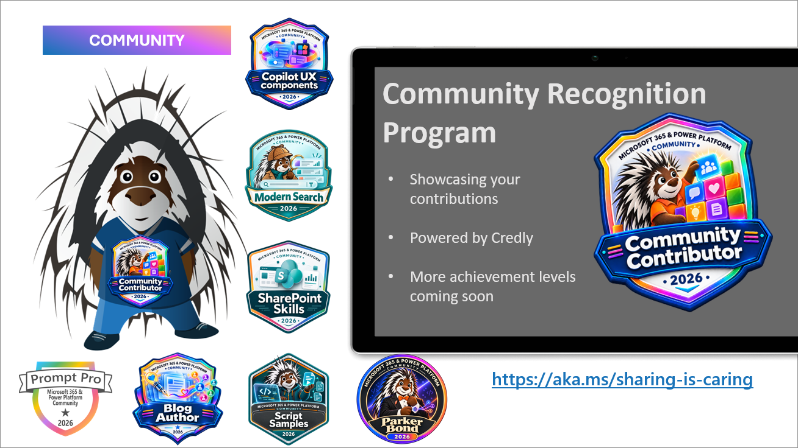

Join the Microsoft 365, Copilot and Power Platform community for live demos, product updates and questions with presenters. Everyone is welcome, whether you build with no code, low code or code.

[Community calls](#community-calls-this-week) | [Recordings](#latest-community-call-recordings) | [New videos](#new-videos) | [Blog posts](#new-blog-posts) | [Events](#upcoming-events)

## Community calls this week

Download a [recurring community call invite](https://aka.ms/community/calls) and join the conversation. Want to share something you built or learned? [Volunteer for a demo spot](https://aka.ms/community/request/demo).

### Copilot, Microsoft 365 & Power Platform product updates call - 17 November

* **Tuesday, 17 November 2026, 8:00 AM PT / 4:00 PM UTC**
* [Join the call](https://aka.ms/m365-dev-call-join) | [Recurring invite](https://aka.ms/community/ms-speakers-call-invite) | [Recordings](https://www.youtube.com/playlist?list=PLR9nK3mnD-OUQOW86tT5dkCRQAVGY7DlH)

Latest news from Microsoft on Copilot, Microsoft 365 and Power Platform, a community together mode group photo, followed by these demos:

* [Nicole Woon](https://www.linkedin.com/in/niwoon/) - Getting started with HTML pages in SharePoint: Create, edit and publish
* [Joe Komban](https://www.linkedin.com/in/kjoefrancis/) - Copilot in SharePoint: New Skills Management Experience

### Copilot Studio & Power Platform community call - 18 November

* **Wednesday, 18 November 2026, 8:00 AM PT / 4:00 PM UTC**
* [Recurring invite](https://aka.ms/powerplatformcommunitycall) | [Recordings](https://www.youtube.com/@mspowerplatform)

Community updates on Power Platform news, updates & events and samples, followed by these demos:

* [Heather Zigli](https://www.linkedin.com/in/heatherzigli/) - Missing your Repeating Rows from InfoPath? Give Power Apps and the Modern Data Grid Control a Try!
* [Radhika Prasad](https://www.linkedin.com/in/radhika-prasad/) - Spreadsheets to Dataverse: A Field App Demo
* [Matt LaCasse](https://www.linkedin.com/in/matt-lacasse/) - A table-driven approach to business rules in Power Apps

### Copilot, Microsoft 365 & Power Platform community call - 19 November

* **Thursday, 19 November 2026, 7:00 AM PT / 3:00 PM UTC**
* [Join the call](https://aka.ms/spdev-sig-call-join) | [Recurring invite](https://aka.ms/community/m365-powerplat-call-invite) | [Recordings](https://www.youtube.com/playlist?list=PLR9nK3mnD-OURfm5Ypu-wK52cxBv_gXCA)

Latest on Copilot prompt of the week, CommunityDays.org update, Microsoft 365 Maturity model, PnP Framework and Core SDK extension, PnP PowerShell, script samples, Copilot pro dev samples, Power Platform samples and updates on samples.

Community demos this week:

* [Siddharth Vaghasia](https://www.linkedin.com/in/siddharthvaghasia/) - SPFx Extension for Contextual Live Dashboards in SharePoint Lists and Libraries
* [Marc André Schröder-Zhou](https://www.linkedin.com/in/dev-schroeder/) - SharePoint Alerts reborn - a custom SharePoint Notification Service

---
## Latest community call recordings

Full community-call recordings published during 6 November-13 November (UTC). Dates below are publication dates (UTC).

* [Copilot, Microsoft 365 & Power Platform community call – 12th of November, 2026 1 hour,](https://www.youtube.com/watch?v=4UyBb0h1Hgs) - published 13 November.
* [Copilot Extensibility Community Call - November 11th, 2026](https://www.youtube.com/watch?v=oW_U0EgUeho) - published 12 November.
* [Copilot, Microsoft 365 & Power Platform weekly call – 10th of November, 2026](https://www.youtube.com/watch?v=sDJaEJTMVUY) - published 11 November.

---

## New videos

Full community calls appear only in the recordings section above. Presenter profiles are linked where available.

### Microsoft Community Learning

[Subscribe to Microsoft Community Learning](https://www.youtube.com/@MicrosoftCommunityLearning/videos)

* [Less scrolling, more memories: Exploring Microsoft Photos | Sync Up Podcast: November 2026](https://www.youtube.com/watch?v=QGE0rrcNIXc) - 12 November
* [Creating Copilot Components with SPFx - How does that actually work?](https://www.youtube.com/watch?v=N_3IxobIKjk) by [Vesa Juvonen](https://www.linkedin.com/in/vesajuvonen/) - 12 November
* [Learn the new Microsoft Copilot Harness in Copilot Studio with Agent Academy](https://www.youtube.com/watch?v=F3aCpDeoDBM) by [Scott Durow](https://www.linkedin.com/in/scottdurow/) - 11 November
* [Bring your business apps into Microsoft Copilot | Copilot UX components](https://www.youtube.com/watch?v=KljwhoGbm5E) - 11 November
* [Copilot UX Components in Action: Transform Your Deal-Making Process](https://www.youtube.com/watch?v=WD94I1hfdYA) by [Vesa Juvonen](https://www.linkedin.com/in/vesajuvonen/) - 10 November
* [Building Skills in the new Copilot Studio experience](https://www.youtube.com/watch?v=BBpwXlXN-aI) by [Remi Dyon](https://www.linkedin.com/in/remidyon/) - 10 November
* [First Fridays AI for Communicators: Behind the Scenes Microsoft's Town Halls](https://www.youtube.com/watch?v=4Kq30dYW1b8) - 9 November
* [Understanding Copilot Credits in Copilot Cowork and Work IQ](https://www.youtube.com/watch?v=Ho9IKsVnkVQ) by [Kevin Ly](https://www.linkedin.com/in/kevin-ly-21906b32/) - 9 November
* [Ask Copilot how your agents are being used - Introduction to Insights Agent](https://www.youtube.com/watch?v=kqXkxGL8mec) by [Fabian Williams -](https://www.linkedin.com/in/fabiangwilliams/) - 8 November
* [Supporting WebMCP within an SPFx extension](https://www.youtube.com/watch?v=A1FOT8UYRCg) by [Elio Struyf](https://www.linkedin.com/in/estruyf/) - 7 November
* [Sometimes a Little Code Saves a Hundred-Step Flow in Power Automate](https://www.youtube.com/watch?v=4WLDoG4tJiw) by [Ian Tweedie](https://www.linkedin.com/in/iantweedie/) - 6 November

### Power Platform

[Subscribe to Power Platform](https://www.youtube.com/@mspowerplatform/videos)

* [Real stories of Power Platform success across the world | Keeping It Real](https://www.youtube.com/watch?v=J8eIl-8QbzY) - 12 November
* [Automate with Workflows | EP07 | Agent Academy Recruit NextGen](https://www.youtube.com/watch?v=r8dx48DnCvI) - 10 November

### Microsoft 365 Developer

[Subscribe to Microsoft 365 Developer](https://www.youtube.com/@Microsoft365Developer/videos)

* [Work IQ: SharePoint MCP Tools](https://www.youtube.com/watch?v=9RN7lsKIbc0) - 6 November

## New blog posts

Posts published during 6 November-13 November (UTC) on both blog platforms.

### Microsoft 365 Developer Blog

* [Make business content ready for AI with M-Files – SharePoint Embedded partner spotlight](https://devblogs.microsoft.com/microsoft365dev/make-business-content-ready-for-ai-with-m-files-sharepoint-embedded-partner-spotlight/) by Steve Pucelik - 11 November
* [Work IQ: SharePoint Tools](https://devblogs.microsoft.com/microsoft365dev/work-iq-sharepoint-mcp-tools/) by Paolo Pialorsi - 6 November

### Microsoft 365 and Power Platform Community Blog

* [Who keeps the judgment when AI carries the rules? Microsoft HVE Core in practice](https://pnp.github.io/blog/post/microsoft-hve-core-governed-agentic-engineering/) by [Arindam Choudhury](https://github.com/ari20089/) - 6 November

---

## Upcoming events

[CommunityDays upcoming event listing](https://www.communitydays.org/events?when=upcoming) from Monday, 16 November 2026, grouped by month.

### November 2026

* [Microsoft Ignite 2026 NYC Community Day](https://communitydays.org/event/2026-11-16/microsoft-ignite-2026-nyc-community-day) - New York, NY, United States - 16 November 2026
* [Community Days 2026 - Guadalajara](https://communitydays.org/event/2026-11-17/community-days-2026-guadalajara) - Guadalajara, Jalisco, Mexico - 17 November 2026
* [aMP Day Lyon 2026](https://communitydays.org/event/2026-11-17/amp-day-lyon-2026) - Lyon, Auvergne-Rhône-Alpe, France - 17 November 2026
* [Community Summit Roadshow Denver](https://communitydays.org/event/2026-11-17/community-summit-roadshow-denver) - Denver, CO, United States - 17-18 November 2026
* [M365 Community Days DC - Microsoft Ignite 2026 Watch Party + Unconference](https://communitydays.org/event/2026-11-17/m365-community-days-dc-microsoft-ignite-2026-watch-party-plus-unconference) - Arlington, Virginia, United States - 17 November 2026
* [Power BI & Fabric Barcelona - November 2026](https://communitydays.org/event/2026-11-19/power-bi-and-fabric-barcelona-november-2026) - Barcelona, Catalunya, Spain - 19 November 2026
* [AICD - Mumbai](https://communitydays.org/event/2026-11-21/aicd-mumbai) - Mumbai, Maharashtra, India - 21 November 2026
* [Boston Code Camp 41](https://communitydays.org/event/2026-11-21/boston-code-camp-41) - Burlington, MA, United States - 21 November 2026
* [CollabDays Oslo 2026](https://communitydays.org/event/2026-11-23/collabdays-oslo-2026) - Oslo, Norway - 23 November 2026
* [Techbayanihan 2026 Naga City](https://communitydays.org/event/2026-11-23/techbayanihan-2026-naga-city) - Naga City, Camarines Sur, Philippines - 23 November 2026
* [SmartCloud 365 - 2026](https://communitydays.org/event/2026-11-24/smartcloud-365-2026) - Virtual · Germany - 24 November 2026
* [.NET Africa Conference 2026](https://communitydays.org/event/2026-11-24/dotnet-africa-conference-2026) - Sandton, Gauteng, South Africa - 24-25 November 2026
* [Techbayanihan 2026 Parañaque City](https://communitydays.org/event/2026-11-25/techbayanihan-2026-paranaque-city) - Parañaque, Metro Manila, Philippines - 25-26 November 2026
* [Workplace Ninjas India](https://communitydays.org/event/2026-11-27/workplace-ninjas-india) - New Delhi, Delhi, India - 27-28 November 2026
* [Dynamics 365 AIERP Summit - Lisbon](https://communitydays.org/event/2026-11-27/dynamics-365-aierp-summit-lisbon) - Lisboa, Portugal - 27 November 2026
* [Techbayanihan 2026 Baguio City](https://communitydays.org/event/2026-11-28/techbayanihan-2026-baguio-city) - Baguio City, Benguet, Philippines - 28 November 2026
* [ESPC26](https://communitydays.org/event/2026-11-30/espc26) - Amsterdam, North Holland, Netherlands - 30 November-3 December 2026

### December 2026

* [Community Summit Roadshow Miami](https://communitydays.org/event/2026-12-01/community-summit-roadshow-miami) - Miami, FL, United States - 1 December 2026
* [Convergence 2026](https://communitydays.org/event/2026-12-08/convergence-2026) - Miami Beach, FL, United States - 9-11 December 2026

### January 2027

* [M365 Con 27](https://communitydays.org/event/2027-01-11/m365-con-27) - Virtual · Stuttgart, Germany - 11-22 January 2027
* [Workplace Ninjas US 2027](https://communitydays.org/event/2027-01-11/workplace-ninjas-us-2027) - Scottsdale, AZ, United States - 11-14 January 2027
* [M365 Community Days Montréal #4-2026 – Sans gouvernance, pas d’IA](https://communitydays.org/event/2027-01-27/m365-community-days-montreal-hash4-2026-sans-gouvernance-pas-dia) - Montreal, QC, Canada - 27 January 2027

### February 2027

* [Cloud Tech Tallinn 2027](https://communitydays.org/event/2027-02-04/cloud-tech-tallinn-2027) - Tallinn, Harjumaa, Estonia - 4-5 February 2027
* [Knoxville Microsoft Community Days](https://communitydays.org/event/2027-02-25/knoxville-microsoft-community-days) - Friendsville, TN, United States - 25-27 February 2027

### March 2027

* [Global AI Bootcamp - Valencia](https://communitydays.org/event/2027-03-06/global-ai-bootcamp-valencia) - València, Comunidad Valenciana, Spain - 6 March 2027
* [FABCON & SQLCON 2027](https://communitydays.org/event/2027-03-08/fabcon-and-sqlcon-2027) - Atlanta, GA, United States - 8-12 March 2027
* [AI Agent and Copilot Summit NA 2027](https://communitydays.org/event/2027-03-30/ai-agent-and-copilot-summit-na-2027) - Chula Vista, CA, United States - 30 March-2 April 2027

### April 2027

* [M365 Community Days DC 2027](https://communitydays.org/event/2027-04-08/m365-community-days-dc-2027) - Arlington, VA, United States - 8-9 April 2027
* [Exchange & Security Summit 2027](https://communitydays.org/event/2027-04-13/exchange-and-security-summit-2027) - Frankfurt am Main, Hessen, Germany - 13-14 April 2027
* [D365UG SWEDEN ANVÄNDARFÖRENINGSMÖTE](https://communitydays.org/event/2027-04-21/d365ug-sweden-anvandarforeningsmote) - Solna, Stockholms län, Sweden - 21 April 2027

### May 2027

* [Microsoft 365 Community Conference](https://communitydays.org/event/2027-05-04/microsoft-365-community-conference) - Las Vegas, NV, United States - 4-7 May 2027

### September 2027

* [TECHCON, DATACON & PWRCON](https://communitydays.org/event/2027-09-13/techcon-datacon-and-pwrcon) - Atlanta, GA, United States - 13-17 September 2027

---

## Recognition

Contributed to the community? Opt in to the [community recognition program](https://pnp.github.io/recognitionprogram/) and earn badges for your contributions.

