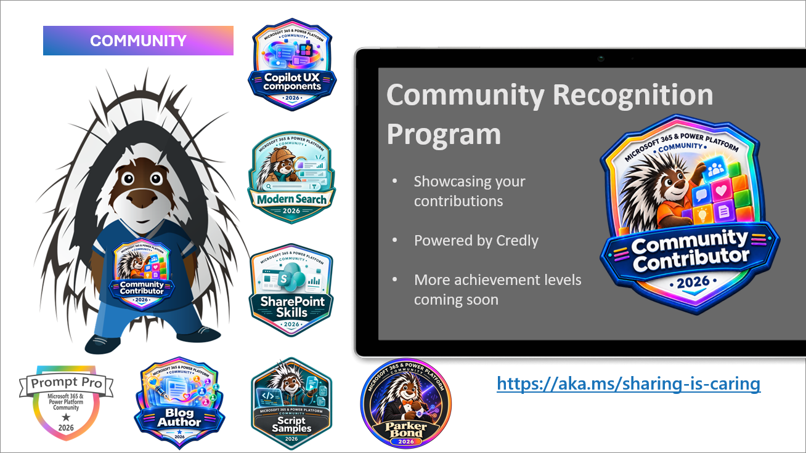

Join the Microsoft 365, Copilot and Power Platform community for live demos, product updates and questions with presenters. Everyone is welcome, whether you build with no code, low code or code.

[Community calls](#community-calls-this-week) | [Recordings](#latest-community-call-recordings) | [New videos](#new-videos) | [Blog posts](#new-blog-posts) | [Events](#upcoming-events)

## Community calls this week

Download a [recurring community call invite](https://aka.ms/community/calls) and join the conversation. Want to share something you built or learned? [Volunteer for a demo spot](https://aka.ms/community/request/demo).

### Copilot, Microsoft 365 & Power Platform product updates call - 24 November

* **Tuesday, 24 November 2026, 8:00 AM PT / 4:00 PM UTC**
* [Join the call](https://aka.ms/m365-dev-call-join) | [Recurring invite](https://aka.ms/community/ms-speakers-call-invite) | [Recordings](https://www.youtube.com/playlist?list=PLR9nK3mnD-OUQOW86tT5dkCRQAVGY7DlH)

Latest news from Microsoft on Copilot, Microsoft 365 and Power Platform, a community together mode group photo, followed by these demos:

* [Nicole Woon](https://www.linkedin.com/in/niwoon/) - Advance considerations with HTML pages in SharePoint
* [Vesa Juvonen](https://www.linkedin.com/in/vesajuvonen/) - UX in Copilot - Reuse same components across Microsoft 365 - implement once - use it everywhere

### Copilot, Microsoft 365 & Power Platform community call - 26 November

* **Thursday, 26 November 2026, 7:00 AM PT / 3:00 PM UTC**
* [Join the call](https://aka.ms/spdev-sig-call-join) | [Recurring invite](https://aka.ms/community/m365-powerplat-call-invite) | [Recordings](https://www.youtube.com/playlist?list=PLR9nK3mnD-OURfm5Ypu-wK52cxBv_gXCA)

Latest on SharePoint Framework (SPFx), Copilot prompt of the week, PnPjs, CLI for Microsoft 365, Dev Proxy, Reusable Controls for SPFx, SPFx Toolkit VS Code extension, PnP Search Solution and updates on samples.

Community demos this week:

* [Mohammed Hamed](https://www.linkedin.com/in/mohammed-hamed-89398913/) - The Self-Healing Voice Agent: When AI Detects a Broken Customer Journey
* [Harminder Singh](https://www.linkedin.com/in/harmindersinghsethi/) - Planning for the Holidays with a Copilot UX component
* [Eliott Margot](https://www.linkedin.com/in/elliot-margot-52742a156/) - Your Agent Passed Yesterday: Run Copilot Studio Evaluations From a Pipeline

---
## Latest community call recordings

Full community-call recordings published during 13 November-20 November (UTC). Dates below are publication dates (UTC).

* [Copilot, Microsoft 365 & Power Platform community call – 19th of November, 2026](https://www.youtube.com/watch?v=T8ZJNlZmz6E) - published 20 November
* [Microsoft Copilot Studio & Power Platform community call – November 2026](https://www.youtube.com/watch?v=yEfMYDCsV8k) - published 18 November
* [Copilot, Microsoft 365 & Power Platform weekly call – 17th of November, 2026](https://www.youtube.com/watch?v=J4U4_OyINw8) - published 18 November

---

## New videos

Published during 13 November-20 November (UTC), newest first within each channel. Shorts and scheduled livestreams are excluded. Full community calls appear only in the recordings section above. Presenter profiles are linked where available.

### Microsoft Community Learning

[Subscribe to Microsoft Community Learning](https://www.youtube.com/@MicrosoftCommunityLearning/videos)

* [Using Copilot Cowork for Dynamics 365 Finance and Operations](https://www.youtube.com/watch?v=TXmbnm4c9VY) by [Billur Şamdancıoğlu](https://www.linkedin.com/in/billur-samdancioglu/) - 20 November
* [Surfacing your business apps in Copilot canvas - IT concierge scenario](https://www.youtube.com/watch?v=CR3KXSgAXDY) by [Vesa Juvonen](https://www.linkedin.com/in/vesajuvonen/) - 19 November
* [How Softcat Scaled Microsoft Copilot Adoption | Microsoft Champion Stories](https://www.youtube.com/watch?v=N7TglyZkBiY) - 18 November
* [Custom Copilot Agent for Document Generation in SharePoint](https://www.youtube.com/watch?v=YR6PP1z8TjM) by [Katrina Frolkina](https://www.linkedin.com/in/katrinafrolkina/) - 18 November
* [Enhanced Microsoft Copilot in Viva Engage](https://www.youtube.com/watch?v=ZAMx6gl5BLQ) - 18 November
* [7 steps or 1 click? Real UX in Microsoft Copilot | Copilot UX components](https://www.youtube.com/watch?v=d5AZVPQNDNY) - 18 November
* [Maturity Model for Microsoft 365- Nov 2026 - AI at Work: MM4M365](https://www.youtube.com/watch?v=C_qY0ATujEQ) - 18 November
* [From Customer Email to Pitch Deck: SharePoint Sales Hub Demo](https://www.youtube.com/watch?v=Q3G7R-VfWhU) - 17 November
* [From Scattered Files to Launch-Ready in Minutes: SharePoint Knowledge Base Demo](https://www.youtube.com/watch?v=kDcYRTKxwPI) - 17 November
* [Automate Contract Management with Copilot and SharePoint](https://www.youtube.com/watch?v=JEewvmqmfZ0) - 17 November
* [How MAIRE Accelerates Engineering Projects with Copilot in SharePoint](https://www.youtube.com/watch?v=CWhKzLNYz5E) - 17 November
* [Introducing the Work IQ Dev Tools](https://www.youtube.com/watch?v=upwueqItz0E) by [Sébastien Levert](https://www.linkedin.com/in/sebastienlevert/) - 17 November
* [How did your leader's message land? | Go deeper with Viva Engage](https://www.youtube.com/watch?v=Mhdv67rcfGU) - 16 November
* [Is your community getting the answers it needs? | Go deeper with Viva Engage](https://www.youtube.com/watch?v=NtVw4IQTiOM) - 16 November
* [Turn a busy week into a great update | Go deeper with Viva Engage](https://www.youtube.com/watch?v=WrxwBO2iE-0) - 16 November
* [What to expect from Microsoft Ignite 2026 | Mondays at Microsoft (Episode 97)](https://www.youtube.com/watch?v=yAtM7cQ2IW8) - 16 November
* [Integrating UI elements into Copilot with SPFx](https://www.youtube.com/watch?v=zi91BI5aAqM) by [Peter Paul Kirschner](https://www.linkedin.com/in/petkir/) - 16 November
* [From Insights to Action: Building a Power BI AI Agent with Microsoft Copilot Studio](https://www.youtube.com/watch?v=HsSasO9fhJc) by [Sankalp Saoji](https://www.linkedin.com/in/sankalpsaoji98/) - 15 November
* [Personal Microsoft IQ Dashboards with the IQ APIs](https://www.youtube.com/watch?v=_Onsa5Zr_Xo) by [Paolo Pialorsi -](https://www.linkedin.com/in/paolopialorsi/) - 14 November

### Power Platform

[Subscribe to Power Platform](https://www.youtube.com/@mspowerplatform/videos)

* [How Black Hills Energy saved $300,000 with Power Platform | EP20 | Keeping It Real](https://www.youtube.com/watch?v=_E8gusnMC8M) - 19 November
* [Microsoft Copilot Harness | EP06 | Agents Under Control](https://www.youtube.com/watch?v=SzHnlFpmKhM) - 16 November

### Microsoft 365 Developer

[Subscribe to Microsoft 365 Developer](https://www.youtube.com/@Microsoft365Developer/videos)

* [Introducing the Starter Pack for Work IQ](https://www.youtube.com/watch?v=HdAQtYuHz7Q) - 17 November

## New blog posts

Posts published during 13 November-20 November (UTC) on both blog platforms.

### Microsoft 365 Developer Blog

* [Frontier Tuning opens to more customers, with new tools for your teams](https://devblogs.microsoft.com/microsoft365dev/frontier-tuning-opens-to-more-customers-with-new-tools-for-your-teams/) by Ranveer Chandra - 18 November
* [SPFx Dev Skills for SPFx 1.24.1: tested across agents and models](https://devblogs.microsoft.com/microsoft365dev/spfx-dev-skills-for-spfx-1-24-1-tested-across-agents-and-models/) by Vesa Juvonen - 18 November
* [Introducing the Starter Pack for Work IQ](https://devblogs.microsoft.com/microsoft365dev/introducing-the-starter-pack-for-work-iq/) by Paolo Pialorsi - 17 November
* [New Capabilities for Building Digital Teammates in Microsoft Teams](https://devblogs.microsoft.com/microsoft365dev/new-capabilities-for-building-digital-teammates-in-microsoft-teams/) by Sujeet Mehta - 17 November
* [Microsoft 365 Developer Program updates: new sandbox options and retirement of legacy sandboxes](https://devblogs.microsoft.com/microsoft365dev/microsoft-365-developer-program-updates-new-sandbox-options-and-retirement-of-legacy-sandboxes/) by Microsoft 365 Platform team - 16 November

### Microsoft 365 and Power Platform Community Blog

* [How I Built a Voice Agent on Azure AI Foundry: What Worked, What Broke, and the Deployment Wall](https://pnp.github.io/blog/post/voice-agent-azure-ai-foundry/) by [Manish Yadav](https://github.com/monty0007/) - 15 November

---

## Upcoming events

[CommunityDays upcoming event listing](https://www.communitydays.org/events?when=upcoming) from Monday, 23 November 2026, grouped by month.

### November 2026

* [CollabDays Oslo 2026](https://communitydays.org/event/2026-11-23/collabdays-oslo-2026) - Oslo, Norway - 23 November 2026
* [Techbayanihan 2026 Naga City](https://communitydays.org/event/2026-11-23/techbayanihan-2026-naga-city) - Naga City, Camarines Sur, Philippines - 23 November 2026
* [SmartCloud 365 - 2026](https://communitydays.org/event/2026-11-24/smartcloud-365-2026) - Virtual · Germany - 24 November 2026
* [.NET Africa Conference 2026](https://communitydays.org/event/2026-11-24/dotnet-africa-conference-2026) - Sandton, Gauteng, South Africa - 24-25 November 2026
* [Techbayanihan 2026 Parañaque City](https://communitydays.org/event/2026-11-25/techbayanihan-2026-paranaque-city) - Parañaque, Metro Manila, Philippines - 25-26 November 2026
* [Workplace Ninjas India](https://communitydays.org/event/2026-11-27/workplace-ninjas-india) - New Delhi, Delhi, India - 27-28 November 2026
* [Dynamics 365 AIERP Summit - Lisbon](https://communitydays.org/event/2026-11-27/dynamics-365-aierp-summit-lisbon) - Lisboa, Portugal - 27 November 2026
* [Techbayanihan 2026 Baguio City](https://communitydays.org/event/2026-11-28/techbayanihan-2026-baguio-city) - Baguio City, Benguet, Philippines - 28 November 2026
* [ESPC26](https://communitydays.org/event/2026-11-30/espc26) - Amsterdam, North Holland, Netherlands - 30 November-3 December 2026

### December 2026

* [Community Summit Roadshow Miami](https://communitydays.org/event/2026-12-01/community-summit-roadshow-miami) - Miami, FL, United States - 1 December 2026
* [Zero Trust KZ Community Day - December 2026](https://communitydays.org/event/2026-12-04/zero-trust-kz-community-day-december-2026) - Almaty, Kazakhstan - 4 December 2026
* [Convergence 2026](https://communitydays.org/event/2026-12-08/convergence-2026) - Miami Beach, FL, United States - 9-11 December 2026

### January 2027

* [M365 Con 27](https://communitydays.org/event/2027-01-11/m365-con-27) - Virtual · Stuttgart, Germany - 11-22 January 2027
* [Workplace Ninjas US 2027](https://communitydays.org/event/2027-01-11/workplace-ninjas-us-2027) - Scottsdale, AZ, United States - 11-14 January 2027
* [M365 Community Days Montréal #4-2026 – Sans gouvernance, pas d’IA](https://communitydays.org/event/2027-01-27/m365-community-days-montreal-hash4-2026-sans-gouvernance-pas-dia) - Montreal, QC, Canada - 27 January 2027

### February 2027

* [Cloud Tech Tallinn 2027](https://communitydays.org/event/2027-02-04/cloud-tech-tallinn-2027) - Tallinn, Harjumaa, Estonia - 4-5 February 2027
* [SQL Konferenz 2027](https://communitydays.org/event/2027-02-22/sql-konferenz-2027) - Hanau, Hessen, Germany - 22-24 February 2027
* [Knoxville Microsoft Community Days](https://communitydays.org/event/2027-02-25/knoxville-microsoft-community-days) - Friendsville, TN, United States - 25-27 February 2027
* [M365 Community Day St. Louis](https://communitydays.org/event/2027-02-26/m365-community-day-st-louis) - Saint Louis, MO, United States - 26-27 February 2027

### March 2027

* [Global AI Bootcamp - Valencia](https://communitydays.org/event/2027-03-06/global-ai-bootcamp-valencia) - València, Comunidad Valenciana, Spain - 6 March 2027
* [FABCON & SQLCON 2027](https://communitydays.org/event/2027-03-08/fabcon-and-sqlcon-2027) - Atlanta, GA, United States - 8-12 March 2027
* [AI Agent and Copilot Summit NA 2027](https://communitydays.org/event/2027-03-30/ai-agent-and-copilot-summit-na-2027) - Chula Vista, CA, United States - 30 March-2 April 2027

### April 2027

* [M365 Community Days DC 2027](https://communitydays.org/event/2027-04-08/m365-community-days-dc-2027) - Arlington, VA, United States - 8-9 April 2027
* [Exchange & Security Summit 2027](https://communitydays.org/event/2027-04-13/exchange-and-security-summit-2027) - Frankfurt am Main, Hessen, Germany - 13-14 April 2027
* [D365UG SWEDEN ANVÄNDARFÖRENINGSMÖTE](https://communitydays.org/event/2027-04-21/d365ug-sweden-anvandarforeningsmote) - Solna, Stockholms län, Sweden - 21 April 2027

### May 2027

* [Microsoft 365 Community Conference](https://communitydays.org/event/2027-05-04/microsoft-365-community-conference) - Las Vegas, NV, United States - 4-7 May 2027

### June 2027

* [CollabDays Hamburg 2027](https://communitydays.org/event/2027-06-26/collabdays-hamburg-2027) - Hamburg, Germany - 26 June 2027

### September 2027

* [TECHCON, DATACON & PWRCON](https://communitydays.org/event/2027-09-13/techcon-datacon-and-pwrcon) - Atlanta, GA, United States - 13-17 September 2027

---

## Recognition

Contributed to the community? Opt in to the [community recognition program](https://pnp.github.io/recognitionprogram/) and earn badges for your contributions.

