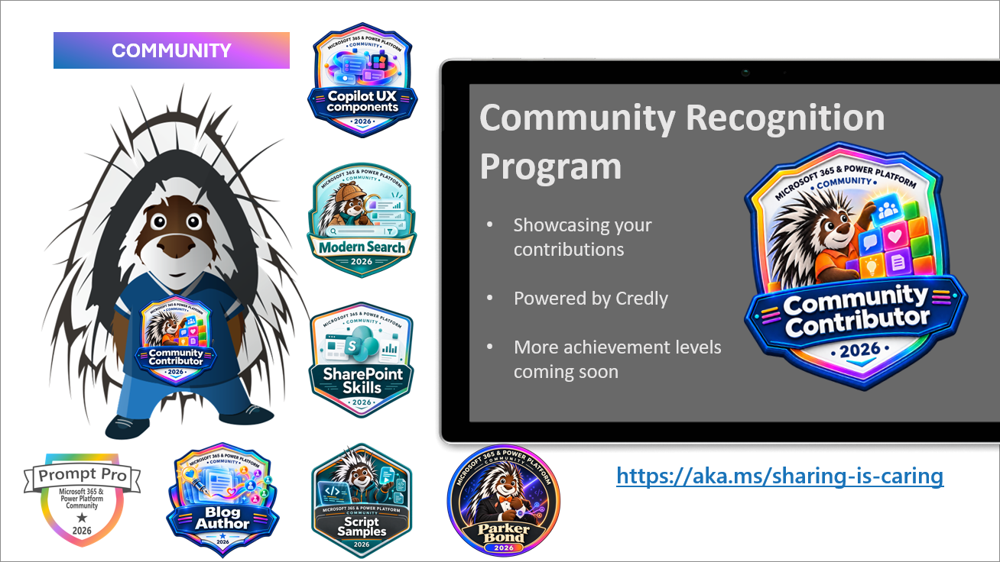

Join the Microsoft 365, Copilot and Power Platform community for live demos, product updates and questions with presenters. Everyone is welcome, whether you build with no code, low code or code.

[Community calls](#community-calls-this-week) | [Recordings](#latest-community-call-recordings) | [New videos](#new-videos) | [Blog posts](#new-blog-posts) | [Events](#upcoming-events)

## Community calls this week

Download a [recurring community call invite](https://aka.ms/community/calls) and join the conversation. Want to share something you built or learned? [Volunteer for a demo spot](https://aka.ms/community/request/demo).

### Copilot, Microsoft 365 & Power Platform product updates call - 1 December

* **Tuesday, 1 December 2026, 8:00 AM PT / 4:00 PM UTC**
* [Join the call](https://aka.ms/m365-dev-call-join) | [Recurring invite](https://aka.ms/community/ms-speakers-call-invite) | [Recordings](https://www.youtube.com/playlist?list=PLR9nK3mnD-OUQOW86tT5dkCRQAVGY7DlH)

Latest news from Microsoft on Copilot, Microsoft 365 and Power Platform, a community together mode group photo, followed by these demos:

* [Sarah Mathurin](https://www.linkedin.com/in/sarah-mathurin1/) - Introduction to Knowledge Base for Copilot - Source of truth for organizations
* [Giorgio Ughini](https://www.linkedin.com/in/giorgio-ughini/) - Microsoft Skill Recorder: Turn Your Workflows into Reusable AI Agent Skills
* [DC Padur](https://www.linkedin.com/in/dcpadur/) - Introduction on new Agent chat web part in SharePoint

### Copilot, Microsoft 365 & Power Platform community call - 3 December

* **Thursday, 3 December 2026, 7:00 AM PT / 3:00 PM UTC**
* [Join the call](https://aka.ms/spdev-sig-call-join) | [Recurring invite](https://aka.ms/community/m365-powerplat-call-invite) | [Recordings](https://www.youtube.com/playlist?list=PLR9nK3mnD-OURfm5Ypu-wK52cxBv_gXCA)

Latest on Copilot prompt of the week, CommunityDays.org update, Microsoft 365 Maturity model, PnP Framework and Core SDK extension, PnP PowerShell, script samples, Copilot pro dev samples, Power Platform samples and updates on samples.

Community demos this week:

* [Ed Williams](https://www.linkedin.com/in/automatethemundane/) - Using GitHub Actions for the Power Platform: From commit to deployment
* [Mohammed Amer](https://www.linkedin.com/in/mohammad3mer/) - Build Star Match game in Copilot using SPFx Copilot Components

---
## Latest community call recordings

Full community-call recordings published during 20 November-27 November (UTC). Dates below are publication dates (UTC).

* [Copilot, Microsoft 365 & Power Platform community call – 26th of November, 2026](https://www.youtube.com/watch?v=kh_DqE72-Mc) - published 26 November
* [Copilot, Microsoft 365 & Power Platform weekly call – 24th of November, 2026](https://www.youtube.com/watch?v=zqGsqVCCvsE) - published 25 November
* [Creative Ways to Find Sponsors for Your Community Events | MGCI Community Builders Network Call](https://www.youtube.com/watch?v=Ex1ybSUbf-k) - published 24 November

---

## New videos

Published during 20 November-27 November (UTC), newest first within each channel. Shorts and scheduled livestreams are excluded. Full community calls appear only in the recordings section above. Presenter profiles are linked where available.

### Microsoft Community Learning

[Subscribe to Microsoft Community Learning](https://www.youtube.com/@MicrosoftCommunityLearning/videos)

* [UX in Copilot Canvas – Modernizing your innovation process with agents and UX](https://www.youtube.com/watch?v=18E4ZOXBfjY) by [Vesa Juvonen -](https://www.linkedin.com/in/vesajuvonen/) - 26 November
* [Microsoft Champions Call | November 2026](https://www.youtube.com/watch?v=xACSLzRwhNI) - 25 November
* [From Security Strategy to Real Adoption: Inside the Microsoft Security Adoption Framework (SAF)](https://www.youtube.com/watch?v=eiMh2bQfVfo) - 25 November
* [Introduction to creating agents with Teams SDK and Agents SDK](https://www.youtube.com/watch?v=XJzs0kI_2o8) by [Sarah Critchley](https://www.linkedin.com/in/sarahcritchley/) and [Ricky Castaneda](https://www.linkedin.com/in/castaric/) - 25 November
* [AI understands. UX acts. In Microsoft Copilot | Copilot UX components](https://www.youtube.com/watch?v=ItARHlfAPSo) - 25 November
* [Announcing Copilot Cowork and plugin support for Copilot UX components](https://www.youtube.com/watch?v=EJskzYACUsA) by [Vesa Juvonen](https://www.linkedin.com/in/vesajuvonen/) - 24 November
* [Building an Agent with Microsoft harness in Copilot Studio](https://www.youtube.com/watch?v=2z31kag4FkQ) by [Rémi Dyon](https://www.linkedin.com/in/remidyon/) - 24 November
* [Meet Microsoft's frontier ecosystem | Mondays at Microsoft (Episode 98)](https://www.youtube.com/watch?v=5peSjXRwNQ0) - 23 November
* [Introducing Open-Source SharePoint Templates from Microsoft | Demo & Setup Guide](https://www.youtube.com/watch?v=bXkNj5fDePw) by [Marc Andreson -](https://www.linkedin.com/in/marcanderson/) and [Vesa Juvonen -](https://www.linkedin.com/in/vesajuvonen/) - 23 November
* [Latest features in the flexible sections in SharePoint](https://www.youtube.com/watch?v=HyA-A3VwSoQ) by [Katelyn Seemakurti](https://www.linkedin.com/in/katelynseemakurti/) - 23 November
* [Using the retrieval API with Custom Metadata in SharePoint Embedded](https://www.youtube.com/watch?v=ms483FW3Bu4) by [Steve Pucelik](https://www.linkedin.com/in/stevepucelik/) - 22 November
* [Using Azure AI video analyzer + Functions + Storage & Power Platform to analyze echocardiograms](https://www.youtube.com/watch?v=wUsM1o9MzCE) by [Sanjiv Venkatram](https://www.linkedin.com/in/sanjiv-venkatram/) - 21 November
* [Using Copilot Cowork for Dynamics 365 Finance and Operations](https://www.youtube.com/watch?v=TXmbnm4c9VY) by [Billur Şamdancıoğlu](https://www.linkedin.com/in/billur-samdancioglu/) - 20 November

### Power Platform

[Subscribe to Power Platform](https://www.youtube.com/@mspowerplatform/videos)

* [Copilot Agent Kit: See Every Agent in Your Tenant with Agent Inventory](https://www.youtube.com/watch?v=dRjX38eNynY) - 23 November
* [Copilot Agent Kit: Find and Fix Agent Problems with Agent Debugger](https://www.youtube.com/watch?v=RHPn2VVj-2g) - 23 November

### Microsoft 365 Developer

[Subscribe to Microsoft 365 Developer](https://www.youtube.com/@Microsoft365Developer/videos)

* No new videos this week.

## New blog posts

Posts published during 20 November-27 November (UTC) on both blog platforms.

### Microsoft 365 Developer Blog

* [Action required: Update app-only permissions for SharePoint tenant App Catalog writes](https://devblogs.microsoft.com/microsoft365dev/action-required-update-app-only-permissions-for-sharepoint-tenant-app-catalog-writes/) by SharePoint team - 25 November
* [Choose the right document platform for your app: SharePoint Embedded](https://devblogs.microsoft.com/microsoft365dev/choose-the-right-document-platform-for-your-app-sharepoint-embedded/) by Steve Pucelik - 24 November
* [Copilot UX components now available in Cowork with plugins – SPFx roadmap update for November 2026](https://devblogs.microsoft.com/microsoft365dev/copilot-ux-components-now-available-in-cowork-with-plugins-spfx-roadmap-update-for-november-2026/) by Vesa Juvonen - 24 November

### Microsoft 365 and Power Platform Community Blog

* [Azure Cost Insights in Copilot Cowork: Work IQ Meets a Custom MCP Connector](https://pnp.github.io/blog/post/copilot-cowork-azure-cost-mcp-work-iq/) by [Abhinav Yadav](https://github.com/Yadui/) - 25 November
* [From Answers to Actions: Building a Computer-Using Agent for Browser Automation](https://pnp.github.io/blog/post/computer-using-agent-browser-automation/) by [Manish Yadav](https://github.com/monty0007/) - 22 November
* [From WhatsApp to Action: A Bilingual Project Portfolio Assistant with Azure and Foundry](https://pnp.github.io/blog/post/whatsapp-project-portfolio-assistant/) by [Manish Yadav](https://github.com/monty0007/) - 22 November

---

## Upcoming events

[CommunityDays upcoming event listing](https://www.communitydays.org/events?when=upcoming) from Monday, 30 November 2026, grouped by month.

### November 2026

* [ESPC26](https://communitydays.org/event/2026-11-30/espc26) - Amsterdam, North Holland, Netherlands - 30 November-3 December 2026

### December 2026

* [Community Summit Roadshow Miami](https://communitydays.org/event/2026-12-01/community-summit-roadshow-miami) - Miami, FL, United States - 1 December 2026
* [Zero Trust KZ Community Day - December 2026](https://communitydays.org/event/2026-12-04/zero-trust-kz-community-day-december-2026) - Almaty, Kazakhstan - 4 December 2026
* [AICD Summit Tunis 2026](https://communitydays.org/event/2026-12-05/aicd-summit-tunis-2026) - Tunis, Tunis Governorate, Tunisia - 5-6 December 2026
* [Convergence 2026](https://communitydays.org/event/2026-12-08/convergence-2026) - Miami Beach, FL, United States - 9-11 December 2026

### January 2027

* [M365 Con 27](https://communitydays.org/event/2027-01-11/m365-con-27) - Virtual · Stuttgart, Germany - 11-22 January 2027
* [Workplace Ninjas US 2027](https://communitydays.org/event/2027-01-11/workplace-ninjas-us-2027) - Scottsdale, AZ, United States - 11-14 January 2027
* [M365 Community Days Montréal #4-2026 – Sans gouvernance, pas d’IA](https://communitydays.org/event/2027-01-27/m365-community-days-montreal-hash4-2026-sans-gouvernance-pas-dia) - Montreal, QC, Canada - 27 January 2027

### February 2027

* [Cloud Tech Tallinn 2027](https://communitydays.org/event/2027-02-04/cloud-tech-tallinn-2027) - Tallinn, Harjumaa, Estonia - 4-5 February 2027
* [SQL Konferenz 2027](https://communitydays.org/event/2027-02-22/sql-konferenz-2027) - Hanau, Hessen, Germany - 22-24 February 2027
* [Knoxville Microsoft Community Days](https://communitydays.org/event/2027-02-25/knoxville-microsoft-community-days) - Friendsville, TN, United States - 25-27 February 2027
* [M365 Community Day St. Louis](https://communitydays.org/event/2027-02-26/m365-community-day-st-louis) - Saint Louis, MO, United States - 26-27 February 2027

### March 2027

* [Global AI Bootcamp - Valencia](https://communitydays.org/event/2027-03-06/global-ai-bootcamp-valencia) - València, Comunidad Valenciana, Spain - 6 March 2027
* [FABCON & SQLCON 2027](https://communitydays.org/event/2027-03-08/fabcon-and-sqlcon-2027) - Atlanta, GA, United States - 8-12 March 2027
* [AI Agent and Copilot Summit NA 2027](https://communitydays.org/event/2027-03-30/ai-agent-and-copilot-summit-na-2027) - Chula Vista, CA, United States - 30 March-2 April 2027

### April 2027

* [M365 Community Days DC 2027](https://communitydays.org/event/2027-04-08/m365-community-days-dc-2027) - Arlington, VA, United States - 8-9 April 2027
* [Exchange & Security Summit 2027](https://communitydays.org/event/2027-04-13/exchange-and-security-summit-2027) - Frankfurt am Main, Hessen, Germany - 13-14 April 2027
* [D365UG SWEDEN ANVÄNDARFÖRENINGSMÖTE](https://communitydays.org/event/2027-04-21/d365ug-sweden-anvandarforeningsmote) - Solna, Stockholms län, Sweden - 21 April 2027

### May 2027

* [MMS 2027 at MOA](https://communitydays.org/event/2027-05-02/mms-2027-at-moa) - Bloomington, MN, United States - 3-7 May 2027
* [Microsoft 365 Community Conference](https://communitydays.org/event/2027-05-04/microsoft-365-community-conference) - Las Vegas, NV, United States - 4-7 May 2027

### June 2027

* [CollabDays Hamburg 2027](https://communitydays.org/event/2027-06-26/collabdays-hamburg-2027) - Hamburg, Germany - 26 June 2027
* [CollabDays Netherlands 2027](https://communitydays.org/event/2027-06-26/collabdays-netherlands-2027) - Vianen, Utrecht, Netherlands - 26 June 2027

### September 2027

* [TECHCON, DATACON & PWRCON](https://communitydays.org/event/2027-09-13/techcon-datacon-and-pwrcon) - Atlanta, GA, United States - 13-17 September 2027

### October 2027

* [MMS 2027 Music City Edition](https://communitydays.org/event/2027-10-10/mms-2027-music-city-edition) - Nashville, TN, United States - 11-14 October 2027
* [CollabDays New England 2027](https://communitydays.org/event/2027-10-15/collabdays-new-england-2027) - Burlington, MA, United States - 15-16 October 2027

---

## Recognition

Contributed to the community? Opt in to the [community recognition program](https://pnp.github.io/recognitionprogram/) and earn badges for your contributions.

